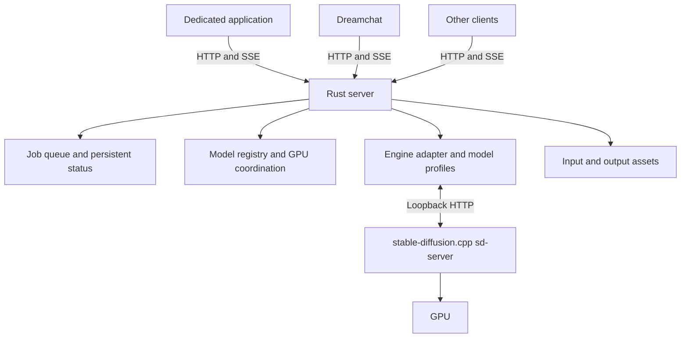

# Image and Video Generation Backend

Status: Qwen Image 2.1 1600×896 baseline frozen; Rust API and H3 execution pending
Updated: 2026-10-14

Publication note: see [README.md](README.md) for restoration/build instructions.
The modified native checkout is represented by pinned upstream revisions and
complete stable-diffusion.cpp/ggml patches under `native/`; the exact CUTLASS
headers are included separately. Old raw logs, generated images and redundant
builds were removed after preserving the frozen executable locally and compact
accepted evidence under `experiments/qwen-image21-sage/evidence/1600x896-v1/`.
Historical `runs/` references below identify the original measurements; those
raw artifacts are no longer shipped. Published paths have been sanitized.

## Purpose

Build a standalone image and video generation backend without a ComfyUI dependency. A dedicated application, Dreamchat, and other clients should be able to use the same backend through a stable API.

The backend and public API will be written in Rust. The first inference engine will be **stable-diffusion.cpp**, running as a separate C/C++ process. The initial model targets are **Qwen Image 2.1** and **MiniMax H3**.

Python remains acceptable for a future inference implementation if measurements or missing capabilities justify it. It is not a dependency of the proposed first inference path.

The inference source checkout and local build setup are described below. Qwen Image 2.1 text-to-image now has a frozen native server baseline, measured headless ComfyUI/Kitchen comparisons and validated memory optimizations. The Rust backend, H3 execution and editing validation remain pending.

## Current accepted baseline — 2026-10-14

**`qwen-image21-1600x896-v1` is frozen.** Use this profile for future Qwen
comparisons and backend integration; do not silently adopt a newer build or
restart completed optimization experiments. Historical sections below retain
their original settings, failures and decisions; this section supersedes their
launcher defaults and proposed immediate next steps.

| Configuration | Accepted choice |
| --- | --- |
| Model / hardware scope | Selected Qwen Image 2.1 INT8 ConvRot diffusion and encoder, Qwen VAE; RTX 4070 Ti SUPER / SM89, CUDA 13.4 |
| Reference request | 1600×896, 40 ER-SDE/beta steps, CFG 2.5, seed 42, CPU RNG, batch 1; frozen positive/negative prompts, no LoRA/reference/second pass |
| Attention and precision | Sage2++; BF16 attention/cache and residual, F32 gate/up with packing; split V on, split K off |
| Fusion flags | All previously accepted INT8, norm/RoPE, modulation, residual and gate/up-SwiGLU fusions |
| CPU / CUDA threads | 11 CPU threads; accepted 512-thread K=4096 ConvRot configuration |
| Placement | Auto-fit with real CUDA scratch accounting; no manual `--max-vram` margin |
| Lifetime | Long-lived native server; conditioning cache capacity 4 in CPU RAM; extra idle-retention flag off |
| VAE | Existing convolution strips plus shortcut, stage-3 and residual-block strips on; old upscale/im2col fusion and PAD reuse off |

Latest live comparison: **8073.24 MiB VAE workspace**, saving **590.625 MiB**
against the preceding strip-convolution baseline. Four warm images average
**39.219 s to saved PNG** and **1.720 s VAE decode**. All 12 reference images
match native RGBA pixels exactly. The control averaged 39.074 / 1.700 s, so the
combination is selected for memory, not a measured latency improvement.
Reload remains 2946.44 MiB / three diffusion blocks per warm image.

The last matched resident ComfyUI comparison was 40.216 s native versus
38.814 s headless AIO/Kitchen. The latest 39.219 s native result was measured
later; do not claim a newly controlled 0.405-second gap. The native and Comfy
reference images differ. Small/odd VAE component test shapes also have known
numerical differences; this acceptance does not extend to every prompt,
resolution, LoRA/editing path or intermediate tensor.

From the project root:

```sh
./experiments/qwen-image21-sage/run.sh --dry-run
./experiments/qwen-image21-sage/run.sh --serve
# Stop the separate server before running the reference replay:
./experiments/qwen-image21-sage/run.sh --run
```

The launcher defaults to dry-run. `--serve` runs on loopback port 1234
(`QWEN_PORT` may override it). `--run` generates one initial image plus two warm
repeats in its own server, verifies the native reference and saves timings and
images under a fresh `runs/*-resident-*` directory, then stops the server.
`QWEN_MODEL_ROOT` relocates the same model files; seed overrides are rejected for
this fixed reference. API clients may supply prompts to the resident server,
but request validation for the profile is still the future Rust adapter's job.

The frozen executable is copied under
`experiments/qwen-image21-sage/baselines/1600x896-v1/`, separate from the build
tree, with SHA-256
`4e33830f7eba36573cba9785249641ae8c727be5e6a506e9c7ef0ee74beea2e3`.
The manifest pins command/environment/prompt evidence. Inherited experimental
`SD_*`/`GGML_*` variables are cleared before applying the profile. Native defaults
and development builds remain separate. Model file contents are not newly
hashed; filename equality alone does not validate a replacement checkpoint.

Read [baseline usage and limits](experiments/qwen-image21-sage/BASELINE.md) and
[the complete test decision register](experiments/qwen-image21-sage/TEST-DECISIONS.md)
before proposing further optimization. The register covers accepted fusions,
CPU/CUDA thread sweeps, rejected precision/layout/kernel variants, both retention
tests, the corrected VAE probes and every strip combination. Do not repeat those
experiments without concrete changed evidence, a relevant regression or a new
requested workload. The proposed next VAE convolution remains untested and is
not an instruction to continue optimizing after this freeze.

## Goals

- Run independently of ComfyUI and independently of the application UI.
- Support selected image and video models also used in ComfyUI.
- Reuse existing model weights and LoRAs where their formats and implementations are compatible.
- Provide predictable job execution, progress reporting, cancellation, and result retrieval.
- Aim for memory efficiency and generation performance comparable to ComfyUI on the same hardware, verified per model and configuration.
- Allow inference implementations to evolve without requiring client changes.

## Initial scope boundaries

The first version focuses on Qwen Image 2.1 image generation/editing and MiniMax H3 video/audio generation. Exact checkpoints, LoRAs, and supported operating limits will be selected through experiments. It will not attempt to reproduce ComfyUI's graph editor, execute arbitrary ComfyUI workflows, or provide compatibility with arbitrary custom nodes.

A pure Rust inference engine is not required. Multi-GPU scheduling, distributed workers, and a general-purpose plugin platform are outside the initial scope.

## Architecture



### Rust server

The Rust service owns the public API and job lifecycle:

- Request validation and access control.
- Persistent job status and queue management.
- Model discovery and capability descriptions.
- Input uploads and output retrieval.
- Progress delivery to clients.
- Worker startup, supervision, and recovery.
- Scheduling GPU use and managing model residency through worker lifecycle operations.

SQLite is the proposed initial store for jobs and metadata. Images and videos are stored as files referenced by asset identifiers.

The service runs independently of the UI. Closing the dedicated application does not stop the service or interrupt jobs submitted by other clients.

### stable-diffusion.cpp inference process

Start with one long-lived worker for one GPU and one active generation job at a time. Keeping the worker alive allows model components to remain loaded between jobs.

Use `sd-cli` for the initial reproducible model experiments. Once the model paths are validated, use a supervised `sd-server` process for warm execution behind Rust.

The engine owns model execution:

- Loading model weights, text encoders, and VAEs.
- Applying and removing LoRAs and other supported job-specific settings.
- Prompt encoding, sampling, and decoding.
- Quantization, CPU offloading, and other model-specific memory optimizations.
- Reporting execution progress and producing image/video/audio results.

Initially, treat the server process as hosting one configured model profile. Switch profiles by stopping the old process, confirming its exit, and starting the next profile. Do not assume an unverified hot-load or unload endpoint exists. Keep only one inference process active on the target GPU during the first experiments.

### Engine adapter and model profiles

The Rust adapter translates the public job contract into native stable-diffusion.cpp requests, launches the process with the selected profile, polls status, and registers results. Qwen and H3 profiles define their component files, operation schemas, sampling defaults, and measured memory settings.

Keep model-specific differences in these profiles and their request mapping. Neither stable-diffusion.cpp's HTTP schema nor a future Python pipeline signature becomes the public API contract. Add alternative engines only for concrete requirements; a general plugin system is not needed initially.

## Model compatibility

Compatibility has three separate levels:

1. **Architecture:** the inference implementation supports the model family and exact variant.
2. **Assets:** the loader supports the checkpoint layout, weight mapping, quantization, text encoders, VAEs, and LoRA format.
3. **Behavior:** the required conditioning, sampling, scheduling, and extensions have equivalent implementations.

Reading the same file format, such as safetensors, does not establish compatibility. Supporting a model family does not establish support for every revision or quantization of that family.

The initial model registry should contain explicitly configured, supported models. Listing models must not load them onto the GPU.

Each registry entry identifies its adapter, weights and required components, supported operations, parameter schema, and chosen memory profile. Clients receive stable model identifiers and capabilities rather than local filesystem paths.

The model families are selected: Qwen Image 2.1 and MiniMax H3. Exact checkpoints, quantizations, LoRAs, and supported operating limits remain to be validated.

## Research findings

Upstream source and documentation were inspected on 2026-10-13 at commit [`d637cfb935feb2254898a8f1524046c958f3df80`](https://github.com/leejet/stable-diffusion.cpp/tree/d637cfb935feb2254898a8f1524046c958f3df80). These are source-level findings, not local GPU or quality results. Pin this revision for the initial experiment, or explicitly record and recheck a replacement revision.

| Capability | Qwen Image 2.1 | MiniMax H3 |
| --- | --- | --- |
| Native C++ model implementation | Present | Present |
| Quantized GGUF weights | Available | Available |
| Text-conditioned generation | Images | Joint video and stereo audio |
| Image conditioning | Editing and ordered multiple references | First/last frame and Ref2VA |
| Video/audio reference conditioning | Not applicable | Available in CLI/C API; missing from the inspected HTTP request parser |
| Offloading and memory controls | Available | Available |
| ComfyUI quality/performance parity | Unmeasured | Unmeasured |

Both models are constructed by the upstream [model builders](https://github.com/leejet/stable-diffusion.cpp/blob/d637cfb935feb2254898a8f1524046c958f3df80/src/pipeline/model_builders.cpp).

### Qwen Image 2.1

The implementation supports text-to-image, editing, and ordered multiple image references. It uses Qwen3-VL-8B and a Qwen Image 2.1-specific VAE. Editing with a GGUF text encoder also requires the vision weights, supplied separately when necessary. Older Qwen Image and Wan VAE weights are not interchangeable with the 2.1 VAE.

Current upstream documentation includes Comfy-Org safetensors, GGUF, and the INT8-convrot text encoder. The historical patches in JLFN/imagegen therefore do not establish that the same patches are required by this revision; test the exact selected files first.

Two optimization candidates are explicitly documented:

- **Prefix caching:** reuse text and reference-image keys/values across denoising steps within a generation. Cache precision trades memory against numerical differences and conversion overhead. At 4,096 prefix tokens, upstream estimates about 2 GiB per condition in FP16, excluding weights and working buffers. Positive and negative conditions have separate caches. Caches are released when sampling ends.
- **Official Turbo weights:** a fixed eight-step sigma preset is available. This is a separate model/profile experiment, not a transparent replacement for the base model or the community Turbo LoRA used by JLFN/imagegen.

Source: [Qwen Image 2.1 guide](https://github.com/leejet/stable-diffusion.cpp/blob/d637cfb935feb2254898a8f1524046c958f3df80/docs/qwen_image_2.1.md).

### MiniMax H3

The implementation supports T2VA, I2VA, first/last-frame conditioning (FL2VA), and reference conditioning (Ref2VA). Both the original time-embedder model and the smaller AdaLN curve-table variant are detected from their weights.

Required components are the diffusion model, video VAE, audio VAE, and the H3-specific Qwen3-VL-32B encoder. The encoder uses 50 language layers and requires the vision tower; an ordinary Qwen3-VL-32B checkpoint is not a direct substitute. Omitting the audio VAE skips audio decoding but still runs joint audio/video diffusion.

Important behavior to preserve in the adapter:

- Width and height align upward to multiples of 32.
- Frames align upward to the `17k + 5` grid, with a minimum of five frames; playback is 24 fps.
- Ref2VA references cannot be combined with first/last-frame inputs in one request.
- `control_frames` are explicitly unsupported for H3.
- Reference preprocessing is part of compatibility. Upstream's documented reference sizing depends on the generation canvas; equivalence with Director's independent reference-quality policies must be checked.
- The H3 VAE implementation enables spatial tiling and disables temporal tiling. Do not assume a generic temporal-tiling flag changes this behavior.

Sources: [H3 guide](https://github.com/leejet/stable-diffusion.cpp/blob/d637cfb935feb2254898a8f1524046c958f3df80/docs/minimax_h3.md), [video conditioning](https://github.com/leejet/stable-diffusion.cpp/blob/d637cfb935feb2254898a8f1524046c958f3df80/src/pipeline/video.cpp), and [H3 VAE](https://github.com/leejet/stable-diffusion.cpp/blob/d637cfb935feb2254898a8f1524046c958f3df80/src/model/vae/minimax_h3_vae.hpp#L560). Model-specific source takes precedence over generic server documentation where frame-count rules differ.

### Weight sizes and compatibility limits

The maintainer's H3 GGUF repository listed these approximate decimal file sizes at the research date:

| Component | File size |
| --- | ---: |
| Original FL2VA or Ref2VA diffusion model, Q4_K_M | 18.8 GB |
| Pruned FL2VA or Ref2VA diffusion model, Q4_K_M | 11.4 GB |
| H3 text encoder, Q4_K_M | 18.2 GB |

The pruned diffusion model plus encoder totals about 29.6 GB before VAEs. These are disk sizes, not peak VRAM or RAM requirements. Actual host/device residency, working buffers, caches, and transfer costs must be measured. The first experiment must record available host RAM as well as VRAM. Source: [H3 GGUF files](https://huggingface.co/leejet/MiniMax-H3-GGUF/tree/main).

General LoRA loading exists, with different application modes for quantized and unquantized weights. Compatibility with the selected Qwen/H3 LoRAs, H3 SLA/sparse attention, Director continuity features, and multi-stage sampling remains unverified. Start with base-model execution before introducing these variables. Source: [LoRA application modes](https://github.com/leejet/stable-diffusion.cpp/blob/d637cfb935feb2254898a8f1524046c958f3df80/docs/lora.md).

## Public API

The API exposes generation jobs rather than inference-engine internals.

| Endpoint | Purpose |
| --- | --- |
| `GET /v1/models` | List configured models and their supported capabilities. |
| `POST /v1/assets` | Upload reference images and other supported inputs. |
| `POST /v1/jobs` | Validate and enqueue a generation request. |
| `GET /v1/jobs/{id}` | Retrieve authoritative status, errors, and output asset identifiers. |
| `GET /v1/jobs/{id}/events` | Subscribe to progress and lifecycle events using SSE. |
| `POST /v1/jobs/{id}/cancel` | Request cancellation. |
| `GET /v1/assets/{id}` | Retrieve an input or generated asset. |

Example request:

```json
{
  "operation": "text_to_image",
  "model": "my-image-model",
  "prompt": "A lighthouse in a winter storm",
  "width": 1024,
  "height": 1024,
  "seed": 12345,
  "parameters": {
    "steps": 28,
    "guidance": 4.0
  }
}
```

This request is illustrative. Parameter names and operation-specific fields need to be finalized against the first supported model.

Common fields remain stable across implementations. Model-specific parameters are validated against the selected model's declared schema. Unsupported options must produce actionable errors rather than being silently ignored.

Reference inputs use asset identifiers. Clients cannot supply arbitrary worker filesystem paths.

The backend records the effective generation settings, including a resolved seed when one was omitted and the selected model configuration. Matching settings do not guarantee identical output across different inference engines or versions.

## Job lifecycle

Proposed states are `queued`, `running`, `cancelling`, `succeeded`, `failed`, and `cancelled`. Use `interrupted` when a crash prevents completion and normal cancellation cannot be confirmed.

Persist accepted jobs before acknowledging them. Dispatch one job at a time to the worker. Execution phases such as model loading, prompt encoding, sampling, and decoding are progress details within a running job.

Progress events may include a phase and step counts where meaningful. Do not fabricate a precise overall percentage for phases whose duration is unknown. The status endpoint remains authoritative after a client reconnects.

The inspected sd-server supports cancellation of queued jobs but returns HTTP 409 for a job that is already generating. Do not advertise cooperative in-flight cancellation for this engine revision.

Rust can remove a job from its own queue immediately. For an active job, the proposed first implementation terminates the dedicated inference process, confirms exit, discards partial results, and recreates the process when needed. Keep the job in `cancelling` until termination is confirmed; only then mark it `cancelled`. A spontaneous process failure produces `failed` or `interrupted`, not a successful cancellation. Process termination discards loaded models and its recovery cost must be measured.

After a server restart, previously active jobs are marked interrupted rather than silently regenerated. Queued jobs remain persisted. The exact queue-resume policy remains an open decision.

## Internal engine integration

Use stable-diffusion.cpp's native loopback HTTP API for the first persistent integration:

| Engine endpoint | Adapter use |
| --- | --- |
| `GET /sdcpp/v1/capabilities` | Inspect the loaded engine's capabilities. |
| `POST /sdcpp/v1/img_gen` | Submit image generation/editing requests. |
| `POST /sdcpp/v1/vid_gen` | Submit video generation requests. |
| `GET /sdcpp/v1/jobs/{id}` | Poll progress and retrieve results. |
| `POST /sdcpp/v1/jobs/{id}/cancel` | Cancel an engine job while it is queued. |

Rust retains the authoritative persistent queue and submits only the active job to sd-server. Track the relationship between public job IDs and engine job IDs. Translate polled engine progress into public SSE events; engine restarts must not silently regenerate jobs.

Process startup arguments select the model and memory profile. Process exit is the initial mechanism for unloading and active cancellation. Pin the engine revision and validate the request mapping against it. Capability discovery supplements explicit model profiles: the inspected server does not advertise every supported H3 field accurately.

The native server transports media as base64 in JSON, including the completed video container. Account for encoding overhead and duplicate buffers in host-memory measurements. Rust decodes, validates, and stores completed outputs behind public asset IDs. CLI experiments write into per-run output directories. Neither mode exposes tensors through the public API.

### Verified server limitations

- The HTTP parser accepts H3 image references but does not parse video/audio reference arrays. CLI/C API support those inputs. Test them through CLI first; adding HTTP transport or a small C-API worker is a separate implementation decision if required.
- In-flight cancellation is unsupported, as described above.
- Video output formats are WebM, animated WebP, and AVI. WebM requires the corresponding build support. Generated audio is passed to the container encoder; verify the selected format's actual audio track and synchronization. Do not assume MP4 output or audio support in animated WebP.
- The inspected capability response omits H3 reference-image support even though the request path supports it.

Sources: [server API](https://github.com/leejet/stable-diffusion.cpp/blob/d637cfb935feb2254898a8f1524046c958f3df80/examples/server/api.md), [request parser](https://github.com/leejet/stable-diffusion.cpp/blob/d637cfb935feb2254898a8f1524046c958f3df80/examples/common/common.cpp#L2052), [cancellation handler](https://github.com/leejet/stable-diffusion.cpp/blob/d637cfb935feb2254898a8f1524046c958f3df80/examples/server/routes_sdcpp.cpp#L808), and [video result encoding](https://github.com/leejet/stable-diffusion.cpp/blob/d637cfb935feb2254898a8f1524046c958f3df80/examples/server/async_jobs.cpp#L295).

## GPU and memory management

There are two distinct responsibilities:

| Layer | Responsibility |
| --- | --- |
| Rust scheduler | Decide when a job may use the GPU and when models must be unloaded. |
| stable-diffusion.cpp engine | Execute the chosen profile and manage weights, activations, and intermediate buffers. |

Begin with explicit, verified memory profiles per model. A profile can select precision, supported quantization, component or block offloading, and VAE tiling where applicable.

Available upstream controls include:

- `--auto-fit`: automatic weight placement across compute GPU, RAM, other GPU, or disk as capacity permits, with automatic graph segmentation when needed.
- `--max-vram`: a budget for managed weights and runner buffers during automatic graph-cut execution; it is not a universal cap on every allocation in the process.
- `--backend` and `--params-backend`: separate execution and weight placement. Explicit parameter placement disables auto-fit.
- `--offload-to-cpu`: hold weights in RAM and move them to VRAM when needed.
- Asynchronous next-segment weight prefetch, Flash Attention, and model-specific VAE tiling.

Compare built-in auto-fit with explicit placement profiles. Do not add a separate Rust auto-tuner initially. Record actual placement, disk fallback, and transfers so that fitting in VRAM is not mistaken for acceptable throughput. Weight size alone is not a sufficient estimate of peak memory: resolution, frame count, activations, decoding, and temporary workspaces also matter.

Sources: [engine controls](https://github.com/leejet/stable-diffusion.cpp/blob/d637cfb935feb2254898a8f1524046c958f3df80/examples/common/common.cpp#L558) and [weight manager](https://github.com/leejet/stable-diffusion.cpp/blob/d637cfb935feb2254898a8f1524046c958f3df80/src/model_manager.h).

Keep models warm when useful. When switching profiles or yielding the GPU to another service, stop the engine and confirm exit before proceeding. The integration with any existing external GPU coordinator must be decided separately; the server cannot assume that unrelated applications respect its internal queue.

Job-specific LoRAs and settings must not leak into subsequent requests. Qwen's within-generation prefix cache is an experiment candidate; it is distinct from caching user inputs across jobs. Initially, avoid cross-job caches of prompt embeddings or other input-derived tensors; add them only when their ownership and invalidation rules are defined.

Memory or worker failures must leave the next job with a known usable state. Restarting the worker is the recovery fallback when cleanup cannot be confirmed.

## Storage and deployment

Keep model weights, uploaded assets, generated outputs, and temporary job files logically separate. Reuse existing compatible model files through configuration where practical; copying all weights is not an architectural requirement.

SQLite stores references and metadata rather than image or video blobs. Completed assets are exposed only after their files have been finalized. Partial outputs from failed or interrupted jobs are not presented as successful results.

Package a reproducible stable-diffusion.cpp binary alongside the Rust service. Record the upstream revision, build flags, ggml revision, GPU backend/toolchain, driver, and optional media support. No Python environment is required for this initial runtime. A future Python adapter would need its own pinned environment.

Propose local-only binding initially. Authentication, network exposure, storage retention, and cleanup policy need explicit decisions before broader use. Prompts and media should not be included in routine diagnostic logs.

## Application and Dreamchat integration

Both clients use the same API and discover capabilities from the backend. The dedicated application can expose more controls, while Dreamchat can submit a smaller set of supported requests.

Clients own their presentation and product workflows. The backend owns generation and results. Neither client needs to manage the inference binary, local model paths, or the worker process.

## Delivery sequence

1. **Qwen Image 2.1 CLI experiments:** establish image generation/editing quality and memory baselines, then evaluate individual optimizations.
2. **MiniMax H3 CLI experiments:** establish joint video/audio and conditioning baselines, then measure scaling and memory profiles.
3. **Thin Rust integration:** supervise sd-server, translate native requests, and implement the public job/asset lifecycle, progress, cancellation fallback, model switching, and recovery.
4. **Client integration:** connect the dedicated application and Dreamchat through the stable API using only validated model capabilities.

Only expand model support after the initial adapters and lifecycle have been validated.

## Experiment plan

The first Qwen text-to-image smoke test has been executed and is recorded below. The broader comparison, editing, H3, and Rust integration experiments remain planned. Source/build preparation is separate from model execution.

### Local source and build setup

The engine is checked out in `stable-diffusion.cpp/` as an independent nested Git repository, detached at the researched revision. It is not registered as a submodule of the parent project. Local optimization work can be made in this checkout without replacing the inference integration.

The build uses the dependency revisions pinned by upstream:

| Component | Revision |
| --- | --- |
| stable-diffusion.cpp | `d637cfb935feb2254898a8f1524046c958f3df80` |
| ggml | `d25b121ce1d6ae0c7e62ad080460d9fc1e46dd93` |
| libwebp | `0c9546f7efc61eac7f79ae115c3f99c91c21c443` |
| libwebm | `5bf12267eea773a32fcf4949de52b0add158a8d5` |

The local build targets the RTX 4070 Ti SUPER's CUDA architecture 89. It uses Release mode, the native CPU backend, CUDA 13.4.92, GCC 16.2.1, CMake, and Ninja. WebP and WebM support are enabled. The bundled web frontend is disabled and its submodule is not initialized; the server HTTP API remains part of the build.

Run the project-level helper to configure and incrementally rebuild both binaries:

```sh
./build-inference.sh
# Optional higher concurrency when sufficient RAM is available:
SD_BUILD_JOBS=6 ./build-inference.sh
```

The helper defaults to two build jobs and uses this machine's compiler paths. It does not download dependencies, reset source changes, start the server, or load models. Build outputs are `stable-diffusion.cpp/build-cuda/bin/sd-cli` and `stable-diffusion.cpp/build-cuda/bin/sd-server`; the upstream ignore rules exclude the build directory from source control. This target-specific build is not intended as a portable distribution for other GPUs.

Build verification on 2026-10-13: both Release binaries compiled and linked successfully, both `--version` and `--help` calls succeeded, and all dynamic libraries resolved. `sd-cli --list-devices` identified CUDA0 as the RTX 4070 Ti SUPER with compute capability 8.9, plus the CPU backend. Compilation emitted upstream warnings; no source patches were needed. The build log is retained in `stable-diffusion.cpp/build-cuda/build.log`.

GPU enumeration required execution outside the tool sandbox; compilation ran inside it. During this build verification, no model weights were downloaded or loaded, no inference was run, and no long-running server was started. These checks establish build/startup readiness only; the subsequent inference run is recorded below.

### Preparation and measurement record

- Select the target GPU, available host RAM, and usable VRAM budget. Establish a repeatable GPU ownership arrangement for the test window.
- Record the exact engine/build revision and model component hashes. Reuse selected compatible local weights where available; identify any required conversions or downloads before execution.
- Define a small fixed set of test prompts, seeds, and reference assets. Use the same selected inputs for engine comparisons.
- Record the comparable ComfyUI workflow, precision, component versions, sampler, sigma schedule, steps, and reference preprocessing. Note every difference that prevents a controlled comparison.
- Capture per-run effective settings, success/failure, load time, generation time, peak VRAM, peak host RAM, output dimensions/frame count, and output paths. Add phase timing and transfer/fallback information where observable.
- Separate a fresh-process run from a warm-process run. Restarting sd-cli for each request does not measure warm model reuse; use sd-server for that measurement once the same model configuration works through CLI.

### Experiment 1: Qwen Image 2.1

**Baseline:** run the selected base-model files with their matching encoder and VAE, initially without LoRAs. Cover text-to-image and an editing request with two ordered reference images. The selected text-to-image baseline is 1600 x 896, CFG 2.5, 40 steps, ER-SDE, and Beta scheduling, matching the user's usual settings after 32-pixel dimension alignment.

Compare against ComfyUI for prompt adherence, text rendering, reference identity, edit correctness, detail, and artifacts. Same-seed outputs need not be pixel-identical across engines.

After a successful baseline, change one variable at a time:

1. Selected diffusion and encoder quantization, keeping all other components fixed where possible.
2. Built-in auto-fit versus an explicit CPU/GPU placement profile.
3. Prefix cache disabled versus `auto`, followed by an explicitly selected lower-memory cache format if necessary. Include reference-heavy input to expose cache costs.
4. VAE tiling and supported attention settings, checking for visual differences as well as time and memory changes.
5. The exact required LoRA, checking both compatibility and state isolation on a subsequent request without it.
6. Official Qwen Image 2.1 Turbo as a separate profile with its prescribed weights and schedule; evaluate the quality/speed tradeoff independently of base-model parity.

**Exit evidence:** working generation and editing, selected component hashes, measured cold/warm behavior, and at least one acceptable memory/quality profile. Do not promote a faster profile if it fails the required reference or image-quality checks.

#### First Qwen SageAttention smoke test — 2026-10-13

The repeatable launcher is `experiments/qwen-image21-sage/run.sh`; its default mode prints the command without loading models. Run it explicitly with `--run`:

```sh
./experiments/qwen-image21-sage/run.sh --dry-run
./experiments/qwen-image21-sage/run.sh --run
```

It reuses these existing files under `/path/to/models` without conversion or copying:

| Component | Relative path |
| --- | --- |
| Diffusion | `diffusion_models/qwen-image2.1/qwen_image_2.1_int8_convrot.safetensors` |
| Text encoder | `text_encoders/qwen-image2.1/qwen3vl_8b_int8_convrot.safetensors` |
| VAE | `vae/qwen-image2.1/qwen_image_2.1_vae_bf16.safetensors` |

The historical smoke-test launcher allowed `QWEN_MODEL_ROOT` and `QWEN_SEED` overrides. The current frozen launcher retains model-root relocation but fixes reference seed 42. Model hashes were not computed for this smoke test and remain required for the controlled comparison record.

Settings: 1600 x 896, 40 steps, CFG 2.5, `er_sde`, `beta`, seed 42, CPU RNG, `--sage-attn`, `--backend cuda0`, `--auto-fit on`, and `--max-vram -1`. The nominal 16:9 canvas at a 1600-pixel long edge is 1600 x 900; rounding the height to 896 follows the existing AIO Qwen path's nearest-multiple-of-32 rule. No reference images, LoRAs, or negative prompt were supplied. The chosen prompt in `prompt.txt` describes a rainy Scandinavian harbor cafe, an adult woman holding a cup, mixed warm/cool light, textured materials, and a sign reading "HARBOR CAFE".

SageAttention is built into this CUDA runtime and does not require a Python package or a rebuild. Upstream selects its supported CUDA kernel per layer and can fall back to Flash/default attention. The run log confirms SageAttention was enabled for the diffusion model; it does not establish that every layer used Sage or that this implementation is equivalent to Kitchen attention. See the pinned [SageAttention guide](https://github.com/leejet/stable-diffusion.cpp/blob/d637cfb935feb2254898a8f1524046c958f3df80/docs/sage_attention.md).

The fresh CLI process completed successfully on the RTX 4070 Ti SUPER. GPU access required execution outside the tool sandbox. Auto-fit placed diffusion weights on CUDA0 and text encoder/VAE weights in CPU RAM, with computation on CUDA0. No engine source changes were needed.

| Observation | Result |
| --- | ---: |
| Process exit code | 0 |
| Launcher wall time, including CLI startup and output saving | 77 s, whole-second measurement |
| Engine image-generation time | 76.03 s |
| Prompt conditioning | 2.92 s |
| Sampling, 40 steps | 71.04 s |
| VAE decoding | 2.05 s |
| Highest sampled whole-GPU memory use | 14,971 MiB, approximately 14.62 GiB |
| Whole-GPU memory use at first sample | 1,780 MiB |
| Saved PNG dimensions | 1600 x 896 |

GPU memory was sampled once per second with `nvidia-smi`; it includes other GPU users and can miss short peaks. It is not the inference process's allocator peak. Peak host RAM was not measured. This is a fresh-process result, not a controlled cold filesystem-cache benchmark or a warm-server measurement.

Artifacts are retained in `experiments/qwen-image21-sage/runs/20261013T072250Z-SR9QmX/`: `image.png`, the copied `prompt.txt`, `command.sh`, `engine-version.txt`, `generation.log`, `gpu.csv`, `gpu-monitor.log`, and `result.txt`. Run directories are ignored by Git. Each invocation creates a new directory rather than overwriting a result.

Visual inspection confirmed a coherent scene, readable "HARBOR CAFE" text, the requested red coat and cup, and recognizable harbor details. This single image establishes that the exact selected files work for this text-to-image case. It does not establish ComfyUI quality/speed parity, editing support, matching noise/sigma behavior, or an optimal memory profile. No ComfyUI comparison or H3 generation was run. Launcher syntax validation and dry-run checks passed separately from this live GPU run.

After this first run, the launcher was updated to pass the user's exact negative prompt from `experiments/qwen-image21-sage/negative-prompt.txt` through `--negative-prompt-file` and copy it into each new run directory. Its text is: `artifacts, gpt-image, washed-out colors, low quality, low resolution, AI slop, deviantart, sloppy lines, rough sketch, blurry, indistinct, missing fingers, badly drawn hands, wrong number of fingers`. The first-run measurements and image above were produced without it.

#### Second Qwen run — 512 MiB margin and negative prompt

On 2026-10-13, the same positive prompt, seed, model files, dimensions, sampler, scheduler, CFG, step count, and SageAttention setting were rerun with the negative prompt above and `--max-vram -0.5`. At that point the launcher defaulted to this 512 MiB margin; the frozen v1 launcher above now uses auto without a manual margin. GPU execution again required approved sandbox escalation.

| Observation | First run: 1 GiB margin, empty negative | Second run: 512 MiB margin, supplied negative |
| --- | ---: | ---: |
| Launcher wall time | 77 s | 76 s |
| Engine image-generation time | 76.03 s | 75.26 s |
| Prompt conditioning | 2.92 s | 2.18 s |
| Sampling, including lazy diffusion-weight loading | 71.04 s | 71.03 s |
| VAE decoding | 2.05 s | 2.03 s |
| Highest sampled whole-GPU memory use | 14,971 MiB | 14,962 MiB |
| Whole-GPU memory use at first sample | 1,780 MiB | 1,760 MiB |

The second run exited successfully and produced a visually coherent 1600 x 896 PNG with readable sign text. Auto-fit reported a 13,504 MiB CUDA budget but chose the same weight placement: diffusion on CUDA0, text encoder/VAE in CPU RAM, all computation on CUDA0. This run showed no meaningful sampling-time improvement or increase in sampled GPU memory use. Both the memory margin and negative prompt changed, and filesystem cache state was uncontrolled, so the small total-time difference cannot be attributed to the memory setting alone. The same once-per-second whole-GPU measurement limitations apply.

The second run's complete artifacts, including both prompt files, are in `experiments/qwen-image21-sage/runs/20261013T072749Z-zO0jS5/`. The positive prompt was verified byte-identical to the first run, and the saved negative prompt matches the supplied file. No engine source changes were made.

#### Weight-residency diagnosis — 2026-10-13

The user reported ComfyUI queue durations of 47 s for a run that loaded the model with a LoRA, and 42 s for a subsequent already-loaded run without the LoRA, using Kitchen attention. The user also observed GPU memory use around 15.6 (unit and measurement phase unconfirmed). These are user-provided observations, not locally instrumented ComfyUI measurements. The five-second difference cannot isolate model-loading cost because the LoRA also changed.

A third CLI run replayed the second run's exact inputs and settings, adding only `--log-level debug`. It completed successfully with approved GPU sandbox escalation, without engine source changes. Artifacts are in `experiments/qwen-image21-sage/runs/20261013T074331Z-debug-7nor7cre/`; timing is in `result.json`. Wall time was 77.06 s, engine generation 75.17 s, sampling 70.86 s, and decoding 2.09 s. Decoded RGB pixels were identical to the second run.

The debug log and pinned source establish the following for this configuration:

- The text encoder staged 6,630.50 MiB of compute weights to CUDA0 once (0.28 s), then released that GPU staging allocation after conditioning and before diffusion.
- Diffusion loaded all 457 tensors once, with 6,920.55 MiB of GPU parameter buffers. Loading took 0.81 s, including 0.60 s reported for copying to the backend. There were no further weight loads, weight staging, weight eviction, or prefetch messages during sampling.
- All 80 diffusion forwards used one full graph (`segment 1/1`): two sequential conditioning passes per each of 40 steps. The Qwen path does not use the UNet-only batched-CFG branch in `src/pipeline/diffusion_engine.cpp:2718`. This alone does not establish a performance disadvantage against ComfyUI, whose effective batching was not inspected.
- The diffusion compute workspace was 1,547.55 MiB; positive and negative prefix caches were enabled automatically (230 and 57 tokens, F32). In 55 middle-of-run one-second samples, whole-GPU memory use was 11,381–11,401 MiB (about 11.1 GiB), and median reported GPU utilization was 100%.
- After sampling, the engine released six diffusion weight blocks to make room for VAE decoding. The VAE staged 482.81 MiB once in 0.02 s and used a 10,632.62 MiB compute workspace. The whole-GPU memory peak of 14,977 MiB occurred near the end, consistent with this decode phase rather than the steady sampling phase.

The residency diagnosis therefore does not support repeated diffusion-weight transfers as the cause of the 71-second sampling time. Raising the memory budget is unlikely to address this measured path, which already keeps diffusion weights resident. Input/output tensor copies and CPU-side sampling still exist (`src/core/ggml_runner.cpp:291` and graph output readback); no CUDA transfer/kernel timeline was captured, so their exact cost and the attention/matmul split remain unmeasured. Installed `nsys`/`ncu` executables were not found on PATH. A future investigation should profile compute kernels and compare attention implementations or CFG execution, keeping the image configuration fixed. No optimization change or ComfyUI instrumentation was made during this diagnosis.

#### Direct SageAttention kernel verification — 2026-10-13

The startup message alone did not prove which CUDA attention implementation executed. To verify it, the same 40-step configuration was replayed with a small local CUPTI runtime callback library loaded into only the inference process. This diagnostic used the installed CUDA toolkit, required approved GPU sandbox escalation, and did not modify or rebuild the inference engine or GGML. The callback recorded actual attention-related CUDA kernel launch symbols and counts; it did not measure per-kernel GPU duration.

The completed run is retained in `experiments/qwen-image21-sage/runs/20261013T074945Z-kernels-pz7688s_/`, including the tracing source, exact command, `kernels.tsv`, readable `kernels-demangled.tsv`, generation log, result, and image. CUPTI observed **2,560 launches** of `sageattention::qk_int_sv_f8_attn_kernel` with per-thread INT8 Q/K, FP8 V, and the final `use_pv_fp16_accu=true` template argument. The dispatch in `ggml/src/ggml-cuda/sage-attn.cu:257` and the kernel template in `ggml/src/ggml-cuda/sageattention/attn_fp8.cuh:39` identify this as **SageAttention2++**. The count matches 32 diffusion layers x 2 conditioning passes x 40 steps.

The trace also recorded 64 FlashAttention launches. This matches the two initial masked text-prefix computations across 32 layers: Qwen creates causal masks for text segments, while the generated-image segment and subsequent prefix-cache reuse call unmasked attention (`src/model/diffusion/qwen_image_2_1.hpp:222` and `:525`). Thus the trace and source agree that image attention uses Sage2++, with a limited masked-prefix fallback. The instrumented run succeeded, and its decoded RGB pixels matched the previous uninstrumented run exactly. Its approximately 76-second wall time is diagnostic, not a separate benchmark.

Sage being merely requested but globally bypassed is therefore ruled out for this exact case. This does not establish speed parity with Kitchen attention or locate the remaining runtime cost; those require comparative/kernel-duration profiling.

#### F16 prefix-cache experiment — 2026-10-13

Replayed the debug residency run with `--model-args qwen_image_2_1_prefix_cache=true,qwen_image_2_1_prefix_cache_type=f16`, keeping SageAttention, model files, both prompts, seed, canvas, steps, CFG, sampler, scheduler, and memory budget unchanged. Both runs used debug logging and the same one-second GPU monitor, without CUPTI instrumentation. The log confirmed F16 storage for both prefixes (230 and 57 tokens), and the run succeeded with approved GPU sandbox escalation.

| Measurement | F32 reference | F16 prefix cache |
| --- | ---: | ---: |
| Process wall time | 77.06 s | 77.08 s |
| Sampling | 70.86 s | 70.96 s |
| Engine generation | 75.17 s | 74.95 s |
| Median whole-GPU memory, 55 middle samples | 11,396 MiB | 11,120 MiB |
| Highest sampled whole-GPU memory | 14,977 MiB | 14,978 MiB |

F16 reduced median sampling-phase GPU usage by 276 MiB but showed no meaningful speed improvement in this single comparison. The full-run peak remained governed by decoding. GPU memory includes other applications and is sampled once per second; initial whole-GPU usage was 1,784 MiB in the reference and 1,774 MiB in this run. This is not a repeated statistical benchmark.

The 1600 x 896 output remained visually similar, with small detail changes, and was not pixel-identical. Mean absolute RGB-channel differences against the F32 reference were 6.26, 5.56, and 5.71 on the 0–255 scale; these are pixel differences, not quality scores. Both prompt files were byte-identical to the reference. Artifacts and the exact command are in `experiments/qwen-image21-sage/runs/20261013T075536Z-f16-cache-yw59b6i7/`. The launcher default and engine source were not changed; F16 was applied only to this experimental run.

#### ComfyUI/Kitchen source comparison — 2026-10-13

This investigation provides source-level evidence and generation settings from the supplied comparison image; it did not execute ComfyUI, run new GPU benchmarks, or modify inference code. The reference checkout is ComfyUI `08ff3c11b3a85eb07c2c06f21cb378ac2e086840`, with installed `comfy-kitchen` 0.2.37 and PyTorch 2.13.0+cu130 in its `.venv`. The AIO checkout is based on `52ecbf87dda674f51e1e0a798f8f56d0d37d303d` and has pre-existing local modifications; observations describe the inspected working files. These installed files were not verified against the running ComfyUI process. The stable-diffusion.cpp and GGML revisions remain those pinned above.

The saved comparison image `comfyui/img_00022.png` identifies the base-generation node as Qwen Image 2.1, 40 steps, CFG 2.5, seed 42, ER-SDE/Beta, Kitchen INT8 attention, default prefix-cache dtype, automatic cache placement, no enabled LoRAs, and no second sampler pass. Its text encoder is **`clip/qwen-image2.1/qwen3vl_8b_bf16.safetensors`**, whereas the CLI uses the INT8-convrot encoder. This corrects the assumption that every component file matched. The encoder difference can affect conditioning and image output; it does not directly explain repeated diffusion-forward cost. The recorded diffusion model and VAE match the selected baseline filenames.

**1. Highest-priority candidate: INT8 GEMM output and activation traffic.**

The CLI's `ggml_cuda_mul_mat_i8` calls `cublasGemmEx` into a full INT32 accumulator buffer, then launches `dequantize_i32_rows_cuda` to apply scales/bias and write a separate F32 output. The path explicitly requires F32 output and accepts F32 or prequantized INT8 input. Consequently, changing only prefix-cache storage to F16 cannot make the transformer's main activations 16-bit. See [GGML INT8 execution](stable-diffusion.cpp/ggml/src/ggml-cuda/ggml-cuda.cu#L1697) and [Linear input conversion](stable-diffusion.cpp/src/model/common/ggml_block.hpp#L238).

Kitchen's installed CUDA `int8_linear` instead attempts a fused CUTLASS INT8/dequantization path on SM8+ GPUs, including this SM89 card. Its normal preference function does not force cuBLAS fallback. A successful fused path writes directly to the requested output dtype, avoiding the full external INT32 intermediate and separate dequantization launch. It retains a cuBLAS-plus-dequant fallback when the fused kernel cannot handle the call, and `COMFY_KITCHEN_DISABLE_CUTLASS` can disable the fast path. Source availability is not proof of which route the user's previous run selected. Relevant source: [Kitchen dispatch](</path/to/ComfyUI/.venv/lib/python3.12/site-packages/comfy_kitchen/backends/cuda/__init__.py:2036>), particularly the CUTLASS branch at line 2218.

ComfyUI's Qwen 2.1 profile prefers **BF16**, with F32 as its fallback, rather than universally using FP16. Model inputs and conditioning are cast to the inference dtype, and Kitchen preserves that requested result dtype. Confirm the effective dtype during a later runtime measurement before treating BF16 as measured. Sources: [Qwen supported dtypes](</path/to/ComfyUI/comfy/supported_models.py:2074>) and [model input casting](</path/to/ComfyUI/comfy/model_base.py:224>).

As a scale illustration, the 1600 x 896 target has 5,600 image tokens. One 5,600 x 4,096 activation occupies 87.5 MiB in F32 versus 43.75 MiB in BF16/F16. Repeated writing and rereading of such activations can matter even when total VRAM capacity is ample. These are tensor-size calculations, not measured bandwidth or a claimed speedup.

**2. Candidate: fuse Qwen block operations.**

The inspected ComfyUI Qwen implementation uses paired RMSNorm+RoPE (`ck.rms_rope`), fused LayerNorm/modulation (`ck.adaln`), and, for fused-MLP INT8 checkpoints, `linear_input_act(..., "swiglu")` to fold activation/gating into the down-projection's ConvRot quantizer. Kitchen's eligibility checks cover aligned K=4096/12288 shapes when shared memory permits. See [Qwen block implementation](</path/to/ComfyUI/comfy/ldm/qwen_image21/model.py:49>) and [activation-aware Linear](</path/to/ComfyUI/comfy/ops.py:1018>).

The C++ Qwen block expresses normalization, modulation, SiLU, multiplication, and residual addition as separate graph operations. GGML does already fuse some operation patterns, so counting source expressions alone would overstate actual launches. One concrete gap is that its existing RMSNorm/Mul/RoPE fusion expects `GGML_OP_ROPE`, while this Qwen path uses `GGML_OP_ROPE_APPLY`. The SwiGLU-to-ConvRot fusion is also absent from the inspected INT8 interface. Sources: [Qwen block](stable-diffusion.cpp/src/model/diffusion/qwen_image_2_1.hpp#L282), [RoPE selection](stable-diffusion.cpp/src/model/common/rope.hpp#L1070), and [fusion eligibility](stable-diffusion.cpp/ggml/src/ggml-cuda/ggml-cuda.cu#L3346).

Do preserve existing strengths: C++ already reuses the quantized ConvRot input across Q/K/V projections through `int8_convrot_cache`. It is incorrect to assume every projection redundantly requantizes that same input. Both implementations also support combined gate/up projection weights. Any optimization must be compared against the actual optimized graph, not a naive reference.

**3. Candidate: compare the actual Kitchen and Sage attention kernels.**

Kitchen INT8 attention is not identical to the native Sage2++ kernel we traced. The installed Kitchen wrapper quantizes Q/K/**V to INT8**, can accept BF16/F16 inputs, and selects a **128-key tile** for unmasked head-dimension-128 attention with more than 1,024 keys. Its container path prequantizes Q/K/V and releases the floating-point inputs before attention. Our Sage2++ path uses INT8 Q/K, **FP8 V**, a **64-key tile**, F32 Q/K inputs, and F32 public output (via conversion from the kernel's FP16 result). Both the arithmetic and the preparation/layout work differ. This does not establish which is faster for our shapes. Sources: [Kitchen attention wrapper](</path/to/ComfyUI/.venv/lib/python3.12/site-packages/comfy_kitchen/sage_attention.py:57>), [Comfy container path](</path/to/ComfyUI/comfy/ldm/modules/attention.py:669>), and [native Sage2++ launch](stable-diffusion.cpp/ggml/src/ggml-cuda/sage-attn.cu#L211).

Benchmark matched Qwen shapes before attempting a new attention backend. Preserve masks, scaling, accumulation behavior, prefix concatenation, and quality. The requested exclusion of FlashAttention experiments remains in force.

**4. Lower-priority explanations: sampler overhead, CFG batching, and cache switches.**

- Both ER-SDE implementations make one denoiser call per logical step and use a maximum order/stage of three with 200 integration points; a third-order solver does not imply three extra model evaluations here. ComfyUI runs sampler tensor arithmetic on the tensor's device, whereas the C++ sampler uses host `sd::Tensor<float>` values and reads model results back. This is a real architectural difference, but its measured share of the runtime is unknown and the latent tensors are much smaller than transformer activations. Sources: [Comfy ER-SDE](</path/to/ComfyUI/comfy/k_diffusion/sampling.py:1593>) and [C++ ER-SDE](stable-diffusion.cpp/src/runtime/denoiser.hpp#L2466).
- ComfyUI can batch CFG branches only when their conditioning is compatible and its memory estimate fits. Qwen uses `CONDRegular`, which requires identical tensor shapes; its tokenizer does not pad every prompt to a common fixed length. Different positive/negative prompt lengths therefore argue against assuming a batched-CFG advantage in this case. Actual execution remains untraced. Sources: [batch selection](</path/to/ComfyUI/comfy/samplers.py:260>), [Qwen conditioning](</path/to/ComfyUI/comfy/model_base.py:2632>), and [shape compatibility](</path/to/ComfyUI/comfy/conds.py:37>).
- Both implementations cache the step-independent prefix, so adding a missing prefix cache is not the solution. The measured F16 cache experiment saved memory without changing speed. Increasing VRAM budget did not change residency or speed either.
- CUDA Graphs remain a separate possible launch-overhead experiment, not an explanation established by this source review. They cannot eliminate matrix arithmetic or unnecessary global-memory intermediates.

**Proposed next experiment:** measure the CLI's GPU time in INT8 GEMM, ConvRot quantization, dequantization, attention, normalization/RoPE, and elementwise kernels. The existing CUPTI launch counter proves kernel selection but not duration. Then compare one representative INT8 Linear chain against the installed Kitchen path using synthetic tensors and the observed Qwen dimensions. This can test the strongest hypothesis without loading another full model or importing ComfyUI as a product dependency. Confirm Kitchen's selected kernel and output dtype as part of that measurement. Only then implement one focused change (for example fused INT8 output/dequantization), retain the existing path for comparison, and measure full generation plus numerical/image quality. A full BF16 activation path is broader work and needs its own design; neither `--type` nor prefix-cache dtype supplies it today. No claimed percentage speedup follows from this source-only investigation.

#### Measured diffusion GPU profile — 2026-10-13

The proposed profiling experiment is now complete, using the unchanged F32-prefix
reference with native Sage2++, 40 steps, CFG 2.5, 1600 x 896, seed 42, and the
512 MiB margin. No inference source or launcher defaults were changed.

CUPTI recorded all 80 diffusion forwards without dropped records. Within the
72.839 s diffusion graph window, GPU activities occupied 71.777 s: INT8 GEMM
21.082 s, separate INT32-to-F32 dequantization 9.209 s, Linear ConvRot quantization
4.043 s, Sage core 5.714 s, and Sage preparation 2.069 s. Device-to-device copies
cost another **8.489 s**, versus just 0.0334 s for host/device transfers in this
window. Gating/elementwise operations cost 11.286 s, normalization/RoPE 5.768 s,
and generic layout/concatenation/dtype kernels 4.034 s. Generic attention format
conversions are in that last category rather than Sage preparation.

This moves the measured priority toward the **INT8 Linear/MLP chain and activation
copies**. cuBLAS already selected a CUTLASS-named INT8 GEMM kernel internally;
the proposed optimization concerns fused dequantization/output and memory traffic,
not merely adopting CUTLASS by name. Large copy sizes/counts match materialized
MLP halves and hidden activations, although copy call stacks remain untraced.
The measured costs are opportunities to investigate, not guaranteed savings.

Sampling took 73.93 s with CUPTI versus 70.93 s in a new uninstrumented control;
the observed +4.2% includes instrumentation and uncontrolled run variation.
Both images were RGB pixel-identical to the earlier reference, with unchanged
prompt bytes and normalized command arguments. Process wall times were 79.06 s
and 76.04 s respectively. The graph window excludes lazy model loading, text
encoding, and decoding; sampling time includes lazy diffusion loading.

Full methodology, per-category timings, limitations, and artifact locations are
in [the profiling results](experiments/qwen-image21-sage/profiling/RESULTS.md).
The next proposed experiment is a representative MLP/Linear-chain benchmark and
copy-call-site investigation before modifying inference code. A ComfyUI/Kitchen
runtime profile has not been measured, so this does not establish the exact
cause of the cross-runtime timing difference.

#### First measured optimization: direct gate/up SwiGLU — 2026-10-13

CUDA call stacks and 2D-copy pitches confirmed that Qwen's combined gate/up
projection was materializing its two halves before activation. The existing
GGML SwiGLU operator can read those halves directly using the original row
stride and produce the same contiguous output. A focused change in the Qwen
model header uses that operator; the separate-weight branch is unchanged.
No GGML/kernel, precision, attention, or sampler changes were needed.

The new trace eliminates exactly **5,120 copies** (two per block x 32 layers x
80 forwards). Diffusion device-to-device GPU time falls from 8.187 to 3.346 s,
and its compute buffer falls from 1,547.55 to 1,274.27 MiB. A new uninstrumented
pair measured sampling at **70.98 s original vs 66.22 s optimized** (6.71% less
time), and process start through saved image/exit at **76.120 vs 71.479 s**.
These are single-pair observations, not statistical benchmark estimates.

All 72,351,744 outputs in the CUDA synthetic check were bit-identical, and all
four new full-generation images were RGB pixel-identical to the original
reference. Both binaries built successfully; the normal launcher now uses the
optimized build, with an original executable preserved for comparison. The
engine change is uncommitted. Other backends and live server requests were not
tested. Separate dequantization and the remaining activation copies are still
possible targets for future experiments.

See [the direct SwiGLU experiment](experiments/qwen-image21-sage/profiling/DIRECT-SWIGLU.md)
for source reasoning, exact runs, binary hashes, validation, and limitations.

#### Matched INT8 ConvRot chain vs Kitchen — 2026-10-13

A synthetic GPU benchmark now compares the actual GGML ConvRot + INT8 Linear
graph against installed Kitchen 0.2.37, using identical inputs, INT8 weights,
and scales at 5,600 rows. It includes rotation/quantization, GEMM, and output;
initial transfers and warmup are excluded. F32→F32 timings were:

| Shape (K→N) | GGML | Kitchen | Kitchen forced separate-output fallback |
| --- | ---: | ---: | ---: |
| 4,096→4,096 | 1.2255 ms | 0.8701 ms | 1.1920 ms |
| 4,096→24,576 gate/up | 5.7880 ms | 4.1753 ms | 5.7189 ms |
| 12,288→4,096 down | 2.7204 ms | 2.7235 ms | 2.6973 ms |

Projection and gate/up are 29.0% and 27.9% shorter with Kitchen at matching
precision. Down is more variable: a reverse-order repeat measured 2.7701 vs
2.4625 ms, so its observed paired improvement spans approximately 0–11%.
Seven timed batches per variant and separate kernel traces are retained.

Kitchen's fused output dispatch was verified, including its successful return
and actual `DefaultGemmWithVisitor` kernel. In the gate/up trace, GGML's GEMM
takes 3.635 ms plus a separate **2.006 ms dequantization**, while Kitchen's
combined GEMM/output takes 3.977 ms. Kitchen's forced cuBLAS fallback largely
reproduces GGML's cost. This supports a shape-targeted fused-output experiment
for gate/up with F32 preserved, rather than assuming BF16 is required first.

All sampled F32 quantized values, scales, and outputs matched bit for bit.
BF16 input/output is faster in these tests but changes quantization behavior;
it is a separate precision variant. Native and Kitchen use different CUDA/
cuBLAS versions, and isolated warmed Linear calls do not reproduce full-model
cache behavior or shared Q/K/V quantization. No full-generation speedup is
claimed and no additional inference code was changed.

See [the matched INT8 comparison](experiments/qwen-image21-sage/profiling/INT8-KITCHEN.md)
for BF16 variants, per-stage attribution, numeric differences, environment,
artifact paths, and limitations.

#### Native fused INT8 gate/up experiment — 2026-10-13

An optional CUDA implementation now combines the Qwen gate/up INT8 GEMM and
F32 output scaling in a single CUTLASS kernel. Its scope is K=4096, N=24576,
bias-free ConvRot group size 256 on SM89. Native quantization, F32 activations,
SageAttention2++, and the earlier direct-SwiGLU optimization are retained.
All other shapes keep the previous cuBLAS/dequantization path. This introduces
a build-time CUTLASS header dependency, with no Kitchen or Python runtime
dependency. The local CUTLASS 4.5.0 headers are archived with hashes.

The native synthetic A/B test measured gate/up at 5.956 vs 4.233 ms, with
all 449,945,600 tested F32 output values bit-identical across aligned and
unaligned sequence lengths. The tests use ordinary F32 inputs and varied
channel scales, not only the earlier exactly representable BF16 inputs.
The unsupported projection shape was verified to retain the fallback.

At the full 1600x896/40-step reference, fusion-on sampling measured 64.21 s
and 61.96 s in two uninstrumented runs; fusion-off controls measured 66.21 s
and 64.98 s. The pairs saved 2.00/3.02 s of sampling; mean sampling fell
from 65.595 to 63.085 s (3.8%). Mean process wall time fell from 70.786 to
68.167 s (3.7%). All five test images, including the separately profiled run,
matched the earlier RGB reference pixel for pixel. Keep the observed
variation visible when reporting the gain; two pairs on a shared desktop
GPU are not a stable throughput guarantee. Compute Sanitizer reported zero
memory errors on the tested 57-row gate/up case.

A separate full-model GPU trace confirms 2560 fused gate/up kernels and
12800 remaining separate GEMM/dequantization pairs. Gate/up GPU time fell
from 14.270 s in the earlier direct-SwiGLU profile to 9.812 s. Native ConvRot
and the 2560 Sage kernels remain. This validates the targeted optimization;
it does not explain the entire difference from the user's ComfyUI timing.

The experiment remains disabled by default. Build with
`GGML_CUDA_INT8_GATE_UP_CUTLASS_PATH` and opt in per process using
`GGML_CUDA_FUSED_INT8_GATE_UP=1`. Detailed timings, controls, numerical checks,
limitations, and reproduction commands are in
[the fused INT8 report](experiments/qwen-image21-sage/profiling/FUSED-INT8.md).

#### Native fused 4096 projections — 2026-10-13

The F32 INT8 fused-output path now also supports bias-free K=N=4096
projections on SM89, controlled independently by
`GGML_CUDA_FUSED_INT8_PROJECTION=1`. It uses the existing CUTLASS kernel,
without changing native ConvRot, F32 precision, attention, or sampling.
Measured short-sequence regressions led to a **512-row minimum**; smaller
projections and the down projection retain cuBLAS. Both fusion flags remain
off by default and the existing build option is retained.

At 5600 rows the synthetic whole-chain median falls from 1.1932 to 0.9184 ms
(23.0%). Full-output comparisons cover 235,933,696 finite F32 values,
including threshold boundaries, unchanged gate/up, and down fallback;
all output bytes, quantized inputs, and scales match. Compute Sanitizer
reports zero memory errors on the tested 513-row case.

Two fresh full-generation A/B pairs hold gate/up fusion on and toggle only
ordinary projection fusion. Sampling averages **61.525 vs 59.065 s (4.0%
shorter)**; process wall time including loading and saving averages **66.513
vs 64.071 s (3.7% shorter)**. Pairwise sampling savings are 2.94 and 1.98 s,
so the variation remains visible. All five images, including the separately
profiled run, are pixel-identical to the original RGB reference.

The full trace confirms 10240 fused ordinary projections, 2560 fused gate/up
operations, 2560 remaining separate GEMM/dequantization pairs, and unchanged
Sage launch counts. Separate dequantization falls from 4.008 s in the earlier
gate/up-only profile to 0.764 s; native ConvRot still costs about 3.9 s.
Two local A/B pairs establish a measured improvement, not a general speed
guarantee or equivalence to the user's complete ComfyUI workflow.

See [the projection fusion report](experiments/qwen-image21-sage/profiling/PROJECTION-FUSION.md)
for exact timings, dispatch boundaries, trace evidence, and reproduction.

#### CPU thread reference (2026-10-13)

Before changing ConvRot, a fresh CLI comparison tested 4, 8, 11, and 16 CPU
threads, with one excluded warmup and three measured runs per setting in
varied order. The same binary, SageAttention2++, both INT8 GEMM fusions,
prompts, and generation settings were retained. All 13 images were
pixel-identical to the reference.

Use explicit `--threads 11` in the next experiment. It had the lowest measured
mean sampling time (**57.59 s**) and start-to-saved-PNG time (**62.65 s**),
with sampling between 57.49 and 57.72 s. Mean sampling times for 4, 8, and 16
threads were 58.47, 59.89, and 59.18 s respectively. Eleven threads matches the
previous automatic setting, so this establishes a controlled reference rather
than an additional optimization. Engine defaults remain unchanged.

These are fresh processes with warm filesystem cache, not a persistent
model-server benchmark. The shared desktop GPU and three samples per setting
limit causal conclusions; retake controls when testing ConvRot. See the
[CPU thread report](experiments/qwen-image21-sage/profiling/CPU-THREADS.md)
for loading/conditioning/VAE timings, spread, method, and reproduction.

#### ConvRot CUDA block size (2026-10-13)

With CPU threads fixed at 11, test 256, 512, and 1024 CUDA threads for native
K=4096 ConvRot activation quantization. The rotation's group scheduling follows
the block size; arithmetic, rounding, scales, padding, and shared-memory layout
remain unchanged. K=12288 retains 1024 threads.

The preferred opt-in experimental reference is
`GGML_CUDA_CONVROT_THREADS=512`, alongside the two existing INT8 GEMM fusion
flags. Three uninstrumented runs per variant gave mean sampling times of
**58.83 s (1024), 58.42 s (512), and 58.55 s (256)**. Mean start-to-saved-PNG
fell from **63.71 to 63.33 s** with 512. That is a modest **0.7% sampling** and
**0.6% end-to-end** reduction against fresh controls. The 512-vs-256 difference
is too small to infer a universal hardware ranking.

Separate full-diffusion GPU profiles measured ConvRot/activation quantization
at **3.852 s (1024), 3.241 s (512), and 3.264 s (256)**. The 512 variant saves
about 16% of that stage, while the smaller whole-image gain above reflects its
share of total work. Profiles confirm 7,680 selected-width launches and 2,560
unchanged 1024-thread launches, with no dropped records.

The synthetic comparison covers 13 shapes, complete quantized values/scales,
and 238 million Linear output values per variant, all bit-identical to the
pre-change executable. Memcheck and racecheck pass for both smaller block
sizes. All 13 full images, including warmup and three separate profiles, match
the reference pixels.
The engine still defaults to 1024; 512 is enabled explicitly for subsequent
experiments. See the [ConvRot report](experiments/qwen-image21-sage/profiling/CONVROT-THREADS.md)
for separate GPU attribution profiles and full reproduction evidence.

#### ConvRot absolute-maximum fusion (2026-10-13, not adopted)

A focused experiment accumulated the row's absolute maximum during the last
rotation stage at K=4096/512 CUDA threads, removing its separate shared-memory
scan. All synthetic outputs and both full images remained bit-identical, and
memcheck/racecheck passed, but large-row quantization remained approximately
0.190 ms with or without fusion. Separate full-diffusion profiles measured
**3.407 s without fusion and 3.419 s with it** for ConvRot/activation
quantization. One profile per variant does not establish a meaningful
regression; it also provides no reason to adopt the change.

The active engine source was restored to the previous 512-thread reference.
The isolated patch, frozen experimental binaries, and results are preserved
in the [absmax experiment report](experiments/qwen-image21-sage/profiling/CONVROT-AMAX.md).
No repeated uninstrumented full-image latency benchmark was run for this
candidate. A later SwiGLU/quantization fusion would be a separate experiment
targeting materialized intermediate tensors rather than this shared-memory
scan.

#### Packed SwiGLU / ConvRot fusion (2026-10-13, retained as opt-in)

The CUDA backend now supports `GGML_CUDA_FUSED_SWIGLU_CONVROT=1` for the
Qwen FFN's packed F32 SwiGLU → ConvRot path at K=12288. SwiGLU is evaluated
while loading the quantizer's shared-memory buffer, avoiding a separate
materialized activation write/read. A graph dependency keeps the packed input
alive until quantization, including under direct graph allocation. Use-count,
output, layout, and overlap checks retain the ordinary path when fusion is
unsafe or unsupported. No public model/API change is required.

With the existing 11 CPU threads, 512 CUDA threads for K=4096, both INT8 GEMM
fusions, SageAttention2++, and unchanged reference generation settings, three
uninstrumented pairs measured:

| Mean latency | Fusion off | Fusion on |
| --- | ---: | ---: |
| Diffusion | 57.17 s | 54.83 s |
| Process start through successful PNG save | 61.92 s | 59.61 s |

This saves about **2.31 s to the saved image (3.7%)** locally. Each run is a
fresh process with warm filesystem cache; model loading is included in the
start-to-save figure. These are not persistent-server request timings.
All three pairs favor fusion, and all images match the previous reference
pixel for pixel. A separate accepted GPU profile shows the affected stage
falling from 5.19 to 2.86 s and verifies all 2560 pairs are fused.

The Qwen compute buffer remains 1274.27 MB and placement is unchanged. This
reduces memory traffic; it does not establish a VRAM capacity saving. Synthetic
full-chain checks, graph-allocation checks, CUDA memcheck/racecheck, and CLI/
server builds pass. Server requests are not live-tested. The optimization is
retained behind its startup environment flag; engine defaults remain unchanged.

See the [SwiGLU/ConvRot experiment report](experiments/qwen-image21-sage/profiling/SWIGLU-CONVROT.md)
for individual timings, numerical validation, rejected trace boundaries,
executable hashes, memory observations, and the replay command.

#### Gate/up CUTLASS configuration sweep (2026-10-13, no new variant adopted)

A bounded experiment compared six configurations of the fused INT8 gate/up
kernel: the existing 128×256×64 tile with three pipeline stages, three smaller
tiles, and two/four pipeline stages. Precision, scaling order, ConvRot, and
ordinary projection kernels were unchanged. All synthetic outputs matched the
preserved original bit for bit at M=5600, 5657, and 5830; GPU traces confirmed
the intended configuration was actually executed.

Smaller tiles and two stages were slower in the first sweep. Four stages gave
only a 1.66% improvement at the dominant M=5600 shape, falling to 0.20% in a
reverse-order repeat, while prefix-size results changed direction. No stable,
useful gain was established, so no candidate advanced to full-image testing.
The active helper source was restored to the existing configuration; prior
optimizations and the last measured 59.61 s start-to-PNG reference are retained.
A control image from the restored, rebuilt CLI remains pixel-identical to the
reference. This does not establish that the current configuration is globally
optimal.

See the [gate/up tuning report](experiments/qwen-image21-sage/profiling/GATE-UP-TUNING.md)
for complete measurements, numerical/dispatch checks, and preserved artifacts.

#### INT8 down-projection fusion (2026-10-13, initial experiment)

An opt-in candidate extends the existing CUTLASS fused GEMM/F32-dequantization
path to K=12288, N=4096 on SM89. Its final eligibility guard requires at least
4096 rows: an initial 512-row guard regressed at M=513. Precision, channel/row
scale order, ConvRot, Sage attention, and previously accepted fusions are unchanged.

The isolated ConvRot/Linear graph is bit-identical to the preserved reference.
The final sweep checks 120,320,000 F32 outputs, 360,960,000 INT8 values, and
29,375 row scales per variant. The image-related shapes improve in repeated
microbenchmarks; a reverse-order repetition measured about 4.7–6.5% improvement.
Focused memcheck/racecheck of the fused kernel's row-tail case reports no errors.
This is not an image-latency result.

Full-image testing exposed VAE CUDA scratch-memory failures. Three fused runs
at the saved explicit 512 MiB margin completed diffusion but failed during VAE.
At the user's request, the explicit `--max-vram -0.5` argument was removed while
retaining auto-fit. One fused default-auto-fit image then completed in **60.50 s
to saved PNG**, with pixels exactly matching the established reference. The
following **unfused** default-auto-fit warmup failed in VAE too, so the planned
three comparison pairs could not be completed. No mean image speedup is claimed.

Source and logs confirm that default auto-fit also reserves 512 MiB; removing
the argument does not eliminate the internal margin. Available desktop VRAM
changed between runs. The successful explicit-margin off run evicted six
parameter blocks before VAE; failed runs evicted five. The memory manager also
uses a fixed 512 MiB allowance for backend scratch that is absent from graph
measurements. Exact scratch allocation and eviction causality remain unmeasured.

The active engine was restored byte-for-byte and CLI/server rebuilt. The new
`GGML_CUDA_FUSED_INT8_DOWN` flag is only supported by the frozen candidate in
`runs/down-projection-build/`. The earlier 59.61 s accepted reference remains
unchanged. The next diagnostic should capture VAE scratch allocation, pool
capacity, live free VRAM, and evictions before changing memory policy or
repeating the image comparison. Server requests were not live-tested.

See the [down-projection report](experiments/qwen-image21-sage/profiling/DOWN-PROJECTION.md)
for numerical checks, complete runs, failures, default-auto-fit behavior,
restoration evidence, and reproduction commands.

#### VAE memory accounting diagnosis (2026-10-13)

Opt-in diagnostics on the accepted engine reproduced the VAE failure without
down-projection fusion and measured the missing memory directly. After evicting
five GPU parameter blocks, auto approved the 10632.617 MiB VAE graph with
636.5 MiB device memory free, because its internal scratch allowance is only
512 MiB. The CUDA scratch pool then needed to grow from 92 to 788 MiB:
**696 MiB of additional physical memory**. Its last 394 MiB growth request found
only 332.25 MiB available and failed, a measured **61.75 MiB shortfall**.

The largest temporary is a **787.5 MiB FP16 GEMM output** for the VAE decoder's
full-resolution upsampling convolution. The backend converts this temporary
to the graph's F32 output afterward. The temporary is outside graph buffer
accounting; the already-measured convolution input/output must not be counted
again. Existing scratch-pool capacity also must not be double-counted.

A separate diagnostic run with `--max-vram -1` (1024 MiB CLI margin, auto-fit
still enabled) evicted six blocks instead of five, completed all three scratch
pool expansions, and saved a pixel-identical reference image. The internal
ModelManager allowance remained 512 MiB in both runs; the additional CLI
headroom caused the extra eviction. This is one verified workaround check,
not a new performance reference or a general guarantee.

No memory policy or numerical path was changed. Instrumented source was
restored byte-for-byte and the active CLI/server rebuilt. The next proposed
change is to include upcoming backend scratch requirements and incremental
pool growth in capacity checks before stopping weight eviction. The earlier
down-projection image comparison remains pending that memory-handling work.

See [VAE memory diagnosis](experiments/qwen-image21-sage/profiling/VAE-MEMORY.md)
for exact allocations, source attribution, successful/failed runs, and the
preserved diagnostic executable.

#### Auto-fit CUDA scratch accounting (2026-10-13, implemented)

The runtime now asks CUDA for a graph/segment bound on floating-point cuBLAS
pool allocations, sharing precision/output policy with execution. It accounts
for input conversions, temporary output, batched pointer arrays, allocation
alignment, and VMM granularity. Serial operators reuse the maximum pool
requirement. The free-device check charges only additional growth; the budget
check includes existing pool capacity plus growth once. The existing 512 MiB
safety reserve remains for other kernels, library internals, and external use.

For the reference VAE, this is 788 MiB total, minus 92 MiB already resident:
**696 MiB additional growth**. Auto evicts sufficient weights before decoding.
Three complete 1600×896 reference runs with `--auto-fit on` and **no explicit
`--max-vram`** succeeded and produced the exact established RGB hash. Mean
process-start-to-saved-PNG time was **60.683 s**,
with warm filesystem cache; this is a functionality check, not a controlled
speed comparison. No numerical path or down-projection fusion was changed.

CLI/server builds and local synthetic CUDA allocation/reuse tests passed.
Coverage is the serial-stream CUDA/VMM path; other pool types, concurrent graph
streams, and non-cuBLAS scratch retain the previous fallback allowance. No
persistent server request or broader model/GPU/resolution matrix was tested.
The down-projection image comparison remains a separate next experiment.

See [auto-fit scratch accounting](experiments/qwen-image21-sage/profiling/AUTO-SCRATCH.md)
for per-run timings, VRAM telemetry, exact scope, and reproduction.

#### Down-projection image A/B after the memory fix (2026-10-13)

The previously validated down-projection helper is restored as an opt-in on top
of the CUDA scratch fix. Both variants use the same binary, 11 CPU threads,
accepted optimizations, and `--auto-fit on` without `--max-vram`. Only
`GGML_CUDA_FUSED_INT8_DOWN=0/1` differs. One excluded warmup and three measured
pairs in off/on, on/off, off/on order all complete successfully.

| Mean latency | Fusion off | Fusion on |
| --- | ---: | ---: |
| Sampling | 56.157 s | 55.603 s |
| Process start to saved PNG | 60.889 s | 60.347 s |

The PNG-time reduction is **0.542 s (0.89%)**, with each pair favoring fusion
by 0.295/0.541/0.791 s. This is a small local benefit, not a general throughput
guarantee. All seven unprofiled images are pixel-identical to the reference.
A separate complete CUPTI run is also pixel-identical and confirms all 2560
down-projection calls are fused: no separate INT8 GEMM/dequantization pairs
remain in the 80-forward diffusion window. Sage counts remain unchanged;
no trace records are dropped or cross the measured boundaries.

Auto correctly requests 696 MiB additional VAE pool growth with fusion off
(92 MiB resident), versus 744 MiB with it on (44 MiB resident). Both reach the
same 788 MiB requirement. Runs evict five or six weight blocks according to
live capacity; sampled whole-GPU peaks span 14483–15509 MiB, including desktop
usage. No manual margin is needed for these tested runs.

Retain the helper behind `GGML_CUDA_FUSED_INT8_DOWN=1`; defaults remain off.
CLI/server builds pass, and the identical helper's earlier numerical/sanitizer
checks are reused. Persistent-server requests are not live-tested. No dependency
change, commit, or push is made. See the [resumed down-projection report](experiments/qwen-image21-sage/profiling/DOWN-AUTO.md)
for exact runs, hashes, scope, and reproduction.

#### Headless ComfyUI / Kitchen reference — 2026-10-13

The installed AIO Qwen adapter now runs headlessly through ComfyUI's actual
sampler, encoding cache and Kitchen CUDA path. Four complete 1600×896 images
at 40 ER-SDE/Beta steps, CFG 2.5 and seed 42 reproduce identical pixels within
Comfy. The selected INT8 ConvRot diffusion/encoder files, BF16 VAE and original
benchmark prompts are used. No ComfyUI server is required.

First process start to PNG is 47.233 s; two ordinary repeat images average
38.654 s, including saving, with 37.291 s sampling. Repeats reuse AIO's
process-local prompt encoding cache but call its model loaders again. The
current sd.cpp reference averages 55.603 s sampling / 60.347 s fresh-process
start to PNG. These totals have different cache/lifecycle conditions.

A separate GPU trace covers 80 diffusion forwards in each engine:

| Summed diffusion GPU work | Optimized sd.cpp | Comfy / Kitchen |
| --- | ---: | ---: |
| INT8 GEMM and output dequantization | 21.525 s | 20.247 s |
| Linear ConvRot / activation quantization | 4.460 s | 3.593 s |
| Normalization, RoPE and elementwise | 12.912 s | 2.637 s |
| Layout and device copies | 7.122 s | 1.182 s |
| Attention core + preparation + masked prefix | 7.574 s | 7.416 s |
| Total, including remaining work | 53.675 s | 35.133 s |

Normalization/elementwise and layout/copies account for 87.4% of the observed
GPU-time gap. Kitchen's fused RMSNorm+RoPE costs 0.827 s versus roughly 3.966 s
for native's separate kernels. Kitchen uses BF16 activations/prefix cache and
INT8 Q/K/V attention; the native reference uses F32 activations/prefix and FP8 V.
Both actually execute Sage kernels, so missing Sage activation is not the
explanation. Different precision and fusion prevent interpreting the difference
as a guaranteed recoverable speedup.

This reference motivates the **RMSNorm + RoPE fusion** experiment below, at
existing native precision. BF16 activation changes remain a separate proposal.
See the [headless reference report](experiments/qwen-image21-sage/comfy-headless/RESULTS.md)
for full settings, phase boundaries, source fingerprints, live dispatch evidence,
privacy scope and reproduction. Existing private ComfyUI logs, history,
workflows and configuration are excluded; new profiler artifacts contain
technical metadata and test images, with no prompt text or tensor contents.

#### RMSNorm + RoPE fusion, F32 reference preserved — 2026-10-13

An opt-in CUDA kernel now fuses Q/K RMSNorm, affine multiplication and
table-based RoPE for 128-element heads. Enable it with
`GGML_CUDA_FUSED_RMS_ROPE=1`; the default remains off. The backend checks shape,
use counts and memory overlap, falling back to the existing operations when
fusion is ineligible. The graph retains the original inputs through the
layout-changing output, covering both the scheduler and sd.cpp's direct
single-GPU allocator. F32 activation/prefix precision stays unchanged.

One warmup and three fresh-process pairs, ordered off/on, on/off, off/on, use
the same frozen executable and all previously accepted optimizations. Only the
new flag changes. Auto-fit uses no manual VRAM margin.

| Mean, three runs per variant | Fusion off | Fusion on |
| --- | ---: | ---: |
| Sampling | 53.473 s | 51.643 s |
| Process start to saved PNG | 58.109 s | 56.289 s |

The saving is **1.820 s / 3.13%** to saved PNG, with all three pairs favoring
fusion. Use these fresh controls rather than earlier-session absolute times.
All seven ordinary images and the separate final profile image are
pixel-identical to the native reference. The profile confirms 5,120 fused calls,
no separate Q/K weighted RMSNorm/RoPE calls, and 1.830 s summed GPU time for the
fused kernels, versus approximately 3.78–3.97 s in prior unfused captures.
There are no dropped activity records or events crossing measured boundaries.

Synthetic checks compare 310,833,280 F32 values across 16 cases with zero bit
differences, including fallback and allocator cases. Focused CUDA memcheck and
racecheck pass; CLI/server builds pass. Server requests, other GPUs and non-CUDA
backends are not live-tested. Auto-fit completes without OOM; the diffusion
compute buffer is 1274.27 MiB off / 1272.04 MiB on. GPU execution used approved
sandbox escalation. No dependency update, commit or push is made.

See [RMSNorm + RoPE results](experiments/qwen-image21-sage/profiling/RMS-ROPE.md)
for source scope, exact run artifacts, frozen hashes and reproduction.

#### LayerNorm/modulation and gated residual, F32 preserved — 2026-10-13

Two separate opt-in CUDA paths now fuse LayerNorm with modulation multiplication
(`GGML_CUDA_FUSED_NORM_MODULATION=1`) and gated multiplication with residual
addition (`GGML_CUDA_FUSED_GATED_RESIDUAL=1`). The Qwen graph removes redundant
full-activation copies during prefix reuse and explicitly preserves input
lifetimes. The small scale/tanh vectors retain their original operations;
prefix-building forwards retain the original path. F32 precision stays unchanged.

| Variant, mean of three runs | Sampling | Process start to saved PNG |
| --- | ---: | ---: |
| Previous native baseline (RMS/RoPE on) | 51.643 s | 56.282 s |
| Plus norm/modulation | 48.767 s | 53.400 s |
| Plus norm/modulation and gated residual | 45.990 s | 50.617 s |

One excluded warmup and three interleaved repetitions per variant use the same
frozen binary, prompt bytes and generation settings, with RMSNorm/RoPE and all
accepted INT8 optimizations enabled. Auto-fit uses no manual VRAM margin.
The combined saving is **5.666 s / 10.07%** to saved PNG and
**5.653 s / 10.95%** in sampling. All ten ordinary images and
the separate profile image are pixel-identical to the **native** reference,
not ComfyUI. Compared with the earlier ComfyUI/Kitchen sampling mean, native
still takes 8.699 s / 23.33% longer; ComfyUI was not rerun in this experiment.

The profile confirms 4,992 calls per new kernel, 5,120 RMSNorm/RoPE calls,
unchanged accepted INT8/Sage dispatch, and zero dropped records or boundary
crossings. Against the preceding profile, 9,984 activation copies disappear,
removing 916 GB of device-to-device transfer per image. Use the interleaved
ordinary timings for the controlled latency conclusion.

Synthetic checks compare 389,947,392 F32 values without a bit difference;
focused CUDA memcheck/racecheck and CLI/server builds pass. Auto-fit succeeds
without OOM, with the same 1272.04 MiB diffusion compute buffer. Other models,
GPUs, non-CUDA backends and live server/API/UI behavior are not validated.
GPU execution used approved sandbox escalation. Both flags default off;
no dependency update, commit or push is made.

See [norm/modulation and gated residual results](experiments/qwen-image21-sage/profiling/MODULATION.md)
for evidence, source scope, timing artifacts and reproduction.

#### Partial BF16 activation experiment: residual stream — 2026-10-13

`SD_QWEN21_BF16_RESIDUAL=1` stores the 4,096-wide residual activation stream in
BF16 during the 78 prefix-reuse forwards. Norm statistics/modulation and residual
multiply/add compute in F32; residual outputs round to BF16. Direct CUDA kernels
avoid materializing normalization's F32 cast buffer. The two prefix-building
forwards, INT8 weights, Q/K/V, Sage, prefix cache, projection/MLP intermediates,
text encoder, VAE and sampler retain their previous paths. This is a partial
BF16 experiment, not a complete BF16 inference path or Kitchen reproduction.

| Mean, three runs per variant | F32 | BF16 residual stream |
| --- | ---: | ---: |
| Sampling | 45.980 s | 45.027 s |
| Process start to saved PNG | 50.627 s | 49.682 s |

Three interleaved pairs, after one excluded warmup, show a saving of
**0.953 s / 2.07%** in sampling and
**0.945 s / 1.87%** to saved PNG. Both variants use the
same frozen binary and prior optimizations; only the BF16 residual flag changes.
Auto-fit uses no manual margin. Peak VRAM does not improve in this measurement:
1272.04 MiB diffusion compute buffer and 14765 MiB sampled whole-GPU peak.

BF16 changes the image: RGB SSIM against native F32 is 0.914894, RMSE 15.210
on the 0–255 scale. Visual inspection preserves the overall subject, readable
sign and lighting, with noticeable roof/background changes and no obvious gross
rendering failure in this sample. One prompt/seed is not a general quality test.
Every run is deterministic within its own precision variant; F32 remains
pixel-identical to the prior native reference. Neither variant is claimed
pixel-identical to ComfyUI. Against the earlier ComfyUI sampling measurement,
the partial BF16 path remains 20.74% slower; ComfyUI was not rerun.

The profile verifies 4,992 calls to each BF16 kernel and unchanged accepted
INT8/Sage/RMSNorm-RoPE dispatch, with no dropped or boundary-crossing events.
481,697,792 synthetic outputs exactly match the unfused BF16 reference; focused
CUDA memcheck/racecheck and CLI/server builds pass. No other-model/GPU/backend
or live server/API/UI validation is claimed. GPU execution used approved
sandbox escalation. The flag stays off by default; no dependency update,
commit or push is made.

See [BF16 residual-stream results](experiments/qwen-image21-sage/profiling/BF16-RESIDUAL.md)
for image links, exact scope, evidence and reproduction.

#### Isolated Q/K/V attention chain and V packing — 2026-10-13

A source-matched synthetic benchmark now compares Q/K/V projections,
RMSNorm/RoPE, prefix concatenation, attention and output projection using
5,600 image tokens, 32 × 128 heads/channels, and the observed 230/57-token
prefixes. It uses actual native GGML and installed Kitchen operations, shared
synthetic input/weight data, warmed CUDA-event timings and separate CUPTI
captures. It does not load a trained transformer block or run the AIO node.

The main structural differences are F32 versus BF16 intermediate storage,
two native versus one Kitchen Q/K RMSNorm-RoPE kernels, and twice the byte
volume in native prefix concatenations. Native Q/K already reach Sage's layout
directly from the existing fusion. Kitchen accepts strided BF16 attention
inputs; native V was first copied into head-major F32 and then converted to
F16. Kitchen itself still copies its BF16 attention output into token-major
layout. These findings narrow the memory-work hypothesis without proving that
one mechanism explains the entire engine gap.

The local `SD_SAGE_DIRECT_V_CAST=1` experiment combines that V packing and
conversion using the existing strided CUDA copy. It defaults off and is
restricted to the tested CUDA/F32/128-channel/single-batch, unmasked, unit-scale
Sage case. No new kernel, dependency update or precision change is introduced.
The full trace confirms 2,560 direct conversions replace 5,120 copy/conversion
launches while all previous fusion and Sage counts remain valid.

Three ordinary image pairs measure sampling **46.977 → 46.600 seconds** and
process start → saved PNG **51.734 → 51.356 seconds**. Pairwise sampling savings
are −1.50, +1.33 and +1.30 seconds: variation exceeds the mean saving, so no
reliable full-run speedup is established. All seven ordinary images and the
profile image retain the native F32 reference pixels exactly. Auto-fit works
without a manual margin, diffusion compute reservation stays 1272.04 MiB, and
no peak-VRAM saving is established. Full ComfyUI generation was not rerun.

Keep this change experimental. The proposed larger next test is BF16 output
from INT8 projections through Q/K normalization/RoPE and cached K/V, with
attention quantizers consuming the resulting layouts directly. This addresses
intermediates untouched by the earlier BF16 residual-only test. It requires
separate implementation and image-difference validation; it is not implemented
here. See [attention-chain experiment](experiments/qwen-image21-sage/profiling/ATTENTION-CHAIN.md)
for timings, source/layout comparison, limitations and reproduction artifacts.

### Qwen follow-up: BF16 attention chain (2026-10-13)

The approved larger attention experiment is now implemented behind
`SD_QWEN21_BF16_ATTENTION=1`, default off. INT8 Q/K/V projections write BF16;
fused RMSNorm/RoPE and prefix K/V storage use BF16; Sage2++ preparation consumes
BF16 Q/K and strided V directly. Output ConvRot reads BF16 and absorbs the
existing 1/32 scaling before the output projection. Reductions remain F32.
The residual and MLP paths remain F32, isolating this change from the earlier
residual-only BF16 experiment. Native Sage still has an FP16 internal output
converted to BF16; this is not a full Kitchen precision reproduction.

| Mean of three images per variant | Native F32 | BF16 attention |
| --- | ---: | ---: |
| Sampling | 46.017 s | 41.867 s |
| Fresh process start → saved PNG | 50.683 s | 46.552 s |
| Diffusion compute allocation | 1272.04 MiB | 1179.54 MiB |

One excluded warm-up and three alternating pairs use the same frozen binary,
40 ER_SDE/beta steps, CFG 2.5, seed 42, 1600×896, the established prompts,
Sage2++, 11 CPU threads and auto-fit without a manual VRAM margin. All previous
accepted fusions remain enabled; residual BF16 and the old direct-V flag are
off in both variants. Sampling gains are 4.16, 4.14 and 4.15 seconds, a stable
**9.02%** mean reduction. Whole-GPU peaks remain 15154 MiB in every ordinary
run, so the smaller diffusion allocation does not establish a lower total peak.

The full profile confirms 7,680 BF16 projection kernels, 5,120 BF16 RMSNorm/RoPE
kernels and 2,560 BF16 output-quantization calls across 80 forwards. Prefix
caches are BF16 and native Sage2++ remains active. Full-size synthetic outputs
match the unfused path with the same rounding exactly; repeated image hashes
are stable within each variant. The F32 path preserves its existing pixels.

BF16 changes the image: SSIM against native F32 is **0.868993**, RMSE **23.1353**
on a 0–255 scale. Visual inspection finds a coherent scene with altered local
details, not proof of general quality equivalence. This is not pixel identity
with ComfyUI. The historical ComfyUI/Kitchen sampling mean is 37.291 s; native remains
about 12.3% slower relative to that reference. ComfyUI was not rerun and native
sampling includes initial diffusion loading. Keep the precision change opt-in.

Final-build profiles attribute the gain mainly to layout/dtype/device-copy work
(−2.191 GPU seconds), normalization/RoPE/elementwise work (−1.114 seconds) and
Sage preparation (−0.553 seconds). INT8 GEMM and the attention core change little.
Both CLI and server builds, final image-hash/dispatch checks and small CUDA
memcheck/racecheck pass. The remaining normalization/gating and MLP-adjacent
work is the next profiling target; no further optimization is included here.

See [BF16 attention results](experiments/qwen-image21-sage/profiling/BF16-ATTENTION.md)
for precision boundaries, source/build provenance, profiles, checks and limits.

### Qwen follow-up: combine BF16 attention and residuals (2026-10-13)

Both existing BF16 switches can operate together without a C++ or binary
change. The combined full-model profile confirms all BF16 attention kernels
plus 4,992 BF16 norm/modulation and 4,992 BF16 gated-residual calls. Existing
INT8 fusion counts and Sage2++ remain intact, with zero dropped CUPTI records.

Three alternating pairs compare attention-only against attention plus residuals,
using the same frozen final binary, prompt/seed and generation settings:

| Mean of three images | BF16 attention | BF16 attention + residual |
| --- | ---: | ---: |
| Sampling | 42.770 s | 41.837 s |
| Process start → saved PNG | 47.486 s | 46.582 s |
| Maximum planned diffusion compute | 1179.54 MiB | 1179.54 MiB |

The combination saves **0.933 seconds / 2.18%** in sampling. All pairs favor it,
by 0.72, 0.54 and 1.54 seconds, so the magnitude varies. The new attention-only
baseline is slower than its earlier 41.867-second mean; use the contemporaneous
pairs rather than subtracting measurements from different sessions. The cause
of timing drift was not isolated. No repeatable whole-generation peak-VRAM
reduction is demonstrated. Auto-fit remains enabled without a manual margin.

All seven ordinary images match their own variant reference hashes. The combined
image changes relative to attention-only (SSIM 0.883433), while happening to be
closer to the original native F32 image (SSIM 0.955252) in this one example.
This is neither a general quality improvement nor pixel identity with ComfyUI.
ComfyUI was not rerun. No C++/CUDA code, defaults, model files or dependencies
changed; previously validated kernels were reused. Both flags remain opt-in.

See [combined BF16 results](experiments/qwen-image21-sage/profiling/BF16-COMBINED.md)
for profiles, reproducibility, memory observations and limits. The combination
is the candidate benchmark reference for the normalization/modulation plus
ConvRot experiment below.

#### BF16 normalization/modulation plus ConvRot fusion

The next experiment implements an opt-in CUDA fusion under
`GGML_CUDA_FUSED_NORM_CONVROT=1`, with both `SD_QWEN21_BF16_ATTENTION=1` and
`SD_QWEN21_BF16_RESIDUAL=1` held constant. It combines BF16 residual
normalization, F32 modulation and ConvRot256 activation quantization, avoiding
the intermediate F32 write/read in global memory. It preserves the existing
normalization reduction order and rounding. The existing 512-thread ConvRot
setting remains in effect for separate kernels; the fused kernel uses 1024
threads to preserve normalization arithmetic.

The change is confined to four GGML files. Input-lifetime dependencies support
the direct graph allocator, and dispatch guards retain the prior path for
unsupported layouts or externally used intermediate results. Prefix-building
forwards are unchanged. The new switch is off by default and requires the
existing norm/modulation fusion switch. CLI and server builds succeed.

The 15-case synthetic suite compares 46,879,284 bytes of packed INT8 data and
F32 scales exactly, including retained/reused intermediate checks. Small
memcheck/racecheck runs find no errors or hazards. Full-model CUPTI confirms
4,992 new fused calls, zero remaining standalone BF16 norm/modulation calls,
the expected prior fusion/Sage2++ counts and zero dropped records.

| Mean of three unprofiled images | Both BF16 flags, fusion off | Both BF16 flags, fusion on |
| --- | ---: | ---: |
| Sampling | 42.563 s | 41.560 s |
| Process start → saved PNG | 47.351 s | 46.361 s |
| Diffusion compute allocation | 1179.54 MiB | 1179.54 MiB |

Sampling improves by **1.003 seconds / 2.36%**. Pair savings are 1.89, 0.52 and
0.60 seconds, so the first pair inflates the mean relative to the other two.
All pairs favor fusion, but do not treat one second as a precise guaranteed
saving. Whole-GPU peak VRAM does not improve reliably. Auto-fit continues to
work without a manual margin, with 80 single-segment forwards per image.

All seven ordinary images and the candidate profile are **bit-identical in
decoded RGB** to the established combined BF16 reference. The synthetic checks
also establish exact intermediate quantization for their covered cases; neither
result proves identity for every input or pixel parity with ComfyUI. No model
files, attention algorithm or defaults are changed.

A same-binary baseline profile also reproduces those pixels. The targeted
normalization/modulation plus ConvRot GPU time falls from 2.216 to 1.671 seconds
and from 9,984 to 4,992 kernel calls. Total GPU activity time falls by only
0.209 seconds across these two individual profiles because other kernel timings
vary. The targeted 0.545-second saving supports the modest improvement seen in
the two smaller ordinary pairs; the full one-second mean should be treated
cautiously.

See [normalization/ConvRot fusion results](experiments/qwen-image21-sage/profiling/NORM-CONVROT.md)
for the implementation, validation, paired measurements and profiling evidence.

#### MLP down-projection plus BF16 gated residual

The next opt-in experiment, `GGML_CUDA_FUSED_DOWN_RESIDUAL=1`, combines the
MLP's 12288 → 4096 INT8 projection with gate multiplication, residual addition
and the final BF16 store. Both BF16 flags and the norm/ConvRot fusion above
remain enabled. Attention's output projection and prefix-building forwards
retain their previous paths. The default remains off.

The CUTLASS epilogue preserves the separate F32 scaling/multiply/add rounding
before BF16 conversion. A narrow graph change computes the gate before GEMM
and retains the real inputs through the fused store. No new public operation,
API, dependency version or model file is introduced. Shape/layout, aliasing,
retained-output and external-use guards preserve the fallback path.

Fourteen synthetic cases compare 509,075,456 BF16 output bytes exactly,
including boundary sizes, non-MLP controls and retained/reused intermediates.
Eligible 4096-row memcheck and racecheck runs pass. Full-model CUPTI verifies
2,496 new fused MLP calls, 2,496 remaining attention gated-residual calls and
the prior BF16/norm/ConvRot/Sage dispatch counts, with no dropped records or
phase-boundary crossings in the accepted trace.

| Mean of three unprofiled images | MLP fusion off | MLP fusion on |
| --- | ---: | ---: |
| Sampling | 41.403 s | 40.527 s |
| Process start → saved PNG | 46.137 s | 45.284 s |
| Diffusion compute allocation | 1179.54 MiB | 1179.54 MiB |

The mean sampling improvement is **0.877 seconds / 2.12%**. Individual pair
savings are **0.08, 0.55 and 2.00 seconds**, so the first pair is effectively
a tie and the final pair dominates the mean. Treat this as a modest local
gain with substantial variability, not a guaranteed 0.88-second saving.
All seven ordinary images are bit-identical in decoded RGB to the established
combined BF16 reference. No consistent whole-generation VRAM saving is shown;
auto-fit continues to work without a manual margin.

Same-binary profiles put the MLP projection/residual chain at **5.279 → 4.573
GPU seconds**, saving 0.706 seconds (13.4%) and 2,496 kernel launches. The
attention projection/residual times are essentially unchanged. Total diffusion
GPU activity falls from 38.858 to 38.193 seconds in these single captures.
The profile supports a modest real gain while the ordinary paired results
show that its observed wall-time magnitude varies.

CLI and server builds pass; runtime testing uses the CLI. ComfyUI was not
rerun, and these pixel checks do not establish identity with ComfyUI. See
[MLP down/residual fusion results](experiments/qwen-image21-sage/profiling/DOWN-RESIDUAL.md)
for the exact scope, measurements, profiling and excluded diagnostic attempts.

#### Fresh comparison with headless AIO/Kitchen after the combined fusions

A new comparison on 2026-10-13 keeps both BF16 flags, normalization/ConvRot
fusion and MLP down/residual fusion enabled. No inference code is changed.
Three ordinary native images average **40.600 s sampling**, versus **37.459 s**
for three repeated headless AIO/Kitchen images: a remaining **3.141 s** gap.
Native starts a fresh CLI process per image; AIO retains its process and prompt
encoding cache. Their mean times to saved PNG are 45.381 and 38.821 s,
respectively, so that larger gap includes lifecycle, encoding and VAE differences.
AIO's first startup-to-PNG measurement is 46.756 s.

Separate profiles contain 38.852 native versus 35.998 Comfy diffusion GPU
seconds. Matched 5600-token target blocks reveal the strongest remaining
precision-preserving opportunity: native attention output quantization,
projection, scaling and gated residual cost **1.500 ms/block**, versus
**1.031 ms/block** in Kitchen. Native's separate output scale and residual
kernels account for **1.543 GPU seconds** over 2,496 cached-prefix blocks.
This is a potential optimization budget, not a predicted wall-time gain.

The proposed next experiment is attention output GEMM → output ×32 → gated
residual fusion, preserving the existing F32 rounding order and final BF16
store. Follow with a paired Q/K RMSNorm/RoPE investigation if exact native
pixels remain the priority. A separate MLP experiment should isolate the
SwiGLU/ConvRot gap and then evaluate BF16 gate/up: live metadata confirms that
Kitchen uses BF16 for this large intermediate whereas native still uses F32.
That precision change requires image-quality assessment rather than assuming
bit identity. Native's shared QKV preparation and Sage core already outperform
their Kitchen counterparts in the new profiles.

All five images from each engine reproduce that engine's established RGB
reference exactly; the two engine references differ. Auto-fit succeeds without
a manual margin. Selected native/Comfy/AIO/Kitchen source hashes are unchanged,
and private ComfyUI data remains outside the harness. No additional optimization
has been implemented. See [current Comfy comparison](experiments/qwen-image21-sage/profiling/COMFY-CURRENT.md)
for matched-chain timings, source findings, lifecycle limits and ranked tests.

#### Attention output projection, scale and BF16 gated residual fusion

The proposed attention experiment is now implemented behind the default-off
`GGML_CUDA_FUSED_ATTENTION_RESIDUAL=1` switch. Both BF16 flags and all earlier
fusions remain enabled. The new CUTLASS epilogue retains the explicit output
×32 scale restoration, separate F32 gate multiply/add rounding and final BF16
store. Only eligible cached-prefix blocks change; the first two prefix-building
forwards and unsupported/retained/aliased cases preserve fallback execution.

Twenty synthetic cases compare 710,402,048 BF16 bytes exactly, with eight
verified fused calls. The existing MLP regression suite, eligible memcheck and
racecheck cases pass. CLI and server build successfully; runtime testing uses
the CLI. All eleven model images, including diagnostic controls, reproduce the
established native RGB reference exactly. This does not establish ComfyUI parity.

Three ordinary pairs average **45.343 → 42.680 s sampling** and **50.418 →
47.794 s process-start-to-PNG**. Individual sampling gains are 1.73, 2.33 and
3.93 s, so the 2.663 s / 5.87% mean includes substantial timing variation.
Absolute timings shifted: subsequent controls measure 40.96 s for the previous
binary and 40.80 s for the new binary with this fusion off. Those controls do
not show a persistent new-build regression; do not directly compare this
candidate mean against the earlier ComfyUI timings.

Strict profiles verify 2,496 attention-fusion calls and a matched attention
output chain reduction of **3.916 → 2.380 GPU seconds**, saving **1.535 s** and
4,992 target kernel launches. Total selected GPU activity falls by 1.308 s
across the individual captures. Auto-fit still works without a manual margin;
diffusion compute allocation stays at 1179.54 MiB. See
[attention output fusion results](experiments/qwen-image21-sage/profiling/ATTENTION-RESIDUAL.md)
for the arithmetic, checks, timing drift, profile boundaries and frozen binaries.

#### Paired BF16 Q/K RMSNorm/RoPE experiment (2026-10-13)

The default-off `GGML_CUDA_FUSED_QK_RMS_ROPE=1` experiment combines the two
existing Q/K kernels while preserving reduction order, separate normalization
weights/epsilons and BF16 rounding. Qwen schedules both projections before the
adjacent norm/RoPE chains; lifetime and overlap guards preserve safe fallback.
Both BF16 flags and all previous fusions, including attention output/residual,
remain enabled for the comparison.

Twelve isolated kernel cases and twelve graph/allocator cases pass bitwise
comparison; eligible synthetic memcheck/racecheck checks pass. CLI and server
build, and all nine CLI-generated images match the established native reference.
ComfyUI pixel parity is not claimed.

Three alternating ordinary pairs average **40.117 → 38.770 s sampling** and
**44.889 → 43.526 s process-start-to-PNG**. Individual sampling savings range
from 0.38 to 1.83 s. The directly attributable profile result is **1.556 →
1.094 GPU seconds** in Q/K, saving **0.462 s / 29.7%** and 2,560 launches.
Total selected GPU activity in that separate profile pair instead rises
37.842 → 38.527 s as other work takes longer. The ordinary mean therefore must
not be interpreted as a stable 1.347-second gain caused entirely by this fusion.

Auto-fit completes without manual margin. Diffusion compute allocation declines
1179.54 → 1167.68 MiB, while whole-GPU peak usage does not show a reduction.
The flag remains opt-in. See the [paired Q/K report](experiments/qwen-image21-sage/profiling/PAIRED-RMS-ROPE.md)
for arithmetic, fallback checks, frozen binaries, timings and scope limitations.

#### F32 SwiGLU/ConvRot experiment (2026-10-13)

The precision-preserving F32 investigation finds **no useful runtime speedup**.
Thread-count changes and register/warp rotation variants are bit-identical but
show no consistent advantage. A vectorized 256-thread candidate is marginally
faster in an isolated 24-pair confirmation: **1.022730 → 1.016804 ms**, or
0.58%, equivalent to only about 15 ms across the image if transferable.

The conditional full-image test keeps all previous optimizations on, including
paired Q/K, and preserves the native RGB reference exactly. Strict profiles
confirm 2560 candidate calls, but target GPU time changes **2.762655 →
2.781533 s**, so the isolated advantage does not carry into that model profile.
Both images are profiled; their sampling timers are not ordinary latency results.

Fourteen isolated cases, ten graph/allocator cases, synthetic memory/race
checks and CLI/server builds pass. Auto-fit works without manual margin and
diffusion compute stays at 1167.68 MiB. Keep the original kernel in the accepted
configuration. The prototype remains default-off behind
`GGML_CUDA_SWIGLU_CONVROT_VEC=1`; BF16 gate/up was not included in that F32 investigation.
See the [F32 SwiGLU/ConvRot report](experiments/qwen-image21-sage/profiling/SWIGLU-F32.md)
for screening, exactness, dispatch, timing limitations and evidence.

#### BF16 gate/up intermediate experiment (2026-10-13)

`SD_QWEN21_BF16_GATE_UP=1` rounds the packed gate/up projection output to BF16.
A direct BF16 GEMM epilogue feeds fused SwiGLU/ConvRot; activation and rotation
arithmetic remain F32. All accepted earlier optimizations stay on, including
BF16 attention/residual and paired Q/K. The rejected F32 vector prototype stays
off. The new flag remains **default-off**, preserving the existing F32 reference.

After correcting a cached-quantization lifetime edge, strict full-model traces
confirm 2,560 BF16 producers and consumers with all previous fusions still
active. The initial implementation fell back to an extra BF16-to-F32 conversion;
its timings are excluded from the final comparison. Thirteen synthetic graph
cases pass exact comparison against explicit BF16 rounding. Memcheck passes all
thirteen cases; racecheck passes on the unchanged eligible CUDA kernels. CLI and
server build; ten corrected CLI images are deterministic within each precision.

Three ordinary alternating pairs average **38.887 → 38.317 s sampling** and
**43.668 → 43.310 s process-start-to-PNG**. Sampling savings per pair are
+2.06, +0.13 and -0.48 s. Thus the 0.570-second mean improvement is variable,
with the first F32 sample materially affecting the mean. Only one of three pairs
improves time to PNG. A separate final profile saves just **0.097 s** in gate/up
plus SwiGLU/ConvRot (13.055 → 12.958 GPU seconds), while total selected GPU
activity increases 37.272 → 39.005 s. **No stable overall speedup is established.**

The BF16 image is not pixel-identical: SSIM is **0.95221**, mean absolute RGB
difference **4.182/255**. Composition is retained, with visible changes in hands,
cup and cafe-window details. This is one prompt/seed, not a general quality
judgment or evidence of ComfyUI pixel parity. The BF16 hash is
`687ff83538a50c74d01aec50471f204f2a3cb4d6a12f7a688ce2e83d0c02e6ce`;
F32 retains the established `c672ca90…` reference.

Although the logical 5600-row gate/up buffer halves from 525 to 262.5 MiB,
retaining it safely while reserving fallback intermediates increases diffusion
compute allocation **1167.68 → 1440.97 MiB** (+273.29 MiB). Auto-fit still works
without manual margin. Keep this as an optional precision experiment; retain
F32 in the reference configuration given the small/uncertain timing benefit,
extra workspace and changed image. See the [BF16 gate/up report](experiments/qwen-image21-sage/profiling/BF16-GATE-UP.md)
for the final protocol, correction, profiles, image comparison and artifacts.

#### Direct Sage V and K prefix reads (2026-10-13)

Implemented and tested V first, then V+K, with **F32 gate/up** and all previously
accepted optimizations retained. The new optional switches `SD_SAGE_SPLIT_V=1`
and `SD_SAGE_SPLIT_K=1` let Sage preparation read cached prefixes and current
tokens directly, avoiding BF16 concatenation copies. K requires V in this
implementation. The attention core, floating-point reduction order and rounding
remain unchanged; unsupported layouts retain the ordinary path.

| Three ordinary runs per variant | Original | V only | V + K |
| --- | ---: | ---: | ---: |
| Mean sampling | 38.960 s | 38.407 s | 38.287 s |
| Mean fresh-process start to saved PNG | 43.740 s | 43.170 s | 42.999 s |
| Sampling median | 39.020 s | 38.440 s | 38.740 s |

V+K improves mean sampling by **0.673 s / 1.73%** and mean time to PNG by
**0.741 s**. K adds only **0.120 s** mean sampling improvement over V, wins
against V in one of three rounds, and has a slower median: its extra end-to-end
benefit is not established as stable. Separate named-kernel profiles reduce K/V
preparation plus concatenation cost **2.465 → 1.944 → 1.627 GPU seconds**.
Direct K mean/quantization costs more, partially offsetting the eliminated copy.

All **15 full-image outputs** (ordinary, preflight and final profile runs) match
the native `c672ca90…` RGB reference exactly. Eighteen synthetic graph cases
also match attention output and all Sage scratch regions byte-for-byte. This
is native-reference parity, not a new ComfyUI image comparison. Diffusion compute
allocation remains **1167.68 MiB**; auto-fit works without a manual margin.

Keep both switches available as default-off exact-output optimizations; no global
launch defaults change. Retain F32 gate/up. The focused profiler uses exact kernel
names/counts across the trace because parent log receipt is not an exact CUDA
phase boundary; it does not claim total diffusion GPU time. See the
[direct Sage V/K report](experiments/qwen-image21-sage/profiling/SAGE-SPLIT-KV.md)
for raw rounds, profiles, validation, source scope and reproduction artifacts.

#### Fused F32 gate/up and SwiGLU (2026-10-13)

The user-selected reference now keeps **direct V on, split K off, gate/up F32**,
with all previously accepted optimizations retained. The next experiment moves
SwiGLU into the gate/up INT8 GEMM epilogue, preserving F32 scale/activation
arithmetic and writing the half-width SwiGLU result directly. A new optional
`GGML_CUDA_FUSED_INT8_GATE_UP_SWIGLU=1` flag selects it. It replaces the former
SwiGLU/ConvRot fusion for eligible blocks; remaining ConvRot uses the existing
F32 kernel.

Gate/up weights and scales are interleaved **on every call**, using the elided
matrix output's graph-reserved buffer as scratch. The measured runtime includes
this packing cost and adds no permanent packed-weight cache. Dependency views
preserve input lifetimes; unsupported or externally retained cases fall back.

| Three ordinary image pairs | V-on/K-off reference | New fusion |
| --- | ---: | ---: |
| Mean sampling | 38.277 s | 37.060 s |
| Mean process start to saved PNG | 43.095 s | 41.911 s |
| Mean diffusion compute allocation | 1167.68 MiB | 1167.68 MiB |

Sampling improves **1.217 s / 3.18%** and time to PNG **1.184 s / 2.75%**.
All three pairs improve, with sampling savings of 1.18, 0.87 and 1.60 seconds.
A separate profile reduces the affected gate/up–SwiGLU–ConvRot chain from
**12.699 to 11.884 GPU seconds**, including 0.812 seconds of packing. Small-sample
variation remains; these are local workload results, not general guarantees.

All **ten full images** match the established native `c672ca90…` RGB reference
exactly. Isolated output/INT8/scale checks, ten GGML allocator/fallback cases,
CUDA memcheck and targeted racecheck pass. The final traces verify the new
fusion in all 2,560 diffusion blocks and preserve the expected previous fusion
counts. Auto-fit works without a manual margin.

Recommend retaining this as the next opt-in optimization. The experimental flag
still defaults off; global launcher defaults are unchanged. See the
[fused F32 gate/up–SwiGLU report](experiments/qwen-image21-sage/profiling/GATE-UP-SWIGLU.md)
for protocol, scope, raw rounds, profiles and reproducible artifacts.

#### Direct gate/up reads without packing (2026-10-13)

Tested direct reading from the original gate/up weight layout while retaining
**V on, K off, gate/up F32 and the accepted gate/up–SwiGLU fusion**, along with
all earlier accepted optimizations. The optional default-off
`GGML_CUDA_GATE_UP_DIRECT=1` maps paired columns and channel scales during GEMM,
avoiding per-call weight/scale packing. Graph allocation, eligibility and fallback
remain unchanged; there is no permanent packed-weight cache.

The isolated complete gate/up–SwiGLU–ConvRot chain improves 3.1–3.4% at the
three relevant sizes. A 24-pair confirmation at 5,600 rows improves
**4.622320 → 4.465752 ms**, winning every pair with bit-identical results.
This justified proceeding to the full-image test.

| Three ordinary image pairs | Accepted packing | Direct reads |
| --- | ---: | ---: |
| Mean sampling | 37.100 s | 37.160 s |
| Mean process start to saved PNG | 41.872 s | 41.914 s |
| Diffusion compute allocation | 1167.68 MiB | 1167.68 MiB |

**No end-to-end improvement is established.** Direct reading wins only one of
three pairs; sampling savings are −0.64, +1.14 and −0.68 s. The mean differences
are too small to establish a regression either. Retain the accepted packing
path (`GGML_CUDA_GATE_UP_DIRECT=0`) in the reference configuration.

A separate instrumented pair reduces the target GPU chain **12.356750 →
11.711340 seconds** (−0.645410 s / 5.22%). Packing disappears completely;
direct GEMM costs 0.204121 s more, partially offsetting the 0.851144 s packing
saving. This is real component-level evidence, but the small ordinary sample
does not establish a reliable total-time improvement. No unmeasured CPU/cache
cause is assigned to that discrepancy.

All nine full images (seven ordinary and two profiles) match the native `c672ca90…` RGB reference exactly.
Eight isolated cases and ten integrated allocator/fallback cases pass bytewise
comparison; CUDA memcheck reports zero errors. Full-model traces verify 2,560 direct
GEMMs, zero packing calls and all accepted prior fusion counts. CLI and server build, and auto-fit works
without manual margin. See the [direct gate/up report](experiments/qwen-image21-sage/profiling/GATE-UP-DIRECT.md)
for complete measurements, profiles and validation boundaries.

#### Resident runtime and prompt-cache comparison (2026-10-14)

Tested the existing native `sd-server` with a persistent context and its bounded
CPU conditioning cache (`--conditioning-cache-size 4`). All accepted native
optimizations remain enabled, including F32 gate/up with packing, direct V,
BF16 attention/residual and the accepted fusions. No inference code or defaults
changed. The reference remains 1600×896, seed 42, 40 ER_SDE/beta steps and CFG 2.5.

Two four-image series per engine ran in counterbalanced order: native A,
headless AIO/Kitchen A, AIO/Kitchen B, native B. First images are excluded from
the six warm requests per engine; all warm measurements are retained.

| Six warm requests per engine | Native server | Headless AIO/Kitchen |
| --- | ---: | ---: |
| Request to saved PNG, mean | 40.216 s | 38.814 s |
| Request to saved PNG, median | 39.384 s | 38.708 s |
| Sampling, mean | 38.197 s | 37.412 s |
| VAE decode, mean | 1.767 s | 0.678 s |

Native is 1.402 s (3.61%) slower in the mean and 0.675 s slower in the median.
Warm native latency spans 38.863–43.168 s versus Comfy's 37.922–39.491 s;
shared GPU use and unlocked clocks limit conclusions from this small sample.
The VAE remains a visible phase-level gap of about 1.09 s on average. These
phase timers have engine-specific boundaries and should not be treated as
isolated kernel benchmarks.

Process startup to first saved PNG was 42.242/41.205 s for native and
48.653/44.296 s for Comfy. OS file caches were not flushed. Native starts its
timer at process launch; Comfy's early startup timer follows initial standard
library imports. Warm native latency includes HTTP, 50 ms job polling and PNG
transport; the headless Comfy timer includes generation and PNG save without
HTTP transport.

All eight native images match the accepted native RGB reference bit for bit;
all eight Comfy images match their own reference. The engines' reference images
are different. Every warm request has two conditioning-cache hits and zero text
encoding, while still executing 80 diffusion forwards. Conditioning tensors
remain in CPU RAM and are never persisted. Private ComfyUI data was excluded.

Persistent context does not imply all weights or graphs stay in VRAM: native
runner cleanup and automatic GPU residency still release buffers and transfer
diffusion weights on warm requests. Keeping those resources resident would
require a separate experiment. Both test processes are stopped after their
series. See the [resident comparison report](experiments/qwen-image21-sage/profiling/RESIDENT-COMPARISON.md)
for the complete protocol, per-request results, validation and artifacts.

#### Reclaimable diffusion residency experiment (2026-10-14)

Implemented a default-off experiment, `SD_QWEN21_RETAIN_IDLE=1`, to keep Qwen
Image 2.1 diffusion weights and workspace reclaimable after sampling instead
of ending the runner immediately. Prompt-dependent prefix caches still clear.
The existing memory manager can evict allocations for the VAE. Any remaining
workspace is released at the request boundary; retained weights remain tracked.
Full cleanup remains available for model/LoRA changes and destruction.

Tested the same rebuilt server binary with the flag off/on in counterbalanced
order, with all accepted numerical optimizations and prompt caching unchanged.
Each mode has two first images and six warm images:

| Warm result | Control | Retain idle |
| --- | ---: | ---: |
| Request to saved PNG, mean | 38.937 s | 38.802 s |
| Request to saved PNG, median | 38.706 s | 38.644 s |
| Sampling, mean | 36.935 s | 36.792 s |
| VAE, mean | 1.757 s | 1.762 s |
| Diffusion parameter buffers reloaded | 5911.70 MiB | 5911.70 MiB |
| Tensor loading time | 0.80 s | 0.80 s |

The candidate retains 1167.68 MiB workspace after sampling, but the unchanged
10632.62 MiB VAE workspace forces its reclamation and evicts the same diffusion
weights as the control. Roughly 1009 MiB of diffusion parameters survive in both
modes. Full residency of the approximately 6921 MiB diffusion weights throughout
VAE decoding does not fit on this 16 GiB GPU with the current workspace.

All 16 images are bitidentical to the accepted native reference. Warm requests
have two prompt-cache hits, no text encoding and all 80 diffusion forwards.
Build, Python syntax, source/binary hashes and native diff whitespace checks
passed. Changed prompts, LoRA changes, model replacement and cancellation were
not tested live. Private ComfyUI data was excluded; GPU/loopback execution used
approved escalation. No ComfyUI run was repeated in this experiment.

**Decision: leave retention off.** The 0.135 s mean / 0.062 s median difference
is too small to establish a useful gain: the two series favor different modes,
and reload volume/time is unchanged. Investigating VAE workspace memory is a
possible next step, not an implemented change. See the
[residency experiment report](experiments/qwen-image21-sage/profiling/RETAIN-IDLE.md)
for the patch, measurements and validation artifacts.

#### VAE upscale / scale / im2col fusion experiment (2026-10-14)

Implemented `SD_VAE_FUSED_UPSCALE_IM2COL=1`, default off, for the largest
Qwen Image 2.1 VAE resampling convolution. A CUDA kernel combines nearest ×2
upscaling, F32 ×1/128 scaling and FP16 im2col construction. The existing GEMM,
output scaling and bias remain unchanged; all accepted optimizations stay on.

The synthetic production-size im2col comparison passed for **7,431,782,400
bytes**, with isolated graph allocation falling from 9056.290 to 7481.290 MiB
(**1575 MiB saved**). Small convolution and fallback checks also passed.

**The complete-image test failed.** The control produced three reference-identical
images, with 10632.62 MiB VAE workspace and 1.69 s warm VAE time. The first
candidate's full-image VAE memory admission was rejected; automatic fallback
decoded nine spatial tiles in a 3.74 s VAE interval and produced different pixels.
Its 3153.09 MiB per-tile workspace is not a reduction for the original untiled
workload. The benchmark stopped at the identity gate, with no warm candidate
comparison and no conditional retention rerun.

The initial metadata probe was misconfigured: its dummy weight shape forced the
2D constructor, whereas the checkpoint selects `CausalConv3d` with singleton
temporal kernels, lowered to 2D with explicit spatial padding. Equal control
memory was coincidental and did not establish graph equivalence.

A follow-up diagnostic captured the complete loaded graphs and allocation maps.
A corrected probe using the 128 observed parameter shapes reproduces the metadata
dumps byte for byte and all 513 control / 511 fused allocation entries exactly:

| Full graph allocation | Control | Fusion |
| --- | ---: | ---: |
| Loaded graph and corrected probe | 10632.617432 MiB | 12606.856201 MiB |

The fusion changes buffer reuse: its GEMM output moves to the end of the arena,
then the following padded residual convolution's im2col raises the peak further.
Actual graph memory regresses by **1974.238770 MiB**. The old probe understated
the fused graph by **1580.488770 MiB**.

Admission is now fully reconciled: 12606.856201 MiB graph + 482.811401 MiB VAE
weights + 744 MiB additional CUDA pool growth + the existing 512 MiB internal
reserve = **14345.667603 MiB**. The already-resident 44 MiB pool explains the
separate 13877.667603 MiB managed-budget total. No unexplained bytes remain.

**Decision: leave fusion and retention off.** This follow-up used only isolated
instrumentation; no runtime algorithm, allocator policy or memory margin changed.
Two diagnostic control images retained the reference hash; the candidate reproduced
the previous tiled fallback hash. Diagnostic timings are not a new benchmark.
No ComfyUI rerun or private data was used. The next optimization can target buffer
reuse with the corrected graph as its allocation reference; it has not been
implemented. See the [fusion report](experiments/qwen-image21-sage/profiling/VAE-UPSCALE-IM2COL.md)
and [resolved layout diagnosis](experiments/qwen-image21-sage/profiling/VAE-LOADED-LAYOUT.md).

#### VAE buffer-reuse experiment (2026-10-14)

Tested eight combinations with the corrected checkpoint-shaped probe: upscale
fusion, private PAD-scale reuse in the following convolution, and reuse of the
resampling output. None beat the accepted 10632.617432 MiB full-graph workspace.
Fusion plus PAD reuse was the best fused candidate at 11026.367432 MiB: it saves
1580.488770 MiB versus rejected fusion alone, but still adds 393.75 MiB versus
the accepted control.

Implemented only the selected private-PAD reuse, behind default-off
`SD_VAE_REUSE_PAD_SCALE=1`, using the existing CUDA in-place scaling operation.
Synthetic im2col/full-convolution byte comparisons, retained-input integrity and
the unrelated-layer fallback passed. The actual builder matches the probe's
planned graph structure and memory.

The same rebuilt binary ran control / candidate / candidate / control, three
images per process, with all accepted optimizations and automatic memory fitting.
All 12 images decoded without tiling, matched the native RGB reference and had
identical decoded RGBA bytes. Four warm samples per mode gave:

| Measurement | Accepted control | Fusion + PAD reuse |
| --- | ---: | ---: |
| VAE mean | 1.715 s | 1.7675 s |
| Full VAE graph workspace | 10632.617432 MiB | 11026.367432 MiB |
| Request-to-saved-PNG mean | 39.595 s | 41.258 s |

Most of the request-time difference came from unchanged diffusion sampling
(37.6375 versus 39.2575 s), so it cannot be attributed to the VAE edit from this
shared-GPU test. VAE timings overlap and demonstrate no speed benefit.
**Keep fusion and PAD reuse off**, retaining the opt-in experiment. No retention
rerun is warranted by these memory results. ComfyUI and private user data were
not accessed. See the [buffer-reuse report](experiments/qwen-image21-sage/profiling/VAE-BUFFER-REUSE.md)
for all probe variants, validation, timing limits and artifacts.

A subsequently requested two-image check enabled retention with fusion and PAD
reuse. Both images remained reference-bitidentical and untiled, but the second
request still reloaded **5911.70 MiB in 0.80 s**. Reclaimable diffusion workspace
fell from 1167.68 MiB after sampling to zero after VAE. The one warm request took
39.284 s including 1.77 s VAE; this is a mechanism check, not a latency benchmark.
Full diffusion weights plus the VAE graph alone require 17.53 GiB, so more VAE
memory reduction is needed on the 16 GiB GPU. Retention remains off. See the
[follow-up evidence](experiments/qwen-image21-sage/runs/20261014T150556Z-resident-7domran3/retention-validation.json).

#### Two large VAE convolutions in strips (2026-10-14)

Implemented default-off `SD_VAE_STRIP_CONV=1` for the final 288→288 resampling
convolution and following 288→144 residual convolution. Each processes at most
64 output rows, includes the required halo, and writes to one shared result.
Existing F32 scaling, F16 patches/weights, matmul operand order and output math
remain unchanged. All accepted optimizations remain enabled; previous rejected
VAE fusion/PAD reuse and the retention flag remain off.

The corrected checkpoint-shaped probe and actual image runs agree: full VAE
graph workspace falls from **10632.62 to 8663.87 MiB**, saving **1968.75 MiB
(18.52%)**. Both production-shape synthetic convolutions pass byte identity.
The counterbalanced 12-image comparison passes exact RGBA reference identity
with no tiled fallback, unchanged flags and stable source/binary hashes.

| Four warm samples per mode | Control | Strips |
| --- | ---: | ---: |
| VAE mean | 1.7125 s | 1.6925 s |
| Request-to-saved-PNG mean | 39.155 s | 38.881 s |
| GPU parameters reloaded per request | 5911.70 MiB | 2946.44 MiB |
| Tensor-loading time | 0.80 s | 0.40 s |

VAE speed is effectively unchanged; the small end-to-end difference remains
subject to run variation. The lower workspace already lets more diffusion
weights survive VAE admission with retention disabled. Correspondingly, idle
whole-device memory rises from 3570.5 to 6145.0 MiB; that is not a VAE-workspace
regression. Full residency has not been demonstrated.

**Numerical limitation:** smaller synthetic shapes fail complete-convolution
bit identity. Their im2col bytes match, but independently captured GEMM outputs
already differ, before strip assembly/scaling/bias. Precision was not changed;
matrix dimensions can change the underlying numerical execution. Therefore the
flag remains off by default and the result is limited to the validated reference,
not promoted to a general bit-identical implementation. Retention-on testing was
deferred in that experiment and is covered by the follow-up below. See the
[strip-convolution report](experiments/qwen-image21-sage/profiling/VAE-STRIP-CONVOLUTIONS.md).

#### Retention with strip convolution enabled (2026-10-14)

Ran the same frozen binary with strips on in both modes, changing only
`SD_QWEN21_RETAIN_IDLE`: off A / on A / on B / off B, three images per server.
All 12 images pass exact native-reference RGBA identity; all accepted flags,
prompt hashes and source/binary hashes remain unchanged. No tiled fallback.

| Four warm requests per mode | Retention off | Retention on |
| --- | ---: | ---: |
| Request-to-saved-PNG mean | 39.707 s | 38.854 s |
| Request-to-saved-PNG median | 39.743 s | 38.571 s |
| GPU parameters reloaded per request | 2946.44 MiB / three blocks | 2946.44 MiB / three blocks |
| Tensor-loading time | 0.40 s | 0.40 s |
| VAE graph workspace | 8663.87 MiB | 8663.87 MiB |
| VAE mean | 1.838 s | 1.825 s |

The measured 0.853 s improvement is mostly sampling time (0.833 s), with
overlapping timing ranges on the shared GPU. It does not demonstrate reduced
weight transfers or establish a repeatable latency improvement. Retention is
actually exercised, but VAE admission reclaims its 1167.68 MiB workspace and
still requires the same three weight blocks to be evicted. Approximately
3974.11 MiB of diffusion weights survive in either mode, inferred from initial
load minus warm reload; full diffusion residency is not achieved.

Leave retention off by default. The previous strip-convolution memory benefit
stands, but this flag adds no further residency benefit in the tested workload.
No inference source or default was changed. See the
[strip-retention report](experiments/qwen-image21-sage/profiling/STRIP-RETENTION.md)
for first-image timings, validation, memory evidence and measurement limits.

#### Whole residual block in strips (2026-10-14)

Tested default-off `SD_VAE_STRIP_RESIDUAL=1` for
`decoder.upsamples.4.upsamples.0` (1600×896, 288→144 channels). The complete block
runs in 64-row strips with a two-row halo, preserving precision and operation
order. Existing convolution strips remain enabled outside the block; retention
and the rejected VAE fusion/PAD-scale reuse remain off.

The production-shape synthetic block passes byte identity across 825753600 output
bytes, with unchanged input. Its isolated workspace falls from **8275.389 to
3144.273 MiB**. However, the complete VAE arena stays at **8663.867 MiB** in both
modes, and the separate CUDA pool estimate remains 394 MiB. The small 65×129
case fails byte identity: 1,173,302 differing floats, maximum error 0.0234375.
The experiment therefore remains off; no image or weight-retention run follows.

Allocation tracing locates the unchanged arena limit earlier in the decoder:
`DupUp3D` in the `decoder.upsamples.2` shortcut, during 400×224 → 800×448
upsampling. A 1575 MiB contiguous repacking buffer at offset 7088.867 MiB sets
the 8663.867 MiB arena end in both graphs. The flag-off graph matches the previous
strip graph byte for byte, and the diagnostic graph matches the normal probe.

The next proposal is to evaluate that shortcut and its addition in strips,
following ComfyUI's `strip_apply(..., halo=0, out=x_main)` image path. This would
target the measured arena limit; the actual whole-graph saving and numerical
identity must still be tested. It is not implemented in this experiment.
See the [whole-block report](experiments/qwen-image21-sage/profiling/VAE-BLOCK-STRIPS.md)
for validation failures, allocator evidence and artifacts.

#### DupUp3D strips and direct addition (2026-10-14)

Implemented default-off `SD_VAE_STRIP_SHORTCUT=1` for the measured
`decoder.upsamples.2` upsampling shortcut. It processes 32 input rows at a time
with the existing DupUp3D mapping and adds directly into the main result using
`ggml_acc_inplace`. Precision, accepted diffusion flags and existing convolution
strips remain unchanged; retention and whole-residual-block stripping remain off.

All small/production synthetic comparisons and fallback cases pass complete
byte identity, with unchanged live source tensors. The isolated shortcut plus
addition workspace falls from **5512.50 to 2531.25 MiB**. However, the complete
VAE arena changes from **8663.867432 to 8669.360596 MiB**. Metadata variants using
16 and 64 rows give the same larger arena. The separate empty-probe CUDA pool
estimate remains 394 MiB. No image test or weight-reload measurement follows.

Allocation tracing confirms that the former 1575 MiB shortcut repacking peak
has disappeared. The arena limit moves to the next convolution:
`decoder.upsamples.3.upsamples.0.residual.2`, at 800×448 with 576 input / 288
output channels. Its 3543.75 MiB im2col buffer begins at offset 5125.610596 MiB.
The control graph matches the preceding reference and traced graphs match their
normal probes byte for byte.

Leave the new flag off by default. The next proposal is to combine this
numerically validated shortcut change with strip convolution at that new
allocation limit, proving bit identity and complete-graph savings before images.
This combination is not yet implemented. See the
[shortcut-strip report](experiments/qwen-image21-sage/profiling/VAE-SHORTCUT-STRIPS.md)
for evidence and validation boundaries.

#### Shortcut plus stage-3 convolution strips (2026-10-14)

Tested default-off `SD_VAE_STRIP_STAGE3=1` for
`decoder.upsamples.3.upsamples.0.residual.2`, both separately and combined with
`SD_VAE_STRIP_SHORTCUT=1`. Accepted optimizations and existing convolution strips
remain enabled; retention, whole-block stripping and rejected VAE fusions remain
off. Only the new convolution's selection of the existing strip helper changes.

| Complete VAE metadata probe | Arena MiB |
| --- | ---: |
| Control | 8663.867432 |
| Shortcut only | 8669.360596 |
| New convolution only | 9057.617432 |
| Combination | 8669.356201 |

The new convolution passes production-shape byte identity at 800×448, 576→288,
over 412876800 output bytes; isolated workspace falls from 5920.085 to
2770.085 MiB. The 65×129 synthetic case fails identity, with 2,288,498 differing
floats and maximum error 6.375. No image run follows: the combined full arena is
still 5.488770 MiB above the control. All probes use CUDA without scheduler
fallback and estimate the same 394 MiB separate scratch-pool growth.

Allocation tracing now places the arena end at
`decoder.upsamples.4.upsamples.0.residual.6`, a 3543.75 MiB im2col buffer at offset
5125.606201 MiB. This is inside the earlier whole-block candidate, which remained
off as requested. Combining that block candidate with these two changes is a
possible next metadata/numerical experiment, not a measured improvement yet.
Both new flags remain off by default. See the
[combined experiment report](experiments/qwen-image21-sage/profiling/VAE-SHORTCUT-STAGE3.md).

#### All three VAE strip experiments together (2026-10-14)

Combined shortcut strips, stage-3 convolution strips and the final stage's first
residual-block strips in the same existing binary. Accepted diffusion flags and
the original two convolution strips remain enabled; retention and rejected VAE
fusions remain off. No native code change was needed for this combination.

The complete metadata arena falls from **8663.867432 to 8073.242432 MiB**, saving
**590.625 MiB / 6.82%**. Instrumented and normal graphs match; separate estimated
CUDA scratch growth remains 394 MiB. Actual image runs confirm the smaller VAE
workspace. The current production-shape residual-block check compares
825753600 bytes exactly with unchanged input; unchanged component checks from
the preceding experiments are reused.

Four counterbalanced series, three images each, produce **12 bitidentical
1600×896 RGBA images** matching the native reference. Four warm images per mode:

| Metric | Control | All three |
| --- | ---: | ---: |
| Request to saved PNG | 39.074 s | 39.219 s |
| VAE decode | 1.700 s | 1.720 s |
| VAE workspace | 8663.87 MiB | 8073.24 MiB |
| Reloaded diffusion weights | 2946.44 MiB / 3 blocks | 2946.44 MiB / 3 blocks |

This is a demonstrated memory reduction, with no measured speed improvement or
additional resident diffusion block. All images are untiled; warm prompt
encoding comes from the existing CPU cache. This is not a new ComfyUI timing
comparison or a claim of pixel identity with ComfyUI.

The next arena-ending allocation is the 3543.75 MiB im2col for
`decoder.upsamples.2.upsamples.3.resample.1` (800×448, 576→576), at offset
4529.492432 MiB. Strip processing of that convolution is a proposed next test,
not implemented here. New flags stay off by default and retention stays off.
Known 65×129 component identity failures remain unresolved; successful reference
images do not establish general-resolution or intermediate-tensor bit identity.

See [the full comparison](experiments/qwen-image21-sage/profiling/VAE-THREE-STRIPS.md)
for timings, initial-image results, sampled total GPU usage and evidence.

### Experiment 2: MiniMax H3

**Baseline:** select a matching FL2VA model, H3 encoder, video VAE, and audio VAE. Begin with a short I2VA clip with decoded audio. The upstream example uses 864 x 480, 56 frames, and 24 fps; this is a starting test case, not a promised fit or performance result.

Check the generated video's effective frame count, duration, audio track, audio/video synchronization, motion, reference identity, and visible artifacts against a comparable ComfyUI run.

Then expand in a controlled order:

1. Test first/last-frame conditioning and confirm both endpoints behave as intended.
2. Switch to the appropriate Ref2VA checkpoint and test image references. Compare reference preprocessing explicitly with Director's current behavior.
3. If required, test video and audio references through CLI/C API. Record these as engine capabilities pending HTTP integration, not as available Rust API features.
4. Compare selected quantizations and original/pruned variants as separate quality experiments. Do not assume the smaller variant behaves identically.
5. Compare automatic and explicit placement, then spatial VAE tile settings. Record RAM, VRAM, transfers, and any disk fallback.
6. Increase clip length and resolution separately to establish a practical operating envelope. Do not extrapolate long-clip behavior from the short baseline.
7. Test exact required LoRAs only after the base path works. Treat SLA/sparse attention and Director-specific multi-stage or continuity behavior as separate compatibility questions.

**Exit evidence:** acceptable video/audio quality for the required conditioning mode, a measured operating envelope, and known unsupported features. No claim of full Director workflow equivalence follows from basic H3 generation succeeding.

### Experiment 3: Rust integration and lifecycle

Use the model configurations established above to test a small Rust-to-sd-server path before building the full application:

- Submit jobs and map engine status/progress/results to public job and asset IDs.
- Keep one configured model warm, then switch between Qwen and H3 by replacing the engine process.
- Verify that job-specific settings and LoRAs do not affect subsequent jobs.
- Cancel a queued job; terminate an active engine job through the documented process fallback and verify restart/recovery.
- Exercise a worker crash and a bounded failure case, confirming that partial output is not registered as success and the next job can run.
- Measure polling, base64 transport, output storage, and model-switching overhead separately from core inference time.

Only after these checks should the chosen profiles be exposed to the dedicated application and Dreamchat. Numeric quality, latency, and memory acceptance targets remain to be agreed from the hardware budget and baseline results.

## Validation

Compare each supported model configuration with ComfyUI on the same hardware using documented, comparable inputs and settings.

Measure output quality, cold and warm execution time, peak VRAM, host RAM use, model-switching cost, and behavior after cancellation or failure. Record differences in sampling or precision that prevent a direct comparison.

Keep API and lifecycle tests separate from live GPU measurements and visual acceptance. Successful synthetic tests do not establish model compatibility, memory efficiency, or generation quality.

## Open decisions

- Which checkpoints, quantizations, LoRAs, and conditioning features are required?
- Are H3 video/audio references required in the first client integration, and if so should their transport be added to sd-server or provided by a C-API worker?
- Which Director-specific behaviors beyond basic H3 conditioning are required for the first experiment and integration?
- Which GPU and host-memory budget should the first memory profiles target?
- What quality, latency, and memory thresholds make an experimental profile acceptable?
- How should this service coordinate GPU ownership with other local inference services?
- Should queued jobs resume automatically after a service restart?
- What authentication, asset-retention, and network-access behavior is required?
- What form should the dedicated application take?

## Reference material

Research sources are linked beside the relevant findings above and pinned to the inspected stable-diffusion.cpp revision where possible. The maintainer's Hugging Face file listings are date-specific observations; pin exact file revisions and hashes before an experiment.

- [stable-diffusion.cpp inspected revision](https://github.com/leejet/stable-diffusion.cpp/tree/d637cfb935feb2254898a8f1524046c958f3df80)
- [Qwen Image 2.1 GGUF files](https://huggingface.co/leejet/Qwen-Image-2.1-GGUF/tree/main)
- [MiniMax H3 GGUF files](https://huggingface.co/leejet/MiniMax-H3-GGUF/tree/main)
- [JLFN/imagegen reference bridge](https://github.com/JLFN/imagegen/tree/221d5a8427ec6d808e8a33293cac6092219a5450): Rust supervision of an external C++ inference server; historical measurements and patches are not current upstream guarantees.
- [Diffusers memory optimization](https://huggingface.co/docs/diffusers/optimization/memory): background for a possible future alternative engine.
