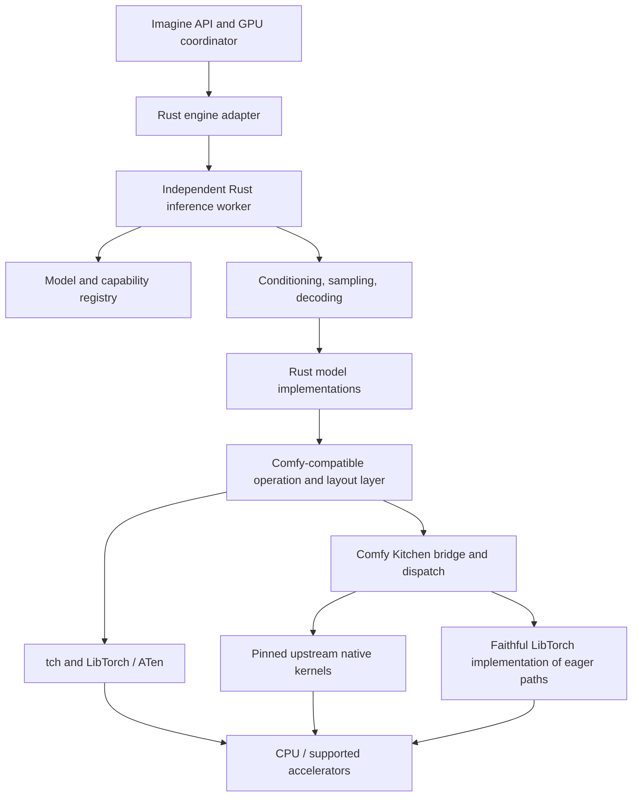

# Rust inference engine with one-to-one ComfyUI parity

Date: 2026-10-17  
Current status, 2026-10-18: **Stage 1 tensor/Kitchen foundation complete**.
The [final report](stage-1-final-validation.md) and
[checkpoint](stage-1-final-checkpoint.json) verify all 135 registered backend
bodies, 155 crate tests and 146 unfiltered Python-free primitive tests. The full
model, algorithm and integration parity target remains assigned to later stages.
No new deviation or approval was needed for the final continuation.

Historical implementation checkpoints (their incomplete-status statements apply
to the checkpoint described):

Status: Stage 0 locking/inventory complete; Stage 1 remains a verified partial tensor/Kitchen foundation. The historical first [whole-stage continuation checkpoint](stage-1-eager-cuda-checkpoint.json) passes 90 crate tests / 82 Python-free primitives, connects all 55 eager and 52 CUDA bodies, and retains 28 general Triton body gaps plus remaining layout/state obligations. The detailed earlier checkpoint history follows. The preceding NA3d checkpoint passes 88 crate tests / 80 Python-free primitive functions, with 18,914 ordinary numerical/error/selection records, five approved controlled-intermediate Sol-Attn cases and unchanged 3,572 controlled unwritten-storage combinations. Fifteen scoped D-05 approvals are recorded in the [ledger](decisions/README.md); defined numerics and original autotuning remain exact. Approved type/device renderers pass all 20,864 metadata cases, including 8,457 type-error and 2,891 device-error strings, plus 593 complete selection scenarios; see the [registry continuation](stage-1-registry-diagnostics.md). The [CUDA FP16 continuation](stage-1-cuda-fp16.md) adds 400 exact cases. The [CUDA INT8 M=1 continuation](stage-1-cuda-int8-m1.md) adds 509 ordinary and six controlled cases; the [GEMV continuation](stage-1-cuda-int8-gemv.md) adds 612 ordinary and 18 controlled cases. The [GEMM continuation](stage-1-cuda-int8-gemm.md) adds 1,728 ordinary and twelve controlled cases. The [cuBLAS continuation](stage-1-cuda-int8-cublas-empty.md) adds twelve controlled consumed-intermediate cases. The approved [linear-family continuation](stage-1-cuda-int8-linear-family.md) verifies 3,456 combinations (earlier 48 linear cases included once) and adds 1,134 ordinary activation cases. The approved [SVDQuant continuation](stage-1-svdquant.md) verifies eight controlled cases, 2,304 scaled-mm outputs, 774 quantizer cases and four workspace-alias cases. The approved [forced-small-M INT4 continuation](stage-1-int4-forced.md) verifies all 36 controlled cases and adds 360 ordinary cases. The [native/chunked INT4 continuation](stage-1-int4-family.md) implements original SM89 selection, verifies both remaining zero-K routes and defined controls, and adds 110 exact outputs and 100 selection predicates. The [AWQ continuation](stage-1-awq.md) implements the original eager and SM89 CUDA direct wrappers and verifies 400 additional cases with backend-specific exact numerics, bias behavior and M=8/9 and 256/257 boundaries. The [AWQ layout continuation](stage-1-awq-layout.md) adds typed dequantization/transpose/export and linear/mm/addmm handlers, with 970 exact storage/numerical/error cases including mixed inputs and quantized bias. The [general layout/backend binding checkpoint](stage-1-binding.md) adds 391 records, source table/MRO/precedence verification and a boxed ATen fallback ABI. Selected existing bodies are connected; full operation/layout coverage and general Triton remain incomplete. The [backend callable continuation](stage-1-backend-bindings.md) connects 41 further bodies (49 total), adds 930 exact call/selection records and verifies cache/identity/None/error behavior. The remaining 86 binding gaps and other Stage 1 obligations remain explicit. The [RoPE continuation](stage-1-rope-bindings.md) connects 32 further bodies (81 total), verifies 1,482 exact cases and leaves 54 explicit backend gaps. Original in-place storage/gradient checks and partial rotary behavior are retained. The [convolution/GroupNorm continuation](stage-1-conv-bindings.md) adds eight bodies (89 total), 1,434 exact records and original native/error/out-buffer behavior, leaving 46 explicit backend gaps. The [remaining eager quantization continuation](stage-1-eager-quant-bindings.md) adds five bodies (94 total) and 1,154 exact records, leaving 41 gaps. Three latest bodies have positive numerical evidence; two FP4/MXFP8 scaled-mm entries preserve original CPU/SM89 errors without claiming successful SM100 matmul. Stage 1 continues under the authority clarification below; source-faithful compatibility work requires no additional approval, while actual departures do. See the [portable INT8 continuation](stage-1-portable-int8.md) and separate [six-case compiler proof](stage-1-triton-compiler.md). Full Stage 1/engine parity remains incomplete.

Current approved exception: [D-04-NULL-DLPACK-EXPORT](decisions/D-04-null-dlpack-export.md), explicitly approved on 2026-10-18. The defined TypeError replaces a confirmed null-data CUDA fault; layout integration and differential validation are verified. See [remaining Stage 1 work](stage-1-completion.md).
**Current continuation:** All 135 frozen registered bodies are connected. The [NA3D continuation](stage-1-triton-na3d.md) passes focused exact frontend/compiler/wrapper and separate Python-free isolation checks. The [runtime-contract continuation](stage-1-jit-runtime-contracts.md) verifies all 950 original argument-binding failures, nine repeated hook scenarios and 7,740 paired explicit-ASTSource/JIT keys, with INT8/W4A8/NA3D and load-failure regressions passing. The last complete unfiltered snapshot remains the [126/118 integer checkpoint](stage-1-triton-integer-checkpoint.json); later source has not yet received final unfiltered validation. Remaining compiler/state/lifetime/restoration work continues. No new approval is pending.

Owner of deviation approval: Tomas.  
Architecture: Rust + LibTorch + mandatory Comfy Kitchen; no stable-diffusion.cpp execution path.

## 1. Binding requirements and decision authority

Build an independent inference engine in Rust that reproduces ComfyUI's functionality, model support and algorithms one-to-one. ComfyUI's Python implementation is the behavioral reference. LibTorch supplies the underlying PyTorch tensor operations; model construction, execution policy and orchestration are implemented in Rust. Comfy Kitchen is a required execution dependency and compatibility target.

The user's requirements are binding:

1. **Functional parity:** preserve supported operations, inputs, outputs, defaults, valid combinations, state transitions and failure conditions.
2. **Model parity:** support every model, variant, component and applicable weight representation in the agreed reference. A family name alone does not establish support.
3. **Algorithm parity:** reproduce the reference's algorithms, operation order, numerical boundaries, dispatch decisions and conditional branches.
4. **Quantization parity:** whenever the reference quantizes, this engine must quantize in the same circumstances and by the same method. This includes runtime activation quantization and post-patch requantization, not just loading quantized checkpoints.
5. **Comfy Kitchen:** use its applicable implementations and reproduce its surrounding semantics. An unrelated kernel with similar results is not an automatic substitute.
6. **No stable-diffusion.cpp dependency:** the new engine must run independently of its binaries, APIs, GGML graph and model implementations.
7. **Python-free production execution:** follow the proposed Rust + LibTorch architecture. Python may be used as a separately authorized development reference, not as a concealed production worker or fallback.
8. **Explicit approval for deviations:** every decision that departs from these requirements or the Rust + LibTorch proposal requires Tomas's explicit approval before implementation or adoption.

Time pressure, missing library bindings, hardware limitations, apparent visual equivalence, better benchmarks, an upstream recommendation and approval from another agent do not constitute approval. Silence is not approval. An exception approved for the old native engine does not carry over.

Routine structure and implementation choices that preserve all requirements may be made within a subsequently authorized implementation task. A fidelity gap must be recorded as a gap; it must not be renamed a supported optimization.

**Authority clarification — Tomas, 2026-10-17:** “Bara så det är klart du behöver
inte mitt godkännande om du upptäcker sånt som måste implementeras för att vara
kompatibel med comfyui koden bara om den avviker”. Continue authorized Stage 1
implementation and necessary local synthetic validation autonomously whenever
they preserve the frozen reference and agreed design. Reproducing original
branches, quirks, errors, allocations or no-write behavior is compatibility work,
not a new deviation merely because a prior test matrix omitted that case.
Metadata-only provenance guards and exact known-own-state comparisons may be
used to validate original unwritten storage without reading unknown/private
storage or changing the engine. Prior bounded tests remain historical coverage,
not new capability restrictions. Ask before a real behavioral/algorithmic/default
or architectural departure, a numerical relaxation, reference advance, or an
action outside existing authorization. Existing data/privacy/platform boundaries
and the Stage 1 limit remain unchanged. Do not claim equality for independent
undefined allocation histories or treat unknown bytes as reference goldens.


### 1.1 Approval record

**Whole-Stage-1 continuation — Tomas, 2026-10-17:** “Kör hela resterande
steg 1 utan att jag godkänner förutom om du måste frångå paritet med comfyui”.
Continue through all remaining Stage 1 implementation and validation without
requesting approval for necessary reference-compatible work. Intermediate
checkpoints document progress; they are not completion or a request to renew
authorization. Stop for an actual required parity departure and describe the
concrete alternative before adopting it. Existing privacy, isolated-development,
local-only and no-production-replacement boundaries remain in force.

Each proposed deviation must contain:

| Field | Required content |
| --- | --- |
| ID and status | Proposed, explicitly approved, rejected or superseded |
| Reference | Exact source revision, symbol, algorithm and triggering inputs |
| Requirement affected | Functionality, model support, algorithm, Kitchen, quantization, numerical behavior or dependency boundary |
| Proposed difference | Concrete before/after behavior, including defaults and fallback behavior |
| Reason and alternatives | Why exact implementation is blocked; alternatives that preserve the requirements |
| Consequences | Numerical, capability, memory, performance, portability and maintenance effects |
| Evidence | Source findings and separately identified synthetic/live results |
| Authorization | Tomas's exact decision and its scope/date; never inferred |
| Acceptance | Tests needed and whether the result may still be called full parity |

**Approved numerical tolerances or algorithm changes: none.** The separately approved [D-05-INT8](decisions/D-05-INT8-triton-autotuning.md) and [D-05-INT8-ROW](decisions/D-05-INT8-per-row-autotuning.md) criteria permit differing winners from each path's unchanged measured autotuning policy; exact numerical results remain required. Scope decisions are in Section 2. Future deviations require their own explicit approval.

## 2. Scope and the meaning of one-to-one

The completion target is full parity across the agreed reference, not a Qwen-only engine. Qwen Image 2.1 is a useful first vertical implementation slice because its complete path exercises Kitchen, quantized weights, references and LoRA. Completing that slice does not satisfy the overall objective.

The reference must be a reproducible source/dependency/configuration snapshot. “Whatever upstream supports today” cannot be a stable test oracle. Pinning a release defines a comparison boundary; it must not conceal omitted functionality. Updates require a reference delta review and corresponding coverage changes.

The default inventory includes core model detection, all registered model configurations, text/vision/audio encoders, autoencoders, conditioning, sampling, auxiliary models, core nodes that implement inference semantics, model patches, loading, precision, quantization, memory management and supported device paths. Training-only functionality must be identified separately; anything reachable during supported inference remains in scope, including gradient-dependent inference algorithms.

### Approved scope — Tomas, 2026-10-17

| Boundary | Approved decision | Consequence |
| --- | --- | --- |
| Reference | “Current local one” | Use the local ComfyUI and Kitchen source identified in Section 3, including the actual local dependency behavior. Do not replace it with newer upstream implicitly. |
| Node packages | “The base one that is required for interference” (inference in context) | Include ComfyUI's built-in inference nodes and the dependencies required for their inference functionality. Comfy Kitchen remains mandatory. General compatibility with arbitrary external custom-node packs is not required. |
| Product boundary | “No ComfyUI graphs or UI related, inference only” | Exclude ComfyUI graph execution, workflow import/export, editor/UI and replication of its HTTP server API. Preserve the inference calculations implemented inside core node functions, exposed through the Rust engine. |
| Initial platform | “Linux first … my environment arch linux and RTX 4070ti Super card” | First release and acceptance target: Tomas's current Arch Linux environment with NVIDIA GeForce RTX 4070 Ti SUPER. Match its applicable CUDA and CPU execution paths. |
| Local execution only | “Inga molntjänster endast lokala beroenden” | Exclude hosted/cloud inference nodes and service integrations. Local inference dependencies may be downloaded for development; downloading source/packages does not authorize cloud inference or uploading test inputs. |

The node-package decision is interpreted as the base/built-in inference functionality and its required dependency closure, not a named third-party package. Inventory the exact modules and dependencies during source locking. If a required path turns out to depend on an external package whose inclusion is ambiguous, request a decision for that package rather than silently omit its behavior or include arbitrary plugins. AIO-specific orchestration is not automatically part of base ComfyUI inference.

Linux-first is a delivery boundary, not a promise of immediate cross-platform support or permanent abandonment of other platforms. Windows, macOS and other accelerators are outside initial acceptance; subsequent platform work needs its own scope. Preserve CPU work and CPU fallback/offload behavior that the reference uses on the initial machine. Lack of VRAM or unavailable model fixtures does not authorize dropping models or changing quantization.

All functionality, model, algorithm and quantization parity requirements apply within this approved inference scope. No final parity claim is possible with an incomplete inventory of that scope. Stages 0 and 1 are authorized; later implementation stages require their own instruction. Development/test-data permissions are recorded in Section 13.

### 2.1 Functional, algorithmic and numerical parity

Functional parity means the same supported task can be expressed and completed with equivalent observable behavior. Algorithmic parity additionally requires the same calculations and dispatch logic, not merely similar outputs.

Bitwise identity is a separate property to measure. The earlier proposal did not promise universal bit-identical images across different devices or software versions. It also did not approve numerical differences. Therefore:

- Under a matched deterministic environment, exact comparisons are the default acceptance gate for integer values, layouts, RNG state, quantized payloads and deterministic tensor results.
- Floating-point differences are investigated at the first divergent operation. They must not be waived through a convenient global tolerance.
- If an exact comparison cannot hold because of reference nondeterminism or a backend limitation, document the cause and propose a bounded, operation-specific acceptance criterion for Tomas's approval.
- A visually similar image cannot compensate for different quantization, an omitted branch or a different sampler.
- A numerical exception, if approved, retains its label; it does not become evidence of bitwise parity.

Rust and LibTorch improve our ability to reproduce PyTorch operations. They do not automatically reproduce Python scalar promotion, tensor subclasses, extension registration, compiler transformations or external kernels.

## 3. Source evidence and baseline selection

Only project documentation, source code, Git revision identifiers and installed dependency source/package identity were inspected for this design. No model was loaded and no runtime prompts, histories, logs, media or runtime reference metadata were inspected.

### 3.1 Observed source references

| Component | Inspected reference | What it establishes |
| --- | --- | --- |
| Local ComfyUI | `/home/thhel/git/ComfyUI`, HEAD `ba994879b88d0ebd9950b1e5c1e923d928f216ba` | Selected local reference for model registry, samplers, quantization and operation dispatch |
| Local Kitchen | `/home/thhel/git/ComfyUI/.venv/lib/python3.12/site-packages/comfy_kitchen`, distribution version `0.2.37` | Selected local reference for Python orchestration, tensor layout and native-extension entry points |
| ComfyUI upstream HEAD observed | `5cc4b870094c89090db54bd8d12649dcaf89f2ba` | Newer upstream exists; not silently selected as the release baseline |
| tch-rs upstream HEAD observed | `4227b89b72059b0651ff83a38637693574e0a2d6` | Candidate Rust bindings; revision updates to PyTorch 2.13 |
| Existing native source lock | `native/comfy-port/reference-lock.json` | Useful provenance only; its exclusions and numerical exceptions are not approved for this engine |

The local ComfyUI tracked paths checked under `comfy`, `comfy_extras`, `nodes.py`, `execution.py` and `requirements.txt` had no unstaged diff. This was not a complete dependency-tree or installation reproducibility audit. Package version strings alone do not prove that installed Kitchen equals its published tag.

Selected SHA-256 fingerprints of the actual inspected files:

| Source | SHA-256 |
| --- | --- |
| ComfyUI `comfy/supported_models.py` | `5943d81bc0257b9b72b065a4ecb2f57c51c826e91f86c333b98fbe8a830e0cef` |
| ComfyUI `comfy/samplers.py` | `f2c264ca9d394612f828e3ffe167c856a278a10e1711b269f0ba65dccb66393f` |
| ComfyUI `comfy/quant_ops.py` | `37f0054dfbd8430524ac2c73dafd25b8ad4eabc490a2b7490eeebde8dffbc749` |
| ComfyUI `comfy/ops.py` | `a0b8c7f32a146b383a795363bef35e480ffa84b5b3e9c9503f323b1446876f45` |
| Kitchen `__init__.py` | `63c6767a9cac5596c00d5c42fd1246137c33a282ed144633dd37342d485a0a50` |
| Kitchen `registry.py` | `3968a0232c500b619640182877b33d9610ddd1726ad4e8081f5d33fee6500308` |
| Kitchen `tensor/base.py` | `1779b95ec16d2f3db1adcdbf448b931104ad6f609849afec7d03c999cfc819eb` |
| Kitchen `backends/cuda/__init__.py` | `4b32e00e230d451e8bdc9c1fbd6917d8e7d2cc0d439dec13e3107e0539252ffd` |

### 3.2 Required release lock

Before implementation acceptance, create a complete source manifest covering ComfyUI, Kitchen, tch/torch-sys, LibTorch/ATen, optional attention dependencies, tokenizer libraries, compiler toolchain and GPU libraries. Include repository commits, local patches, file hashes, build flags, target architectures, ABI choice and binary hashes. Record the matching reference Python environment separately.

Record device model, driver/runtime versions, dtype flags, TF32/reduced-precision policies, determinism, thread settings and enabled backend priorities for each validation environment. These are comparison inputs, not permission to inspect a running user service.

The local source selection is approved. Completing its dependency lock and recording the exact Arch Linux/driver/CUDA environment remain implementation-preparation work. The target OS and GPU are user-specified, not newly probed in this design update. If the local checkout or dependencies change after the documented inspection, report the delta and obtain approval before advancing the reference; “current local” is not a rolling upgrade policy.

Stage 1 now builds the pinned tch/LibTorch/Kitchen tuple and verifies a partial primitive subset in Python-free isolation. This is foundation evidence, not a complete executable or model-parity baseline; see [the Stage 1 report](stage-1-foundation.md).

### 3.3 Stage 0 capture — 2026-10-17

The [local reference capture and inventory](reference-local/README.md) records the selected source, installed dependency identities, preserved source archives and SHA-256 manifests. It inventories 105 model classes, 981 node-schema classes and 17,800 definitions across 744 source modules, retaining registry expressions, conditional imports and source predicates. Counts describe static definitions, not activated support or runtime verification.

The source/dependency fingerprints were verified without importing the reference or reading runtime data. Stage 0 now supplies the reference contract, source acquisition lock, versioned native-library fingerprints, marker audit and explicit local-inference scope matrix. Kitchen/AIMDO sources match their installed counterparts; the selected PyTorch revision and its install-header transformation are recorded. This completes source locking/inventory for review, not release acceptance of an engine. Standalone ABI/linkage, rebuilt-kernel fidelity, runtime reachability and model parity remain foundation/later-stage verification gates. No deviation is approved; no existing backend is replaced. See the capture report's R-01 through R-08 for precise evidence and limitations.

## 4. Architecture



The worker process contains the new engine. Its process boundary isolates GPU failures and supports reliable cancellation/unload through Imagine's coordinator. Process isolation must preserve reference RNG, caching and model lifecycle semantics within the supported session contract; it is not permission to reset state between every request.

Suggested Rust modules, initially internal rather than an unrelated public plugin framework:

| Module | Responsibility |
| --- | --- |
| `reference_contract` | Reference identity, capability IDs, parity evidence and approved exceptions |
| `tensor` | LibTorch handles, dtype/layout semantics, generator state, views and ownership |
| `kitchen` | Required upstream kernel integration, backend registry and layout dispatch |
| `checkpoint` | Reference-compatible model detection, loading, state dictionaries and quantization metadata |
| `models` | Model-family forward passes and component configurations |
| `conditioning` | Tokenization, multimodal encoding, masks, references and guidance inputs |
| `sampling` | Model sampling parameterizations, sigma schedules, samplers and noise processes |
| `patching` | Model/CLIP patches, LoRA and other weight adapters, restoration and invalidation |
| `memory` | Reference residency, offload, allocation, staging and failure/retry policy |
| `pipeline` | Core operation composition, callbacks, previews and output conversion |
| `worker` | Versioned IPC, progress, cancellation, unload and process lifetime |

Each module has a source-to-Rust mapping. Avoid an abstraction that forces distinct upstream paths into one approximate implementation. Share code only where the reference semantics are actually shared.

## 5. LibTorch and tensor semantics

Use tch for operations it exposes faithfully. Where a required ATen operation or configuration is missing, use a small audited C ABI bridge over the pinned LibTorch C++ API. Missing tch bindings are not grounds for selecting a different algorithm.

The bridge must define tensor ownership and reference counts, view/alias behavior, strides, storage offsets, device/stream guards, error conversion and asynchronous lifetime. Never allow C++ exceptions to unwind through Rust. Kernel failures must retain a safe error identity without dumping user tensors or prompts.

Match each reference operation's input dtype, intermediate dtype, accumulation mode, scalar conversion and output dtype. Preserve in-place mutation, broadcasting, empty/scalar tensors, non-contiguous inputs and padding. No blanket `contiguous()`, float promotion, fused multiply-add or reassociation is allowed when it changes the reference path.

Execution uses the reference grad/inference mode per operation; globally disabling autograd is not acceptable if a supported inference feature requires it. Reference `torch.compile`/Triton behavior must be inventoried if enabled in the agreed baseline. A Python-free equivalent is a feasibility gate, not an assumed LibTorch feature.

## 6. Mandatory Comfy Kitchen integration

### 6.1 What the inspected source shows

Kitchen has Python backend selection, tensor subclasses and native CUDA wrappers. `QuantizedTensor` is a Python `torch.Tensor` subclass with layout-specific dispatch and a dequantization fallback. Its CUDA module loads a Python `_C` extension and invokes functions with tensor wrappers and stream information. Some public operations use `torch.ops.comfy_kitchen` registration.

Consequently, linking LibTorch alone does not make Kitchen work. Importing the Python package inside the worker would violate the selected production architecture. Treat the native binding and dispatch port as a substantial implementation task.

### 6.2 Required integration method

Reuse the pinned upstream Kitchen native kernel sources and reproduce their launch contracts. Provide a Python-independent C ABI or LibTorch operator-registration bridge to those sources. Restrict bridge changes to binding, ownership and build integration; preserve kernel calculations, compiler flags, launch geometry and dispatch conditions.

This is the proposed integration mechanism, not evidence that the existing wheel exports a usable standalone ABI. Audit the native binding/build sources before implementing it. If a kernel cannot be exposed without changing semantics, stop that path and submit a deviation proposal.

Port the Python policy layer into Rust: backend enable/disable state, priority, availability checks, per-operation constraints, exception handling and fallback. Reproduce eager paths using the same ATen operations. A CUDA kernel's internal choice between CUTLASS, cuBLAS or another path is part of the algorithm contract.

For Python/JIT-only backends, determine whether the exact kernel can be packaged and launched without Python, including specialization and target-architecture handling. Do not silently replace it with eager or CUDA execution. If exact standalone execution is not feasible, record the capability as blocked pending explicit approval.

### 6.3 Runtime contract

- Kitchen is required at build/package validation and worker initialization. An unusable required Kitchen component produces a clear capability error.
- Route operations to Kitchen wherever the reference routes them to Kitchen; do not force Kitchen on operations for which the reference uses another backend.
- Apply the same hardware, mask, shape, dtype, alignment and version predicates.
- Preserve the reference's fallback when it is part of the agreed valid execution path. A port-specific fallback introduced because an implementation is missing is not permitted.
- When a request explicitly requires Kitchen INT8 attention, reject missing support instead of selecting a different attention algorithm. Internal fallback behavior within that reference implementation is still reproduced.
- Test the selected backend and operation path, not merely the presence of the package or a successful output.

### 6.4 Quantized tensor representation

Represent the equivalent of `QuantizedTensor` explicitly in Rust: payload tensor, layout identity, layout parameters, original shape/dtype, scale tensors, packing information and relevant transforms. An opaque INT8 tensor is insufficient.

Implement the layout behavior of linear/matmul, transpose, reshape/view, slicing where supported, clone, detach, device/dtype transfer, contiguous conversion, copy and state-dictionary export. Preserve whether an operation retains quantization, adjusts metadata, dequantizes or fails. Dispatch precedence must match mixed ordinary/quantized inputs.

Kernel calls use the active LibTorch stream and compatible allocation ownership. Retain buffers until asynchronous operations finish; propagate stream events when moving between streams. Do not hide CPU round trips or device synchronizations in the bridge.

## 7. Quantization and precision contract

**If ComfyUI quantizes, we quantize. If it dequantizes or requantizes, we do so at the same point and for the same reason.** Reading the same model file does not satisfy this requirement.

The inspected `comfy/quant_ops.py` registers `float8_e4m3fn`, `float8_e5m2`, `nvfp4`, conditional `mxfp8`, `int8_tensorwise`, `convrot_w4a4`, `asym_w4a8_int8` and `w6a8_int8`. This is a source-derived starting list, not the complete quantization inventory: layouts and operation-specific paths in Kitchen and ComfyUI must also be enumerated.

For every format and call site, preserve:

1. Storage bits, signedness, packing order, scale dtype/shape and grouping.
2. Scale selection/recalculation, clipping, zero handling, saturation, rounding and special-value behavior.
3. Activation versus weight-only quantization and any mixed-precision path.
4. ConvRot or other transforms, their ordering, parameters and inverse operations.
5. Padding, alignment and exact treatment of padded elements.
6. Stochastic rounding algorithm, seed derivation, generator and draw consumption.
7. Matmul accumulation/output dtype, bias, residual, activation and fusion boundaries.
8. Dequantization and requantization on loading, patching, offload/reload and serialization.
9. Backend-specific support and reference fallback/failure behavior.

The `quantize_input=False` flag in several quantization configurations does not mean that the full linear implementation never quantizes activations. It can mean activation handling occurs inside the format-specific operation. Trace the complete call path before assigning behavior.

The reference FP8/NVFP4/MXFP8 wrappers also contain Comfy-specific scale and stochastic-rounding logic above Kitchen. Calling a generic Kitchen quantizer directly would omit those semantics in affected branches.

Do not substitute BF16/FP16 for an unsupported quantized path, convert all checkpoints to a preferred format, retain patched weights permanently in float, change group sizes, or use deterministic rounding in place of stochastic rounding without approval.

## 8. Model and component coverage

Create a machine-readable parity matrix with one entry per actual capability, not one per marketing model family. Each entry records:

`reference symbol -> model detection rule -> variant -> components -> weight formats -> operation -> conditioning -> sampler/guidance -> dtype/quantization -> backend -> implementation -> tests -> evidence -> exceptions`.

Use statuses `inventoried`, `implemented-unverified`, `synthetic-verified`, `model-verified`, `blocked` and `approved-exception`. “Not yet implemented” is a gap, not an unsupported model that can disappear from the target.

Discovery must cover `supported_models.py`, `model_detection.py`, `model_base.py`, `ldm`, text encoders, VAE loaders, control/vision/audio/3D components, node registrations and optional modules in the agreed source set. The 105 entries observed in the local `models` registry are a lower bound on scope, not the total number of supported checkpoint variants or components.

For every model preserve state-dictionary mapping, metadata interpretation, fused/split projections, architecture dimensions, positional encoding, normalization epsilon, activation variants, masks, conditioning injection, timestep parameterization and latent normalization.

Cover text-to-image, image editing, inpainting, control, upscaling, video, audio and other registered modalities where the reference supports them. Frame count, frame rate, temporal padding, audio length and multimodal synchronization are model-specific contracts.

Failure to obtain an authorized weight fixture or suitable hardware leaves validation blocked. It does not authorize excluding the model or declaring source-only coverage complete.

## 9. Conditioning, sampling and random numbers

### 9.1 Conditioning

Reproduce tokenization, vocabulary, merges, special tokens, prompt templates, weighting, truncation, padding, masks, encoder layer selection and normalization. A Rust tokenizer library is acceptable only after verifying its behavior against the pinned reference.

Reproduce reference-image resizing, interpolation, cropping, channel/alpha handling, color conversion, image ordering, patch placement and positional indices. Avoid a second preprocessing pass at the Imagine/engine boundary. Existing Imagine preprocessing is not automatically the canonical ComfyUI behavior; any difference must be exposed and resolved.

Positive/negative conditioning, CFG shortcuts, zero-negative behavior, control inputs, area/mask conditioning and batch grouping must follow the reference. Cache keys must include all semantic dependencies, including encoder patches and preprocessing policy. Never reuse a cache because two prompts happen to have the same visible text while their effective conditioning differs.

### 9.2 Sampling

Port all reference sampler registrations and their implementation branches. The inspected registry has 42 `KSAMPLER_NAMES` plus `ddim`, `uni_pc` and `uni_pc_bh2`. It exposes nine scheduler names: `simple`, `sgm_uniform`, `karras`, `exponential`, `ddim_uniform`, `beta`, `normal`, `linear_quadratic`, `kl_optimal`.

This registry is only one entry point. Include custom/manual sigma schedules, advanced sampler nodes, noise providers, guiders and model-specific sampling objects in the complete inventory.

Preserve sigma construction precision, terminal zero, denoise/start/end slicing, timestep conversion, solver history, stochastic increments, adaptive stopping, eta/churn settings, masks, guidance ordering and callback timing. `ddim`, for example, must follow the pinned Comfy implementation rather than an independently chosen textbook implementation.

### 9.3 RNG

Represent reference generators explicitly. Match CPU/GPU generator selection, seeds and seed ranges, batch indexing, offsets, draw ordering, distribution transforms, stochastic-rounding streams and SDE/Brownian processes. Do not assume a Rust RNG seeded with the same integer produces Torch noise.

Tests compare generator state and intermediate noise as well as outputs. A different batch packing, cache hit or offload decision must not consume randomness differently unless the reference does so.

## 10. Patching, LoRA and state lifecycle

Port the complete reference weight-adapter registry, its parameter interpretation and ordering. The inspected source includes LoRA, LoHa, LoKr, GLoRA, OFT and BOFT modules; enumerate additional bypass/hooks and associated patch types before declaring coverage complete.

Preserve model versus text-encoder strength, alpha/rank scaling, convolutional shapes, offsets, nested patches, patch order, compute dtype and restore behavior. For quantized weights reproduce dequantize -> patch arithmetic -> reference rounding/requantization -> execution, including any alternative runtime/bypass path selected by the reference.

Clone/shared-storage behavior and patch identity affect caches and memory accounting. Model-only changes must not invalidate unrelated encoder state if the reference retains it; encoder changes must invalidate dependent conditioning. Switching A -> B -> no patch must restore the exact unpatched state without accumulated rounding or stale cache reuse.

Hooks required by base inference remain in scope and must be expressed through the Rust implementation. Arbitrary external Python plugin hooks are outside the approved base-package scope. Any ambiguous external dependency requires a specific scope decision. The old native lock's accepted last-bit solver differences are not inherited.

## 11. Memory, devices and execution lifecycle

Reproduce the reference policy inputs and decisions for model residency, lazy weight casting, loading/offloading, pinned memory, transfers, prefetch, partial unload, staging allocations, workspace, cache budgets and OOM recovery. Different transient allocator addresses are not an algorithmic requirement; changed decisions that affect supported workloads or numerical behavior are.

Keep memory estimates, actual allocated/reserved bytes and physical peak VRAM distinct. “Fits in memory” is not proof of matching reference offload behavior. Test cold load, warm reuse, model switches, varying batch/geometry, low-memory modes and failure recovery.

A different budget threshold, reference-cache strategy, VAE tiling rule or model-specific fixed limit is a decision requiring approval if it diverges from ComfyUI. Do not carry the old native engine's resolution-specific settings into this engine as defaults.

The worker must support interruption, confirmed shutdown, full unload and recovery through the existing Imagine GPU coordinator. Do not release a GPU reservation while a worker may still execute kernels. Never transparently rerun a failed request through stable-diffusion.cpp or Python.

If process-level termination differs from a required ComfyUI interruption/cache contract, document that conflict and obtain a decision before claiming lifecycle parity.

## 12. Imagine integration and existing work

Add the engine behind Imagine's execution boundary after it is authorized and validated. Preserve the established product lifecycle and privacy constraints. Do not assume the old `design-document.md` describes every current implementation detail; the working tree contains ongoing engine/API/UI work and a separate headless Comfy backend.

The existing headless Python backend may serve as an explicitly selected development reference, but is not the deliverable and cannot be a production fallback for the Rust engine. Its current Qwen-only adapter is also not a complete oracle for all ComfyUI functionality.

The public API must be able to express every required engine capability. Existing UI choices, model profiles or API limits cannot silently cap parity. If the present API cannot express a reference operation, document a versioned extension proposal and obtain approval for product behavior changes. Do not add arbitrary filesystem paths or expose internal tensor handles to clients merely for implementation convenience.

The frozen native v1/v2 executables, source locks, patches and accepted evidence remain comparison controls. This document neither changes engine selection nor promotes a candidate. Existing native test decisions are read to avoid repeating rejected experiments; they do not define this engine's numerical target.

## 13. Privacy and reference validation boundaries

Follow `AGENTS.md`'s runtime-data prohibition outside the following explicit user-authorized exception. Tomas authorized reading runtime data during development when using the new inference engine in an isolated environment outside ordinary Dreamchat. On 2026-10-17 he also answered yes to synthetic test material, isolated optional-dependency installation and fetching matching native source/build dependencies.

This authorization permits inspection of the isolated new engine's own test prompts, synthetic references, outputs, logs, intermediates and test metadata as needed for development and verification. It does not permit reading pre-existing Dreamchat/ComfyUI production prompts, histories, media or caches, changing the ordinary environment, or connecting the test engine to ordinary Dreamchat. Test fixtures and runtime artifacts must have a separate root and explicit provenance. Synthetic material is the initial test input; user-supplied private material requires its own clear selection.

Optional dependencies may be installed only into the isolated development/test environment. Record additions as an expanded test configuration; do not advance or mutate the frozen local reference. Matching Kitchen, AIMDO, LibTorch and build-dependency sources may be fetched for that environment. If exact matching provenance cannot be established, report the concrete gap before adopting an alternative. These permissions do not waive functional/numerical parity or authorize later implementation stages automatically.

Production prompts, conditioning, activations and caches stay out of diagnostic files. Keep sensitive caches process-local in RAM. Diagnostics should identify operations, shapes, dtypes, backend decisions and safe error codes only under the applicable authorization. Do not log user payloads, embed them in command lines or persist them to reproduce a failure.

Reference tooling may use Python during development. The shipped engine must be tested without a Python interpreter, ComfyUI installation or stable-diffusion.cpp executable available. Build-time code generation and testing dependencies must be declared separately from runtime requirements.

## 14. Verification and release acceptance

### 14.1 Layered differential tests

| Layer | Required evidence |
| --- | --- |
| Inventory | Every required source capability mapped; unknowns retained and visible |
| Tensor/FFI | Dtypes, aliasing, strides, ownership, streams, errors and exact operation behavior |
| Kitchen | Backend selection, launch inputs, quantized layouts, native and reference fallback branches |
| Quantization | Payload bytes, scales, padding, stochastic state, dequantization and requantization |
| Components | Tokenizer, encoder, attention, transformer blocks, VAE and model sampling intermediates |
| Algorithms | Schedules, solver updates, noise, masks, guidance and callbacks |
| Model variants | Complete authorized fixtures across supported operations and weight formats |
| Lifecycle | Load/reuse/patch/unpatch/offload/unload/cancel/failure/recovery |
| Integration | API expresses capabilities and preserves Imagine's coordinator/privacy contract |
| Packaging | Reproducible source restoration and Python-free standalone execution |

Use paired tests with the exact reference environment and identical permitted inputs. Compare at intermediate boundaries so that errors are localized before diffusion amplifies them. Ensure the reference has not itself fallen back to a different backend. Run negative cases for unsupported reference inputs, malformed checkpoint metadata and kernel availability.

Adversarial synthetic cases include zero and extreme scales, clipping boundaries, odd/padded dimensions, empty tensors where valid, mixed precision, non-contiguous views, long masks, multiple references, batch changes, LoRA ordering and repeated patch restoration.

Coverage must include reachable combinations, not a blind Cartesian product of incompatible options. Record constraints and test each branch plus interactions among quantization, patching, offload, caching and attention. Tests that merely repeat Rust implementation logic do not establish parity.

### 14.2 Acceptance gates

1. Reference scope and complete source/dependency lock are agreed.
2. Kitchen's Python-independent integration is demonstrated for required paths.
3. Every required capability has an implementation and an evidence record.
4. All exact checks pass, or every specific non-exact acceptance criterion has explicit approval.
5. All model/device combinations required by the reference matrix are validated; unavailable fixtures/hardware remain blockers.
6. No missing behavior is silently ignored or substituted.
7. Production dependency isolation, lifecycle and privacy checks pass.
8. Documentation distinguishes achieved parity, approved exceptions and remaining gaps. A subset cannot be labeled full parity.

Track performance separately: cold load, first patch, warm execution, conditioning, sampling, decode, transfers and memory peaks. The design promises no speedup or fixed percentage of ComfyUI throughput. A performance regression does not authorize changing algorithms. Proposed performance targets require a separate agreed criterion.

## 15. Delivery sequence

These are implementation milestones, not scope reductions or authorization to start implementation.

| Stage | Deliverable | Exit condition |
| --- | --- | --- |
| 0 — Reference contract | Approved snapshot/scope, complete inventory, dependency matrix and deviation ledger | No silent exclusions; unresolved decisions explicitly assigned |
| 1 — Tensor and Kitchen foundation | LibTorch bindings, standalone Kitchen build, layouts, dispatch, RNG and quantizers | Differential primitive tests and dependency isolation pass |
| 2 — First complete model path | Qwen Image 2.1 including its required editing, LoRA, precision and memory paths | All selected vertical-path cases pass; result labeled partial overall coverage |
| 3 — Shared algorithm coverage | Complete conditioning/sampler/scheduler/patching/loading contracts | Registry coverage and interaction tests pass |
| 4 — Complete model coverage | All reference families, variants, auxiliary components and modalities | Full model matrix has evidence; no unapproved omissions |
| 5 — Initial platform and integration | Arch Linux / RTX 4070 Ti SUPER, applicable CUDA/CPU paths, API expressiveness, lifecycle, packaging | Full release acceptance gates pass within the approved initial platform scope |
| 6 — Maintenance | Upstream delta review and new-reference differential validation | Each update explicitly identifies additions, changes and regressions |

Work order may change without reducing the target. A partial implementation may be reviewed as partial; production rollout and replacement of an existing backend require their own authorization. Do not provide a fixed completion estimate before Stage 0 establishes the full inventory and Stage 1 resolves the Kitchen ABI/JIT feasibility risks.

## 16. Scope decisions and remaining technical risks

| ID | Question / risk | Required treatment |
| --- | --- | --- |
| D-01 — resolved | Local reference selected by Tomas | Use Section 3's local source; finish dependency locking and seek approval for later reference changes |
| D-02 — resolved scope | Base inference nodes/dependencies only; no ComfyUI graphs or UI | Inventory the base inference dependency closure; ask only about concretely ambiguous external dependencies |
| D-03 — resolved initial target | Linux first: current Arch Linux / RTX 4070 Ti SUPER | Validate applicable CUDA and CPU paths; other platforms are subsequent scope, not initial release blockers |
| D-04 | Kitchen native binding and Python/JIT-only paths | Prove faithful standalone integration; seek approval before any substitute |
| D-05 — partially resolved | Non-bitwise results or reference nondeterminism | [D-05-INT8](decisions/D-05-INT8-triton-autotuning.md) and [D-05-INT8-ROW](decisions/D-05-INT8-per-row-autotuning.md) separately approved for their respective INT8/Triton winner variability only; exact numerics/policy retained. The [empty-width ConvRot criterion](decisions/D-05-INT8-ConvRot-empty-width.md) is separately approved for original unwritten scales and exact controlled-state checks only. The [two-helper extension](decisions/D-05-INT8-ConvRot-empty-variants.md) is also approved and verified. The [registry type-set order criterion](decisions/D-05-registry-type-set-order.md) is approved and its bounded renderer verified. The separate [device-set criterion](decisions/D-05-registry-device-set-order.md) is also approved and verified. The [CUDA INT8 M=1 zero-K output criterion](decisions/D-05-INT8-CUDA-M1-empty-output.md) is approved and verified for its six cases. The separate [GEMV criterion](decisions/D-05-INT8-CUDA-GEMV-empty-output.md) is approved and verified for its 18 cases. The separate [CUTLASS/GEMM criterion](decisions/D-05-INT8-CUDA-GEMM-empty-output.md) is approved and verified for its twelve cases. The separate [cuBLAS consumed-intermediate criterion](decisions/D-05-INT8-CUDA-CUBLAS-empty-intermediates.md) is approved and verified for its twelve cases. The [zero-K linear-family criterion](decisions/D-05-INT8-CUDA-linear-zero-k-family.md) is approved and all 3,456 combinations verified. The separate [SVDQuant nongroup-output criterion](decisions/D-05-SVDQUANT-nongroup-output.md) is approved and all eight cases verified. The [direct INT4 forced-fallback criterion](decisions/D-05-INT4-forced-fallback-zero-k-output.md) is approved and all 36 cases verified. The consolidated [remaining INT4 zero-K output criterion](decisions/D-05-INT4-remaining-zero-k-output-family.md) is approved and all 24 controlled cases/six defined controls verified. Further source-faithful compatibility work follows the authority clarification in Section 1; actual deviations still require explicit approval. |
| D-06 | Imagine API cannot express the full engine contract | Concrete extension proposal before product behavior changes |
| D-07 — resolved boundary | Runtime inspection authorized for the isolated new engine's development data | Use synthetic test inputs initially; optional dependencies and matching native sources may be obtained in isolation. Existing Dreamchat/production runtime data remains outside authorization. |
| D-08 | A dependency's implementation, licensing or packaging prevents distribution | Audit source licenses/build requirements; present the concrete blocker before changing architecture or scope |

D-01 through D-03 and D-07 record Tomas's approved scope/data decisions. Cloud inference is excluded by explicit instruction. D-05 has fourteen separately scoped approved criteria, recorded above; none is a general numerical or algorithmic exception. D-04, other D-05 cases, D-06 and D-08 remain risks or decisions if triggered. Implementation and final parity acceptance are not complete.

## 17. Source map and document validation

Primary public source anchors:

- [ComfyUI inspected revision](https://github.com/Comfy-Org/ComfyUI/tree/ba994879b88d0ebd9950b1e5c1e923d928f216ba): `comfy/supported_models.py`, `model_detection.py`, `model_base.py`, `ops.py`, `quant_ops.py`, `float.py`, `model_patcher.py`, `model_management.py`, `samplers.py`, `sample.py`, `weight_adapter/`, `text_encoders/`, `ldm/`, `comfy_extras/`.
- [Comfy Kitchen repository](https://github.com/Comfy-Org/comfy-kitchen): installed source identity/fingerprints above are the evidence for this document; the upstream kernel and build source must be locked during implementation preparation.
- [tch-rs candidate revision](https://github.com/LaurentMazare/tch-rs/tree/4227b89b72059b0651ff83a38637693574e0a2d6).
- [PyTorch reproducibility documentation](https://docs.pytorch.org/docs/stable/notes/randomness.html): contextual explanation only; the engine must pin the documentation/source version matching its chosen LibTorch.

Project context: [existing design](../design-document.md), [headless backend](../docs/COMFY-BACKEND.md), [privacy contract](../docs/PRIVACY.md), [native baseline](../experiments/qwen-image21-sage/BASELINE.md), [completed experiment decisions](../experiments/qwen-image21-sage/TEST-DECISIONS.md), [historical native port source lock](../native/comfy-port/reference-lock.json).

Validation performed for this document: source-only inspection, static Python AST extraction of model/sampler registrations without importing ComfyUI, dependency-source fingerprinting and document consistency/link checks. No engine code was changed, no dependencies were installed and no inference, GPU, browser or live-runtime validation was performed. Public GitHub metadata retrieval required a network sandbox escalation and succeeded. Existing working-tree changes are outside this document's changes.

## Appendix A — Observed model registry

The following 105 symbols were extracted statically from the selected local reference's `models` list, preserving order. The list establishes a concrete starting inventory; it does not replace component/variant/node discovery within the approved inference scope.

```text
LotusD, Stable_Zero123, SD15_instructpix2pix, SD15, SD20,
SD21UnclipL, SD21UnclipH, SDXL_instructpix2pix, SDXLRefiner, SDXL,
SSD1B, KOALA_700M, KOALA_1B, Segmind_Vega, SD_X4Upscaler,
Stable_Cascade_C, Stable_Cascade_B, SV3D_u, SV3D_p, SD3,
StableAudio3, StableAudio, AuraFlow, PixArtAlpha, PixArtSigma,
HunyuanDiT, HunyuanDiT1, FluxInpaint, Flux, LongCatImage,
FluxSchnell, GenmoMochi, LTXV, LTXAV, MiniMaxH3,
HunyuanVideo15_SR_Distilled, HunyuanVideo15, HunyuanImage21Refiner,
HunyuanImage21, HunyuanVideoSkyreelsI2V, HunyuanVideoI2V, HunyuanVideo,
CosmosT2V, CosmosI2V, CosmosT2IPredict2, CosmosI2VPredict2,
ZImagePixelSpace, MingImage, ZImage, PiD, PixelDiTT2I, Lumina2,
WAN22_T2V, WAN21_CausalAR_T2V, WAN21_T2V, WAN21_I2V,
WAN21_FunControl2V, WAN21_Vace, WAN21_Camera, WAN22_Camera,
WAN22_S2V, WAN21_HuMo, WAN22_Animate, WAN_Animate2, WAN21_FlowRVS,
WAN21_SCAIL, WAN21_SCAIL2, WAN22_WanDancer,
Hunyuan3Dv2mini, Hunyuan3Dv2, Hunyuan3Dv2_1, TripoSplat,
HiDream, HiDreamO1, SenseNovaU15, Chroma, SeedVR2, ChromaRadiance,
ACEStep, ACEStep15, MiniMaxMusic3, YuE2, Omnigen2, Boogu, MageFlow,
QwenImage, QwenImage21, JoyImage, Ideogram4, Krea2, Flux2, Lens,
Kandinsky5Image, Kandinsky5, Anima, RT_DETR_v4, ErnieImage, SAM3,
SAM31, CogVideoX_Inpaint, CogVideoX_I2V, CogVideoX_T2V,
SVD_img2vid, Trellis2, DepthAnything3
```


2026-10-17 continuation: Tomas explicitly approved [D-05-SOL-ATTN-EAGER-FP32-SCATTER](decisions/D-05-SOL-ATTN-EAGER-FP32-SCATTER.md). The preceding proposal/stop is historical. The six-case comparison has passed reference/Rust/Python-free validation; the current integrated checkpoint is 87 crate tests / 79 isolated primitives.

The frozen [value-contract integration checkpoint](stage-1-value-contracts-checkpoint.json) passes all148 crate and139 unfiltered Python-free primitive tests with61,365 physical records. All135 registered bodies are connected. The corresponding272 source/tool inputs, fixture, bridge, compiler profile, four Stage0 locks and32 original CUDA objects are verified unchanged during validation. This remains a partial Stage1 checkpoint: faithful Sol/seed/NA argument work and its final integration continue without renewed approval.
