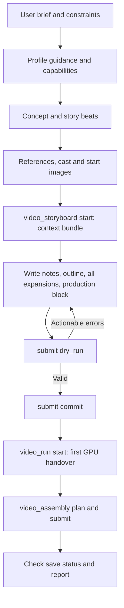

# Agent-directed video creation through MCP

Status: **Design proposal. No implementation is authorized by this document.**

Date: 2026-10-24 (revised after review the same day).

This document proposes extending Imagine's MCP support from images to complete,
agent-directed video productions. The agent plans the story, scenes, references,
generation modes and scene boundaries; Imagine validates, generates and
assembles. Production runs headless. The result is an ordinary saved Imagine
project that the user can open in the UI afterwards.

The proposal builds on Imagine's existing video domain and the
[video support design](../video-support-design.md). It does not supersede that
document's product decisions or authorize changes to inference settings,
startup, storage policy, or existing runtime restrictions.

## 1. Intended experience

A user asks an agent to make a video from a story idea without specifying every
scene, duration, reference assignment, or model variant. The agent:

1. Develops an open idea into a coherent sequence, or preserves a supplied story.
2. Chooses a total duration within the advertised envelope when none is supplied.
3. Chooses the number of scenes and sections and their relative pacing.
4. Identifies the characters, settings, objects and moments that need
   references, and reuses them consistently.
5. Uses supplied references and, when the request includes it, generates
   missing reference images or composed starting frames through image MCP.
6. Chooses Reference or I2V for each scene.
7. Chooses a hard cut or a continuous shot for each scene boundary.
8. Writes scene content following the selected prompt profile's guidance.
9. Validates the plan, fixes actionable problems, generates the scenes and
   assembles the final video.
10. Recovers from interruptions without regenerating successful scenes.
11. Saves the project and reports the final video and how to open the project.

### 1.1 Two user intents

“Design a video from this idea” ends with a reviewable plan. It does not imply
image generation, video generation, or service changes.

“Make a video from this idea” permits the agent to carry out the production
within the user's constraints, without mandatory approval pauses between
planning, generation and assembly. The agent asks only when an unresolved
choice materially changes the requested result or exceeds an established
boundary.

These are orchestration policies derived from the request, not new permission
switches that bypass existing project or session controls.

### 1.2 Headless production, UI hand-off

The agent does not use or change the UI. During production the project exists
only on the server side of the MCP session. The hand-off to the user is the
saved project: after the agent reports completion, the user can open it in the
existing UI to inspect, edit, regenerate or reassemble. Section 13.5 defines
the save and hand-off contract.

## 2. Scope and principles

### 2.1 First delivery

- The NSFW prompt profile as the initial, most complete reference profile.
- External-agent authoring without a second, local LLM call.
- Multiple scenes with multiple ordered sections.
- Per-scene Reference/I2V selection.
- Image references (cast identity, settings, required moments, start/end frames).
- Agent-selected hard cuts and continuous shots, with validated continuity.
- Revision-bound application, asynchronous runs, targeted recovery, assembly.
- Mandatory project save and a final report that lets the user open the result.
- Reuse of Imagine's existing project, take, storage and scheduling services.

Additional prompt profiles fit the same contract without separate orchestration.
Audio/video reference inputs, `blend_seam` and `transition` are exposed only once
the complete path supports them; their presence in the domain model is not
evidence of support.

### 2.2 Principles

**The agent owns creative decisions:** narrative, scene allocation, pacing,
reference meaning, generation mode, editorial boundaries, camera intent. Imagine
never chooses between Reference and I2V on the agent's behalf.

**Imagine owns deterministic execution:** exact timing, validation, model prompt
compilation, frozen inputs, jobs, takes and assembly.

**MCP is a thin adapter.** The MCP server is the proxy (`proxy/src/mcp.rs`), an
HTTP client of Imagine's `/v1` API. Every MCP tool maps onto an Imagine endpoint
(section 10.1); domain logic lives in Imagine, not in the proxy. No second
timeline, GPU queue, persistence system or prompt compiler.

**Creative intent and technical mechanism are separate.** A continuous shot is
an editorial intent; Motion Context or a last-frame bridge is a mechanism.

**Capabilities are explicit.** Unsupported combinations fail validation with an
actionable error instead of silently dropping references or changing modes.

**One schema, one source of guidance.** The agent produces the same profile
output shapes that the local authoring provider produces, parsed by the same
code; MCP exposes the same resolved profile text the UI path uses.

### 2.3 Non-goals

- A new editor, or the agent driving or changing the UI at runtime. The user
  opens the finished project with the existing folder picker (section 13.5).
- New inference models or changes to native sampling defaults.
- Director project import or compatibility with Director's external bridge.
- Automatic scans of historical projects, generated media, or personal files.
- A persistent production daemon or automatic job restart.
- Unlimited rerolls, or claims that a successful generation proves visual
  quality or narrative continuity.
- A requirement that the external agent use Imagine's configured authoring LLM.

## 3. Current source baseline

Observations from source inspection of the current checkout, not live-runtime
acceptance claims.

| Area | Existing foundation | Gap |
| --- | --- | --- |
| Image MCP | Profile discovery, full guidance, reference registration, single/batch generation, session-local job recovery with idempotent `job_id` | No video tools |
| Video API | Project create/open/read/edit/save, asset link/attach, capabilities, per-scene preflight and compiled view, runs, assembly | All routes needed except external authoring and profile text |
| Authoring profiles | Versioned resolution, inheritance, per-operation settings, immutable snapshots | Catalog serialization skips prompt text (`profiles.rs:131`); unknown profiles fall back with a warning (`Snapshot.fallback`) |
| Story authoring | Outline, expansion, review, timing, application into the project | Entry (`POST /v1/video/projects/{id}/authoring`) requires a provider; no direct path for externally written drafts |
| Story application | Builds scenes, sections, bindings and boundaries from a Draft; Append/Replace/Continue destinations | Always `ModelChoice::ProjectDefault`; every continuous scene gets `MotionContextExp` without audio (`engine.rs:378-416`) |
| Story timing | Weights become durations | Hard-coded 15 s scene cap (`engine.rs:253`); fails when the target exceeds 15 s × scene count |
| H3 variants | `reference` and `i2v` with different roles and continuity methods | Expose real constraints; validate per scene and boundary |
| Runs | Ordered targets, frozen seeds, dependencies, input guards, automatic take acceptance; modes MissingOnly, AllSameSeeds, AllFreshSeeds, SelectedWithDependents; required `Idempotency-Key` with `idempotency_conflict` on reuse (`runs_api.rs`, `scheduler_video_runs.rs`) | One active run per project (`run_already_active`) |
| Persistence | Bound projects autosave on every edit, authoring apply and take review (`persistence.rs:759-806`); private projects are bound at creation | Without private storage, a first save needs a user-selected location |
| Assembly | Plan (`/projects/{id}/assembly`) and job submission (`/assemblies/{id}/jobs`, required `Idempotency-Key`) | Distinguish scene completion from a finished video |

### 3.1 Constraints found in source

- H3 `i2v` advertises one First Frame image role and only `LastFrameFirstFrame`
  continuity (`src/video/adapters/h3.rs:61-64`).
- H3 `reference` advertises First Frame, Last Frame, Visual Reference, Video
  Reference, Voice Reference and Audio Reference roles, with Combo, Influence,
  Motion Context and Motion Context Exp continuity (`h3.rs:42-56`). Declarations
  are not proof that every combination is valid; execution validation decides.
- `BoundaryMode` has `hard_cut`, `continuous_shot`, `blend_seam` and
  `transition` (`crates/video-contract/src/assembly.rs:37`). The outline
  validator and schema accept only the first two (`engine.rs:22`,
  `visuals.rs:89`).
- Story image uses are `setting_reference`, `required_moment`, `start_frame` and
  `end_frame` (`crates/video-contract/src/authoring.rs:144`). Character identity
  comes from the request `cast`, not from an image use.
- Applied scene and section IDs are derived from the draft ID and ordinal
  (`engine.rs:289`), so re-applying a storyboard creates new IDs.
- The UI is not notified of server-side project changes; it re-reads the project
  after its own actions, on run state changes and on Refresh. Opening a project
  that a live session already holds reattaches to that session
  (`src/video/api.rs:452-454`).
- The UI's “Open project…” is a folder picker, also in private storage mode
  (`ui/src/video/mod.rs:1319-1356`). In private mode, private stores must be
  inside Imagine's private root (`src/video/bundle.rs:296-317`) and a private
  project must sit at `<private root>/projects/<id>`
  (`src/video/persistence.rs:962-969`). No endpoint lists private projects.

## 4. Responsibility boundaries

| Decision or operation | External agent | Imagine |
| --- | --- | --- |
| Develop or adapt the story | Yes, within the requested scope | Supply guidance, accept structured output |
| Scene and section counts | Yes | Enforce limits and timing feasibility |
| Pacing | Relative weights, target duration | Exact durations, frame alignment, delivery timing |
| Reference meaning | Cast, setting, moment, start/end frame | Validate assets, materialize bindings |
| Generation mode | `reference` or `i2v` per scene, required | Resolve settings, reject unsupported inputs |
| Scene boundary | Editorial intent, optional explicit method | Validate compatibility, resolve `auto` method, compile |
| Content | Scene prose, action, camera, dialogue, sound | Resolve references, compile model syntax |
| Queue work | Start a run on the applied project | Existing scheduler and GPU coordinator |
| Retry | Within the production budget | Revision checks, dependency invalidation |
| Save and publish | Request save and assembly, report results | Save to private storage, assemble, publish |

The agent never invents H3 picture numbering, native latent references, frame
alignment, internal media paths or project IDs.

## 5. Planning model and submission schema

### 5.1 Decision: context bundle, then one complete submission

The whole video — outline, scenes, sections, references, models and
transitions — is written and validated before the GPU is handed over for
generation. Authoring on the MCP path never calls the local authoring LLM and
never requests the GPU; `video_run start` is the only GPU handover. This
matters because the local models load slowly.

The provider path runs image inventory (one call per image), the outline, and
one expansion per scene, building each system prompt and user message in code
(`src/video/authoring/drafts.rs`). On the MCP path the agent writes all of it in
one pass:

1. **Start** an ordinary authoring Draft with `provider: "external"` and the
   existing request fields (`prompt_profile_id`, `brief`, `instruction`,
   `duration_seconds`, `destination`, `cast`, `images`, `add_dialogue`,
   `add_music`, `expected_project_revision`). No provider task is started. The
   response is the **context bundle**:
   - the inventory, outline and scene-expansion system prompts, verbatim from
     the profile (dialogue variants as selected; schema placeholder filled);
   - the outline and expansion user messages rendered with every fixed context
     block. Expansion messages mark three per-scene slots the agent fills from
     its own work: `<previous_scene_context>`, `<next_scene_summary>` and
     `<scene_json>`;
   - every story image as the same normalized JPEG the provider receives, and
     the selected cast's identity images, labelled by role;
   - profile revision, prompt files and planning limits.
2. **Write** inventory notes, the outline, one expansion per scene and the
   production block.
3. **Submit** everything in one call, first with `dry_run: true`. The server
   uses the provider path's functions in order: inventory, outline projection
   (assigning scene/section IDs and image bindings), expansions (after filling
   their code-owned ID and image fields from the projected outline), cast and
   duration checks, then the apply plan with the production block, validated on
   a candidate project. All-or-nothing; errors name `outline`, `expansions[i]`
   or `production.scenes[i]` with a stable code and change nothing. With
   `dry_run: false` the plan is applied atomically.

The **production block** carries choices the profiles do not produce, aligned
to the outline's scene order and stored on the Draft:
   - `model`: `reference` or `i2v` (required; no `auto`).
   - `continuity`: for scenes with `continuous_shot`, `method` (`auto` or an
     explicit `ContinuityMethod`) and `include_audio`.
   - `rationale`: optional planning note, never compiled into a prompt.

Rationale:

- Profile text is delivered verbatim and its output instructions match what the
  server parses. Profiles are never edited for the MCP path.
- The agent's context equals the provider's: the per-scene slots hold values
  the agent wrote itself, and a test proves that filling them with the
  provider's values reproduces the provider's messages byte for byte.
- One parser, validator and projection for both paths; no second schema.
- Two calls author the whole video, with no GPU and no local model involved.
- Production choices stay out of creative text and out of compiled prompts.

Applying the Draft extends the current application in two places: scenes take
`ModelChoice::Override` with the requested variant instead of always
`ProjectDefault`, and continuous scenes take the resolved continuity instead of
a hard-coded `MotionContextExp`. The provider path keeps its current defaults
until it gains the same fields.

The bundle's images are returned to the agent as image content, so it can
write prompts that fit them; this needs only the images, not the GPU. This is the
explicit, supported authoring operation on task-authorized media; image MCP's
rule against inspecting images during delivery acknowledgement is unchanged.

### 5.2 Scene and section semantics

A scene is one generation unit with a model choice, references, ordered
sections and an incoming boundary. A section is an ordered action unit inside
one scene: connected action, reactions, pose changes, dialogue turns or camera
development. A section is not a new clip, cut or I2V starting point; an image
bound to a later section is not a second I2V input.

Outline scene ordinals serve as authoring keys before application. The apply
result returns the mapping from ordinal to canonical scene and section IDs.
After application, focused revisions use typed edits on those canonical IDs.
Re-applying a whole storyboard with `replace` creates new IDs and discards the
earlier takes; the agent uses it only for a deliberate restart.

### 5.3 Continuity facts

During authoring the agent tracks the established state of visible characters,
location, time, lighting, clothing, position and pose, handled objects,
completed versus ongoing actions, and completed versus continuing dialogue and
sound. This lives in the agent's bounded authoring context, derived from scene
content. No persistent world-state subsystem is required.

## 6. Prompt profiles and agent instructions

### 6.1 Use the NSFW profile as the initial source

Start with the existing NSFW templates for outline, scene expansion, dialogue
variants and Animate image, plus inherited guidance such as image inventory.
Profile text is delivered **verbatim**: never edited, shortened, sanitized or
softened for the MCP path, and no MCP-only copy exists. The only substitution
is the existing `{{STORY_OUTLINE_JSON_SCHEMA}}` placeholder, exactly as the
provider path does it.

Guidance reaches the agent in two places:

- `describe_video_profile`, before a Draft exists: profile ID, revision,
  prompt files and inheritance, the shared agent guidance (section 6.3), and
  planning limits from capabilities. Provider generation settings are labelled
  informational metadata; the external agent cannot apply temperature or token
  limits to itself.
- The Draft's **context bundle** (section 5.1): the full effective system
  prompts, the user messages with their context blocks, the dialogue/image
  variants actually selected, the resolved output schemas, and the images.

Results are ordinary tool results, so the path does not depend on a client
loading MCP prompts or resources.

### 6.2 Exact profile resolution

The MCP path requires the requested profile to exist. A resolution that would
set `Snapshot.fallback` is an error (`profile_not_found`), not a substitution.
Operation inheritance inside a profile (for example `story_outline` resolving to
`story_generation`) is allowed and reported in the inheritance information.

### 6.3 Instruction layers

1. Shared agent guidance: the bundle and its slots, production block, Reference/I2V
   selection, boundary mechanisms, Develop versus Adapt. A separate source file
   outside the profiles, never sent to the local provider, with no content
   restrictions and nothing that overrides profile text.
2. Selected profile: narrative style and content guidance, verbatim.
3. Operation: concept development, outline, expansion or image animation.
4. Task context: brief, established concept, selected references, neighbouring
   scenes, and current capability constraints.

Task text and asset labels are task data. They cannot override tool schemas,
session protections or model limitations.

### 6.4 Concept development

Existing story templates avoid inventing significant events when a story is
supplied. That suits adaptation but not an open request such as “make a story
about a night courier.” The shared agent guidance distinguishes:

- **Develop:** the agent creates the plot progression within the user's
  premise and passes it as the Draft `brief`.
- **Adapt:** the agent passes the supplied story as the `brief` unchanged.

Once established, the brief is the story source for outline and expansion, so
the profile's own rules apply unchanged. No profile file is modified for this.

### 6.5 Shared mode and boundary guidance

Reference/I2V and boundary selection are common concerns. Expose them as shared
guidance combined with live capabilities, not static tables copied into each
profile. The adapter keeps ownership of final model syntax.

Selecting the NSFW video prompt profile is independent of the image MCP's
`nsfw` LoRA switch. Preparing a video with the NSFW profile never activates
that switch; the existing image MCP rules for it still apply when the agent
generates reference images.

## 7. Scenes, sections and duration

### 7.1 Planning procedure

1. Identify distinct events, physical transitions, reactions and state changes.
2. Remove accidental retellings of the same occurrence.
3. Estimate time for visible movement, dialogue, listening and pauses.
4. Group compatible beats into sections, and sections into scenes that fit the
   scene cap.
5. Choose boundaries by editorial intent, not clip length alone.
6. Allocate weights and let Imagine compute exact timing.
7. Revise when the plan cannot fit without omitting essential action or
   exceeding the user's limits.

A long continuous event becomes several scenes joined by continuous shots. A
simple event does not gain decorative scenes to fill a target duration.

### 7.2 Decision: one advertised scene cap

Decided: the enforced 15-second application cap is the single authoring policy.
One constant replaces the literal in `durations()` calls and in the outline user
message, which already tells the model “Every Scene must fit 15 seconds”
(`drafts.rs:582`). `video_capabilities` advertises the same value as
`max_scene_seconds`. The profile templates are not changed: the code-built user
message is the enforcement point, as it is today. Raising the cap later is one
change to that constant. Model generation limits and assembly timing remain
separate constraints.

A target duration above `max_scene_seconds` × scene count fails with
`story_scene_duration_capacity`. The dry-run response reports the
minimum scene count needed, so the agent can restructure instead of guessing.

### 7.3 Requested versus effective timing

Validation and apply results report requested total and per-scene durations,
effective generated duration and frame count per scene, any overlap, trim or
transition contribution, effective final duration, and a stable reason for each
difference. The agent never computes native alignment. A request for an exact
final length either compiles to a valid delivery plan or returns a constraint
error.

## 8. References and Reference versus I2V

### 8.1 Semantic roles mapped to existing types

| Role | Existing representation | Distinction |
| --- | --- | --- |
| Character identity | Request `cast` | Preserves identity; does not fix the frame or pose |
| Setting | `StoryImage` usage `setting_reference` | A different room is not the same setting |
| Required moment | usage `required_moment` | Depicted at a suitable point, not necessarily first |
| Start frame | usage `start_frame` | The direct I2V input |
| End frame | usage `end_frame` | Only for a variant that supports a Last Frame role |
| Video, voice, audio | Not exposed in the first delivery | Exposed once admission and execution support them |

No separate MCP reference system.

### 8.2 Mode selection

| Intent | Decision |
| --- | --- |
| New shot from identity and setting references | `reference` |
| Animate a specific image from its composition | `i2v` |
| Several independent visual references in one scene | `reference` |
| Continue from the previous clip's last frame | `i2v` with `LastFrameFirstFrame` |
| Continue motion from compatible prior-generation context | `reference` with a supported motion method |
| Exact starting composition that does not exist yet | Generate a composed start frame, then `i2v` |
| No reference inputs | `reference` with no inputs (its wire profile is `AvNoReferenceV2`) |

The number of available images is not the deciding factor.

### 8.3 Reference preparation and reuse

Register only references made available for the task and reuse their asset IDs
throughout the project. Image MCP reference IDs are profile-bound and are not
video asset IDs. An image generated through image MCP is registered with the
video project by its published `saved_path`, through the existing link route.
Delivery IDs, image MCP reference IDs and video asset IDs stay distinct.

Independent reference images are generated in one `generate_batch`. A composed
start frame that depends on earlier character references is generated after
them.

Registration is not visual understanding. Image inspection is only available as
an explicit, supported authoring operation on task-authorized media. Delivery
acknowledgement never triggers vision analysis. Without inspection, the agent
uses supplied descriptions, reports the limitation and does not invent unseen
image content.

## 9. Boundaries and continuity

### 9.1 Editorial boundary

| Boundary | Choose when | Do not assume |
| --- | --- | --- |
| `hard_cut` | A deliberate cut to a different view, location, time or beat | That clothing, weather, object state or identity reset |
| `continuous_shot` | The same visible action continues without an intended cut, including a split forced by the scene cap | That text alone provides visual continuity |

The first delivery accepts only these two, as the current outline schema does,
and states so in capabilities. `blend_seam` and `transition` remain domain
concepts for a later stage; they are not silently mapped.

The first scene has no incoming boundary unless it continues an existing
timeline (`destination: continue`). The schema's first-scene `hard_cut` is a
convention, not a dependency on an earlier clip.

### 9.2 Continuity by target variant

The target scene's variant determines which methods can implement a continuous
shot:

| Target scene | Hard cut | Continuous shot methods | Conflicts to reject |
| --- | --- | --- | --- |
| `i2v` | No conditioning | `LastFrameFirstFrame` only | An explicit `start_frame` on the scene; missing accepted source take at admission |
| `reference` | No conditioning | Combo, Influence, Motion Context, Motion Context Exp | Source take or artifacts incompatible with the method; unsupported audio carry-over |

Source compatibility depends on more than the model name: source take identity,
artifact availability, geometry, timing and audio requirements. Whether an
`i2v` source can feed a motion method of a `reference` target is decided by
execution validation, and capabilities must state the answer.

`method: auto` resolves deterministically: to `LastFrameFirstFrame` for `i2v`
targets, and to the advertised default for `reference` targets (open decision
3). The resolved method is reported before generation. `include_audio` defaults
to the current behaviour (off).

A last-frame bridge carries an opening image, not velocity, motion or audio.
Reports never promise seamlessness because the bridge is valid.

### 9.3 Narrative state survives a cut

Each scene opens from the previous scene's resulting state plus only the
changes the story establishes. Restating a state is not replaying an action: a
character already seated starts seated. For hard-cut scenes, the new scene's
content states the required visual state when its images do not supply it; the
video model never sees the previous scene's text.

### 9.4 Example

A courier approaches a workshop door, opens it, enters and places a parcel on a
workbench.

- Approach and door opening exceed one scene but should read as one take: two
  `reference` scenes joined by `continuous_shot`, method `auto`.
- The view from inside the workshop: `hard_cut`. Courier, parcel, door state and
  time still agree with the preceding action.
- A close-up of the parcel: another `hard_cut`, no time jump.
- If the close-up must start from an exact composition: generate that start
  frame and make the scene `i2v`.

### 9.5 Boundary validation

Validate the chronological edge and the conditioning source; they are not
necessarily the same scene in the domain. Reject or report missing source
scenes, dependency cycles, unavailable or incompatible source takes,
unsupported variant combinations, an explicit first frame conflicting with
conditioning, unsupported audio carry-over, and invalid overlap or trim timing.

A continuous sequence planned before any rendering has future source takes.
Validation records the dependency instead of rejecting the sequence; exact
artifact checks run when the dependent scene is admitted. An impossible
dependency remains a blocker.

## 10. MCP tool surface

### 10.1 Tools and backing endpoints

Eight tools, grouped by object with an `action` argument where several
operations share one object. Names and shapes are proposals.

| Tool | Actions | Imagine endpoint | Status |
| --- | --- | --- | --- |
| `list_video_profiles` | — | `GET /v1/video/authoring/profiles` | Exists |
| `describe_video_profile` | — | `GET /v1/video/authoring/profiles/{id}` (strict) | **New**: profile metadata, shared agent guidance, limits |
| `video_capabilities` | — | `GET /v1/video/capabilities` | Exists; extend with `max_scene_seconds`, supported boundaries and the section 9.2 continuity table |
| `video_project` | `create` (with the agent's `path`), `get`, `edit`, `save` | `POST /v1/video/locations` (`create: true`), `POST /v1/video/projects/at-location`, `GET /v1/video/projects/{id}`, `POST …/edits`, `POST …/save` | Exist, plus the at-location route and the `create` flag (section 13.5) |
| `video_register_reference` | — | `POST /v1/video/assets/link`, then `POST /v1/video/projects/{id}/assets`; optional cast entry through a new typed `UpsertVisualReference` edit | Exist, plus one edit variant |
| `video_storyboard` | `start`, `submit`, `get`, `review`, `list`, `bundle` | `POST /v1/video/projects/{id}/authoring` (`provider: "external"`, returns the bundle), `POST /v1/video/authoring/{id}/submission`, `GET /v1/video/authoring/{id}`, `POST …/review`, `GET /v1/video/projects/{id}/authoring`, `GET /v1/video/authoring/{id}/bundle` | Start/get/review exist; **new**: external provider mode with bundle, one-call submission with production block and dry run, Draft listing and bundle refetch for recovery |
| `video_run` | `start`, `get`, `stop` | `POST /v1/video/runs`, `GET /v1/video/runs/{id}`, `POST …/stop` | Exist |
| `video_assembly` | `plan`, `submit`, `get` | `POST /v1/video/projects/{id}/assembly`, `POST /v1/video/assemblies/{id}/jobs`, `GET /v1/video/assemblies/{id}` | Exist |

New Imagine endpoints for the MCP tools: profile description and Draft
submission. Everything else is a proxy mapping plus extensions of existing
endpoints.

### 10.2 Dry run, not a stored plan

A submission with `dry_run: true` parses everything, builds the edit plan with
the production block, applies it to a copy of the project document with the
same candidate validation `apply_authoring` uses, runs per-scene preflight on
the copy, and discards it. With `dry_run: false` the same steps run against
`expected_project_revision` and commit atomically. There are no plan IDs or
stored plans: the Draft and the project revision are the binding.

### 10.3 Validation response

Validation and apply results include the project revision, profile and
capability revisions, resolved scenes with model and continuity, requested and
effective timing, reference bindings, dependencies, warnings and blockers. They
distinguish:

- Structurally valid authoring.
- A feasible sequence with pending upstream takes.
- Current runtime readiness.

A plan can be valid while the runtime is unavailable; it is never reported as
runnable when an execution prerequisite is missing.

Errors identify the scene, section or boundary, a stable code, the field path,
a concise explanation and supported corrections. The agent may fix technical
problems automatically when that preserves user intent. It never resolves a
conflict by dropping a required reference or changing an explicitly requested
shot.

### 10.4 Idempotency and recovery

Run start and assembly submit already require an `Idempotency-Key`; reuse with
the same request returns the existing operation (`reused`), and reuse with a
different request is `idempotency_conflict`. `video_run start` and
`video_assembly submit` take a caller-chosen `job_id`, which the proxy forwards
as `mcp-<session>-<job_id>` so MCP keys never collide with UI keys. The proxy
keeps no fingerprints for video.

Submissions recover from the Draft itself: `video_storyboard get` shows
whether the Draft is in review or `applied`. A repeated committing submission
finds the Draft already applied and changes nothing. After a timed-out
`start`, `video_storyboard list` finds the project's Drafts and `bundle`
returns the bundle again. A retried `video_project create` at the same folder
returns the project already created there.

A timeout is not a failure and never triggers a new submission; the agent
recovers with the same `job_id`, run ID or Draft ID. A client disconnect does
not cancel an admitted run.

## 11. Illustrative exchange

A semantic sketch, not a final schema. Two `reference` scenes joined by a
continuous shot.

**Start** (`video_storyboard start`): the existing authoring request with
`provider: "external"`.

```json
{
  "schema_version": 1,
  "expected_project_revision": 3,
  "provider_profile_id": "",
  "provider": "external",
  "prompt_profile_id": "nsfw",
  "operation": "outline",
  "brief": "A night courier delivers a parcel to a workshop.",
  "instruction": "",
  "duration_seconds": 24,
  "destination": "replace",
  "cast": ["ref_courier"],
  "images": [
    {"id": "workshop_exterior", "asset": "asset_example", "label": "Workshop exterior", "usage": "setting_reference"}
  ],
  "add_dialogue": false,
  "add_music": false
}
```

The response is the context bundle: the inventory, outline and expansion
prompts (the outline system prompt is the profile's `story_outline.txt` with
only the schema placeholder filled in), the rendered user messages with the
expansion slots marked, and the images.

**Submit** (`video_storyboard submit`, first with `dry_run: true`): everything
in one call. `outline` and each `expansions` entry are answer strings; the
outline is shown as JSON here for readability, and the expansions, each a
`StoryScene` JSON per the bundle's schema, are abbreviated.

```json
{
  "schema_version": 1,
  "expected_project_revision": 3,
  "dry_run": true,
  "inventory": [{"id": "workshop_exterior", "note": "<agent's inventory note>"}],
  "outline": {
    "scenes": [
      {
        "title": "Arrival at the workshop",
        "summary": "The courier approaches the workshop with a parcel.",
        "description": "A night exterior. The courier approaches the closed door.",
        "ambient_sound": "Distant traffic, footsteps on wet stone.",
        "non_diegetic_music": "",
        "weight": 1,
        "boundary_from_previous": "hard_cut",
        "setting_reference_matches": {"workshop_exterior": true},
        "sections": [
          {"prompt": "The courier walks toward the door carrying the parcel.", "weight": 2},
          {"prompt": "The courier stops and reaches for the handle.", "weight": 1}
        ]
      },
      {
        "title": "The door opens",
        "summary": "The courier opens the door while holding the parcel.",
        "description": "The courier is at the door, parcel held, hand at the handle.",
        "ambient_sound": "Distant traffic, a latch clicks.",
        "non_diegetic_music": "",
        "weight": 1,
        "boundary_from_previous": "continuous_shot",
        "setting_reference_matches": {"workshop_exterior": true},
        "sections": [
          {"prompt": "The courier turns the handle and opens the door, keeping hold of the parcel.", "weight": 1}
        ]
      }
    ],
    "visual_placements": []
  },
  "expansions": ["<scene 1 StoryScene JSON>", "<scene 2 StoryScene JSON>"],
  "production": {
    "scenes": [
      {"model": "reference"},
      {
        "model": "reference",
        "continuity": {"method": "auto", "include_audio": false},
        "rationale": "Same action and camera view across a scene-cap split."
      }
    ]
  }
}
```

When the dry run is valid, the same submission with `dry_run: false` applies it.
Cast prose uses the exact protected markers the bundle supplies (`@alias` from the
project cast); the plain nouns here are placeholders for readability.
Rationales are planning metadata and never reach a compiled prompt.

## 12. End-to-end flow



Planning may iterate before all references exist; applying requires valid
bindings or an explicit upstream dependency.

Scene expansion runs in story order. Each expansion receives the previous
scene's resulting state, the current scene's allocated progression and enough of
the next scene to know where to stop, not an unbounded history.

The validated sequence runs as one run, so the agent does not orchestrate each
GPU handoff. The scheduler keeps control of the shared queue; this neither
promises exclusive GPU ownership nor adds a queue policy.

## 13. Runs, recovery, saving and hand-off

### 13.1 Admission

A run binds to the project revision, resolved model settings, seeds, reference
identities and the relevant profile and capability snapshots. Admission
revalidates prerequisites that may have changed since validation.

### 13.2 Failure and retry

On failure the run reports completed scenes, the failed scene with a stable
code, unstarted dependents and the allowed recovery. Recovery uses the existing
modes: `MissingOnly` to continue, `AllSameSeeds`/`AllFreshSeeds` for full
regeneration, `SelectedWithDependents` for one scene and everything after it.
Arbitrary subsets are not in the first contract (open decision 4).

Retries are bounded by the production budget. Technical retries and creative
rerolls are counted separately; a new seed or changed content is a new creative
attempt, not a transparent recovery.

### 13.3 Revision guards

Every mutation carries the expected project revision, so the agent can never
overwrite a change it has not seen. In the headless model nobody else edits the
project during production; if a conflict does occur, the agent re-reads the
project and revalidates instead of retrying blindly.

An upstream edit or a different accepted take invalidates downstream continuity
through the existing input-revision and boundary logic. An outdated take is not
eligible for assembly.

### 13.4 Automatic acceptance is not quality review

The run accepts technically valid takes automatically, as the run service does
today. Acceptance means the take matches its submitted input revision and can be
used downstream. It does not mean the acting, anatomy, identity, motion or
editing are visually correct. Visual review is a separate, explicitly supported
operation; the agent never claims to have inspected results it did not inspect
within its data-access permissions.

### 13.5 Saving and hand-off

Unsaved projects disappear with the session, so durability is part of
production:

- **Where:** a project path the agent gives the MCP in `video_project create`,
  a new or empty folder. The whole production (project document, outputs, work
  files) lives there. The proxy checks the path is inside the MCP input
  directory; a retried create at the same folder returns the same project. The
  server accepts it only inside a configured project root on the verified
  encrypted volume (`private_project_roots`, default the MCP input directory
  `/run/media/veracrypt1/mcp-inputs`) or inside Imagine's private root. Paths
  outside the encrypted volume are refused, so the encryption policy is
  unchanged. Today's code allows private projects only at
  `<private root>/projects/<id>`, so this needs one shared path guard and
  layout resolution from the project's bound folder (implementation plan WP5).
  The project is saved at creation.
- **When:** automatically. A bound project autosaves on every edit, authoring
  apply and take review, and runs accept takes through review
  (`persistence.rs:759-806`, `runs.rs:203`). An interrupted production
  therefore leaves an openable project with every accepted take.
- **Verified, not assumed.** The agent reads the save status in each project
  snapshot, calls `video_project save` only when the status is not saved, and
  reports a production complete only when the final status is saved.

The final report contains:

- Project path, project ID and save status, so the user can open the project
  in the UI.
- Assembly ID and completion state.
- Published video path, format, size and available integrity metadata.
- Requested and effective final duration.
- Scene and take provenance.
- Warnings and the absence of visual review, where applicable.

Report published paths directly. No MCP-specific media copy or cache, and no
claim that a host path is reachable inside a container without a verified
mapping.

#### Opening the result in the UI (requirement)

The user must be able to open the agent's project in the UI. Because the agent
reports the project path, the existing “Open project…” folder picker opens it:
the server's open-from-location path accepts a private project inside an
approved project root (implementation plan WP5). No UI change is required.

A list of private projects with an “Open private project” window remains
optional later work (Stage 3), useful for projects in Imagine's own private
root. Projects have no title field today; such a list would show the first
scene title.

Alternative considered: saving the result into the user's Library and opening
it through the existing Library “project copy” action creates a new project
from the library entry, separate from the agent's project, its runs and its
take provenance, so it is not the hand-off.

The project is meant to be opened after the report. Opening it earlier attaches
the UI to the same live project, not a copy; the UI may show an outdated state
until its next refresh, and revision guards prevent either side from
overwriting the other.

### 13.6 Restart boundary

Run state is session-local. No durable jobs, no automatic restart. After a
session ends, an old run ID is not presented as recoverable. A saved project can
be reopened for a new, validated run for missing or outdated scenes, with a new
admission identity.

## 14. Data handling

Keep the current loopback and session protections and separate MCP
authentication. Reference access, media ingress, saving and publication use the
existing validated paths and storage services.

| Data | Lifetime |
| --- | --- |
| Source-owned profiles and guidance | Repository/configuration |
| MCP job tracking, authoring Drafts before apply, unsaved session state | Current session |
| Saved projects and published media | Existing product persistence policy |

No persistent transcript of submitted prompts and no disk-backed job history.
Progress events carry no prompt bodies, reference contents or raw native logs.
Tool results return the minimum project scope needed for the current step.
Image MCP result registration follows current source behaviour, not historical
export-cache descriptions. Storage ownership and encryption policy are
unchanged.

This document was written from source and guidance only; implementation and
validation follow the same runtime-data rules in `AGENTS.md`.

## 15. Implementation sequence

Proposed work, not an instruction to start. Work packages, files and tests are
in [MCP-VIDEO-IMPLEMENTATION-PLAN.md](MCP-VIDEO-IMPLEMENTATION-PLAN.md).

### Stage 1: Thin end-to-end path

- `max_scene_seconds` as one constant in the outline message, `durations()` and
  capabilities. No profile edits.
- Message building and answer parsing extracted from the provider path, then
  the external provider mode: context bundle and one-call submission; strict
  profile resolution; shared agent guidance file.
- Production block and dry run: per-scene `ModelChoice::Override`, hard cuts
  and continuous shots with `auto` continuity only.
- Agent-selected project path inside approved roots on the encrypted volume,
  opened from the UI with the existing folder picker.
- Proxy tools with forwarded idempotency keys, per-action timeouts and image
  content in the bundle.
- A synthetic end-to-end test through the proxy, asserting no GPU request
  before `video_run start`.

### Stage 2: Explicit continuity and recovery

- Explicit continuity methods, `include_audio`, and capability reporting of
  source compatibility.
- Recovery through existing run modes; retry budget accounting.
- Default production budget.

### Stage 3: Additional profiles and capabilities

- Normal/Creative and other profiles through the same resolver.
- `blend_seam`, `transition`, and video/audio references once the end-to-end
  path supports them.
- Optional private project list and “Open private project” window in the UI.
- Optional local-provider authoring through MCP, or explicit visual review, as
  separately scoped capabilities.

## 16. Verification and acceptance

No tests or runtime checks were run for this document. Keep synthetic,
manual and live-generation evidence separate.

### 16.1 Synthetic contract checks

| Case | Expected result |
| --- | --- |
| NSFW system prompts in the bundle | Byte-identical to the profile files except the schema placeholder |
| Bundle expansion slots filled with the provider's values | Identical to the provider's user messages; same images |
| Unknown profile | `profile_not_found`; no fallback |
| Malformed outline, wrong expansion count, changed structure | Error naming `outline` or `expansions[i]`; nothing changed |
| External submission and provider answers with the same content | Identical Drafts and project edits |
| Target duration above `max_scene_seconds` × scenes | Error with the minimum scene count |
| Long continuous action | Several scenes with continuous boundaries |
| Hard cut after a state change | State persists; completed actions are not replayed |
| `i2v` with one start frame | Accepted when other constraints hold |
| `i2v` with setting references or a later-section frame | Actionable rejection, nothing dropped |
| Continuous shot into `i2v` with an explicit start frame | Blocker on that boundary |
| Mixed `reference`/`i2v` project | Per-scene model retained; every boundary checked |
| Continuous scene with a future source take | Dependency recorded; artifact check at admission |
| Dry run then `apply` with a changed revision | `apply` rejected atomically |
| Repeated run start or assembly submit with the same `job_id` | `reused`; no duplicate work |
| Same `job_id`, different arguments | `idempotency_conflict` |
| Project state after each production step | Saved without an explicit save call |
| Failure in a middle scene | Earlier takes remain; dependents do not proceed |
| Changed upstream take | Downstream results become outdated |
| Stop without cancel | No new admission; active job continues |
| Session restart | Old run not resumable; saved project reopens |
| Assembly incomplete or outdated | No claim of a finished video |
| Image MCP result reused in video | Registered by `saved_path`; no ID-domain confusion, no extra cache |
| Create at a path inside an approved root | Project saved there; reopens from the same path |
| Path outside approved roots or the encrypted volume, or a non-empty folder | Refused with a stable code |
| Authoring through submission | No authoring-provider or GPU request before `video_run start` |

Use synthetic media and isolated temporary stores. Do not read real job history
or user media to build fixtures.

### 16.2 Manual and live acceptance, when separately authorized

- Produce a short sequence with at least one hard cut and one continuous shot.
- Exercise a mixed `reference`/`i2v` project.
- Interrupt the client, recover the same run, confirm no duplicate generation.
- Interrupt the session mid-run; confirm the saved project opens with the
  completed takes.
- Open the finished project from the reported path with “Open project…”; edit scenes, references, models and boundaries; regenerate one scene and
  reassemble.
- Verify the assembled video's duration, playback and audio.

Rendered continuity and quality need inspection of authorized outputs; schema
tests cannot establish them.

### 16.3 Completion bar for the first implementation

An agent takes an authorized story-to-video request through profile discovery,
planning, references, per-scene mode selection, boundary selection, validation,
generation, assembly and a saved project that the user can open in the UI,
with reliable recovery. A single-scene `generate_video(prompt)` tool does not
meet this bar.

## 17. Open decisions

Settled: complete storyboard authored before any GPU handover, through a
context bundle and one submission (5.1); the agent sees the reference images
(5.1); verbatim profile text (6.1); 15-second scene cap without profile edits
(7.2); no generation-mode `auto` (2.2); agent-provided project path on the
encrypted volume with autosave (13.5); opening from the UI with the existing
folder picker (13.5); server-side idempotency keys (10.4); dry run without
stored plans (10.2).

Still open, none blocking Stage 1:

1. The default duration and production budget when the user supplies only an
   idea.
2. The supported subset of `blend_seam` and `transition` for Stage 3.
3. The default method for `auto` continuity into a `reference` target (the
   current Story path uses Motion Context Exp).
4. Whether the first contract needs arbitrary scene subsets beyond the existing
   run modes, and their dependency policy.

## 18. Source map

Source pointers, not live-runtime verification.

| Source | Relevance |
| --- | --- |
| [Video support design](../video-support-design.md) | Product architecture and decisions |
| [MCP tool catalog](../config/mcp/tools.json) | Current image tool surface |
| [MCP instructions](../config/mcp/instructions.txt) | Image guidance, reference rules, recovery, delivery |
| [MCP server](../proxy/src/mcp.rs) | Tool dispatch, session state, per-call timeout, image `job_id` fingerprints |
| [Authoring drafts](../src/video/authoring/drafts.rs) | Provider messages, answer parsing, review, expansion |
| [Media bundle store](../src/video/bundle.rs) | Private store path guards |
| [Run scheduling](../src/scheduler_video_runs.rs) | Run idempotency keys, one active run per project |
| [Assembly scheduling](../src/scheduler_assembly.rs) | Assembly idempotency keys |
| [Project persistence](../src/video/persistence.rs) | Autosave, authoring apply, private open and save |
| [Storage layout](../shared/storage_layout.rs) | Private project directories |
| [Core API](../src/api.rs) | Asset link route, jobs, sessions |
| [Video API](../src/video/api.rs) | Project create/open/edit/save, capabilities, preflight, compiled view |
| [Authoring API](../src/video/authoring_api.rs) | Provider-bound authoring lifecycle |
| [Runs API](../src/video/runs_api.rs) | Run start, read, stop |
| [Assembly API](../src/video/assembly_api.rs) | Assembly planning and job submission |
| [Profile resolver](../src/video/authoring/profiles.rs) | Inheritance, snapshots, fallback, skipped prompt serialization |
| [NSFW profile](../config/video/prompt-profiles/nsfw/profile.json) | Initial prompt-profile manifest |
| [Authoring engine](../src/video/authoring/engine.rs) | Validation, timing cap, Draft application, current continuity default |
| [Visual projection](../src/video/authoring/visuals.rs) | Context-dependent outline schema and image placement |
| [Shared authoring types](../crates/video-contract/src/authoring.rs) | Request, StoryImage, Storyboard, Draft, destinations |
| [Shared project contract](../crates/video-contract/src/contract.rs) | Scenes, model choices, continuity methods |
| [Creative contract](../crates/video-contract/src/creative.rs) | Scene source fields and section bindings |
| [Editing contract](../crates/video-contract/src/editing.rs) | Revision-bound typed edits and candidate validation |
| [Boundary contract](../crates/video-contract/src/boundary.rs) | Editorial edge and conditioning-source resolution |
| [Assembly contract](../crates/video-contract/src/assembly.rs) | Boundary modes and delivery intent |
| [H3 adapter](../src/video/adapters/h3.rs) | Variant roles and continuity methods |
| [H3 binding compiler](../src/video/adapters/h3/bindings.rs) | Role projection, conflicts, prompt construction |
| [Execution](../src/video/execution.rs) | Admission and frozen reference prerequisites |
| [Run service](../src/video/runs.rs) | Seeds, targets, dependencies, guards, acceptance |
| [Run contract](../crates/video-contract/src/runs.rs) | Run modes and states |
