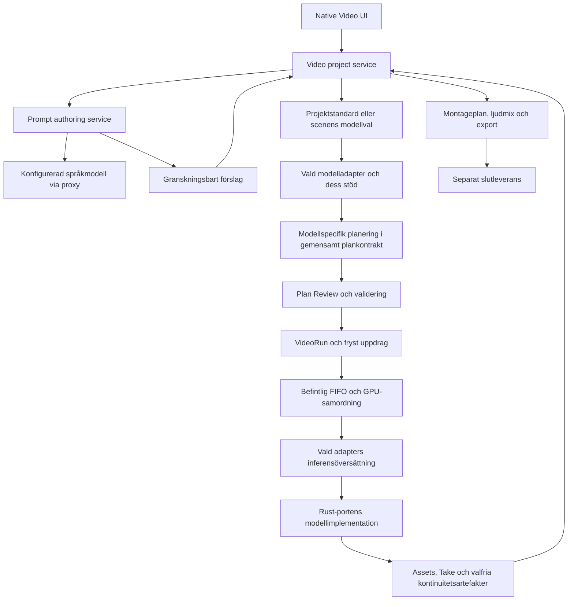

# Video support design — Imagine

Status: **Full implementation enligt P01–P09 godkänd av Tomas 2026-10-20 för isolerat nattarbete. Timeline, modellneutral arkitektur, projektlagring och avancerad H3 enligt D10 gäller. P01 och P02:s lagringsgrund finns; ett senare integrerat enscens-H3/I2V-flöde finns också. Detta är inte full Timeline-/Director-paritet. Återstående integration och acceptans spåras per funktion.**
Senast uppdaterat: 2026-10-21.

**CHECKPOINT-23:** Texttolkningen följer nu Directors Python 3.12 även för
Unicode-ordgränser, alla Python-blanksteg, radbrytningar och skiftlägesokänsliga
ASCII-uttrycks fyra extra Unicode-tecken; 2 964 rena källorakelfall passerar.
Castbilder och röster har bildbidrag, relationsmål/-notering och individuella
röstinställningar samt globalt referensval. Hela deras Reference-manifest matchar
Director i 64 fall, inklusive relationskedjor/cykler, ordning och summeringar.
Native UI har verifierat redigering, kompilerad källa, avstängning, sparning,
kall återöppning och återaktivering i 81 + 32 åtgärder. Workspace: 359 gröna tester.
Det slutaccepterar inte Section/video/timeline-audio-/boundary-projektionen
eller faktisk medietransport och GPU-konditionering. Dessa, full Story, P08,
minnesparitet och det nekade Exp-provet är fortsatt separata öppna krav.

**CHECKPOINT-22:** H3:s Reference/I2V-promptkompilering och dialogmarkörer,
Enhance-referensskydd och dess promptbyggare matchar 421 faktiska Director-fall;
32 I2V-textreferensprojektioner matchar också. Native Plan Review visar samma
kompilerade källa som fryses för jobbet, effektiva mått/tid och konkreta ännu
saknade runtimebindningar. Scen-summary/ambience/musik är separata redigerbara
källfält. Faktisk bild-/röstkonditionering är inte bevisad genom detta.
P07 har sedan CP21 Directors EXIF/RGB/1280/Lanczos och optimized
JPEG90 för providerbilder; 28 egna bildfall matchar både RGB och JPEG byteexakt.
Gemensamt tokenbaserat referensaliasval matchar Director i 64 fall. Native
biblioteks-UI har explicit Create/Open/Refresh, Save/Replace och självständiga
projekt-/castkopior. Tidigare cast, inventering, bildplacering och dialogavsikt
genom Outline/expansion, review, Apply och Save/Open behålls.
Detta är inte full P07-paritet: full Story-promptbyggare, återstående lexikala
detaljer/diagnostik, hela Reference-manifestprojektionen och workertransporten,
flera H3-bild-/röstroller samt bibliotekssemantik/acceptans kvarstår.
P08:s verifierade CP19-resultat behålls; genererade transitions, större källor
och montageleveransers bibliotek/projektkopior återstår till acceptans.
Detaljer och kvarvarande prov finns i `design/video-contract/assembly.md` och
nattrotens `evidence/CHECKPOINT-22.md`. Återstående P07- och bild/ljudruntime,
återstående avancerad H3 och slutacceptans kvarstår. Efter färdigt UI är en
separat kodreview mot Director obligatorisk för **alla** kontroller i UI,
backend, profiler, runtime och export: fri modell-/textencoderväljning, inga
omotiverade tillåtelselistor eller binärhashspärrar. Testbevis hålls separata
från produktkontroller. Exp-trestegsdiagnostik är fortsatt nekad/väntande.
Funktionell **och algoritmisk** ComfyUI-paritet är krav, inklusive exekverings-
och minnespolicy. Separata H3-gap för ägarlivstid, unload, budgetar och
prefetch/synkronisering kvarstår enligt `design/video-contract/parity-deviations.md`;
liknande eller identiska bild-/ljudresultat slutaccepterar inte dessa gap.

## 1. Beslutat och antaget

| ID | Beslut eller förutsättning | Status |
| --- | --- | --- |
| D01 | Videodelen ska byggas i **Imagine**. Dreamchat i ursprungsfrågans punkt 2 var en felskrivning. | Bekräftat av Tomas |
| D02 | Målet är funktionell paritet med ComfyUI Helto Director, inklusive dess kreativa arbetsflöden och UI-funktioner. | Begärt av Tomas |
| D03 | ComfyUI-inferensen portas till Rust i en annan tråd. Designen får anta att den kommer stödja MiniMax H3. | Angiven förutsättning |
| D04 | `stable-diffusion.cpp` ska inte styra denna design; den ersätts av Rust-porten. | Angiven avgränsning |
| D05 | Tomas har godkänt hela implementationen enligt denna plan och låst prototyp, i egen server/UI-instans med separata data och bibehållen GPU-samordning. Befintliga ändringar bevaras. | Fullt implementationsmandat 2026-10-20; tidigare P01/P02-godkännanden kvarstår |
| D06 | Prototypvarianten **Timeline** är valt och låst UI för Video: befintlig Imagine/Helto-chrome, referenser till vänster, viewer och Takes i mitten, kontextuell inspector till höger, Scene/Section-/ljudtidslinje nedanför och Queue & results längst ned. | Godkänt av Tomas 2026-10-19; UI-VAL-01 |
| D07 | **MiniMax H3 är första implementationen av det gemensamma videogränssnittet.** Projekt, editor, jobb, Takes och montage är modellneutrala. Modelladaptrar äger modellens stöd, planering och inferensöversättning. Projektet har modellstandard och varje scen kan överstyra den; modellbyte bevarar författad avsikt och kräver explicit kompatibilitetsvalidering. UI-VAL-01 behålls. | Godkänt av Tomas 2026-10-19; ARK-VID-01, konkretiserat i avsnitt 5 |
| D08 | **Explicit första Save, därefter autosparning i vald projektmapp.** Projektet äger kopior av sina referenser, färdiga tagningar och nödvändiga kontinuitetsartefakter. Återanvändbart bibliotek sparas separat och uttryckligen. Vanliga filer utan nytt krypterings-/inloggningssystem; ingen beständig jobbhistorik eller automatisk återstart av jobb. | Godkänt av Tomas 2026-10-19; LAGR-VID-01, konkretiserat i avsnitt 6; O03 avslutad |
| D09 | **Första videoleveransen omfattar MiniMax H3 och Directors gemensamma lokala arbetsflöden:** tidslinje, referenser, ljud, Story/Enhance, tagningar, A/B-granskning, kontinuitet, slutmontering och beslutad projekt-/bibliotekslagring. LTX och WAN tillkommer senare via modelladaptrar; den modelloberoende arkitekturen finns från början. Avancerad H3 preciseras i D10; Director-import och extern bridge-kompatibilitet är bortvalda enligt D11. | Godkänt av Tomas 2026-10-19; OMF-VID-01; O01 avslutad |
| D10 | **Avancerad H3 ingår från första leveransen:** single-stage och two-stage med Continue latent, Last Frame FirstFrame, Combo, Influence, Motion Context, Motion Context Exp, Re-noise video prediction och tränad latent upscaling. MiniMaxSparseAttension och H3 RTX VSR Refine för vald Take/slutsekvens kommer senare. Vanlig slutmontering/export ingår från början. Experimentstatus och variantspecifika begränsningar behålls; saknat runtime-stöd för en obligatorisk funktion är en leveranslucka, inte skäl att tyst skjuta upp den eller använda en annan metod. | Godkänt av Tomas 2026-10-19; H3-VID-01; O05 avslutad |
| D11 | **Ingen import av Director-projekt/bibliotek och ingen kompatibilitet med Directors externa bridge.** Detta stöd är bortvalt, inte uppskjutet. Imagine får ett eget integrationsgränssnitt utifrån sin modellneutrala domänmodell; Dreamchat-integrationen skrivs om senare mot det. Vanlig medieimport och beslutade lokala arbetsflöden ingår fortfarande. | Godkänt av Tomas 2026-10-19; INT-VID-01; O04 avslutad |
| D12 | **UI-översyn med bevarad UI-VAL-01.** Timeline-layouten behålls med tre tillägg: enscensdesken "Single clip" avvecklas och Animate image skapar ett enscensprojekt; Queue & results är hopfälld när den är tom; alla knappar är ikonknappar utan text; befintliga textknappar (t.ex. Animate, Generate video och verktygsradens textknappar) görs om till ikonknappar, och varje ikonknapp visar namn och, när den är inaktiv, orsaken i verktygstipset. Dold förhandsvisning: textfältet som användaren aktivt skriver i förblir synligt medan fönstret har fokus, även utan pekare över fältet; att bara flytta fokus avslöjar inget. Arbetsordning: buggfixar (fas 0), gemensam grund (fas 1), video (fas 3–5), därefter bildytan. | Godkänt av Tomas 2026-10-23; UI-REV-01 |

D01–D12 styr omfattningen. De tekniska kontraktsförslagen nedan är nu implementationsunderlag; reversibla detaljval kan göras inom mandatet. Varje obligatorisk Director-specifik H3-funktion kräver verifierat runtime-stöd och får inte ersättas med tyst fallback.

## 2. Underlag och nuläge

Kartläggningen bygger på lokal källkod och projektdokumentation, lästa 2026-10-19. Director HEAD var `ab8a643`; Imagine HEAD var `4336b59`. Läsningen avser arbetskopiorna, inklusive pågående ändringar, och är därför inte en fryst jämförelse av enbart dessa commits.

Inga kördata, privata konfigurationsfiler, jobb, promptar från körningar, genererade medier eller anslutna tjänster har lästs. UI-beskrivningen är källbaserad; ingen manuell visuell verifiering eller modellkörning har genomförts.

### Imagine har redan

- En native Rust/egui-app med Helto-komponenter och arbetsytorna Image, Character sheets och Video. Video visar ännu en otillgänglighetsvy.
- Modell-/LoRA-val, referenshantering, bildvisning, inställningsfönster och visuell döljning.
- API för uppladdade assets, jobb, validering, batcher, status/SSE, avbrytning och runtime-kontroll.
- Gemensam FIFO/GPU-samordning samt pågående UI-stöd för kö och resultat.
- Videovärden i `Operation` och en liten `Video { frames, fps, audio }`-struktur, men valideringen avvisar video. Detta är reserverade kontraktsdelar, inte fungerande videostöd.
- Ett bildorienterat backendgränssnitt: `Backend::generate(ImagePass) -> Vec<u8>`. Videointegrationen behöver ett separat typat uppdrag/resultat, inte bara en ny operation i en enum.
- Sessionsbaserad lagring: promptar, jobb och intern assetmetadata i minnet; interna mediefiler rensas vid sessionsslut. Explicit sparade bilder lever vidare. Imagine har inte Directors generella krypterade projektbibliotek.

### Vad paritet betyder här

Director är både redigerare, promptverktyg, planeringslager, genereringskoordinator, tagninghanterare och sekvensmonterare. En ruta för prompt + längd + Generate skulle bara täcka en liten del.

Förslaget är **en sammanhängande Video-arbetsyta med samma kreativa begrepp och beteenden**, medan ComfyUI-noder, sockets och graph execution ersätts av interna Rust-tjänster. Funktionell paritet kräver inte samma placering av knappar eller samma nodgraf.

Director stöder även LTX och WAN. Enligt D09 är första leveransens mål **H3-paritet och gemensamma Director-arbetsflöden**. LTX/WAN-stöd kommer senare via samma modelladaptergräns. Målet innebär inte full paritet över alla modellfamiljer; kvarvarande H3-luckor och avsiktliga skillnader, exempelvis lagringsskyddet enligt D08, ska redovisas uttryckligen.

## 3. Funktions- och UI-kartläggning med implementationsförslag

**Finns** = dokumenterad funktion med motsvarande källkodsyta. **Experimentell** = finns men har begränsad giltighet/acceptans. **Bridge** = tillgänglig integrationsfunktion, inte nödvändigtvis en egen Director-knapp. Källnycklar hänvisar till avsnitt 10.

### 3.1 Projekt, tidslinje och redigering

| ID | Director: funktion och UI idag | Förslag i Imagine |
| --- | --- | --- |
| V01 | **Finns:** ett projekt och en aktiv sekvens `main`; projektinställningar för längd, fps, format/orientering, kvalitet, global prompt och ljud. Separata Global Settings och Project Settings. [S1, S2, S3] | `VideoProject` med en sekvens. Projektknapp i Video-verktygsraden; appinställningar ligger kvar i befintligt Settings. H3-plannern visar effektiv storlek och tid efter modellens avrundning. |
| V02 | **Finns:** Scene-band ovanför Sections. Scener grupperar generiska prompt-/tidsavsnitt; typerna omfattar Generated, Imported, Extended, Edited och Placeholder. [S2, S3] | Samma Scene/Section-distinktion. En H3-scen är ett inferensjobb; dess Sections blir interna shots i prompten. Scentyper är författaravsikt, inte löfte om att varje modell utför varje typ. |
| V03 | **Finns:** lägga till, flytta, ändra längd, duplicera, ta bort och dela Sections; tidslinjerange, Snap None/Seconds/Frames, visning Sections/Media/Prompts, Trim Neighbor/Ripple Edit samt Undo/Redo. Overflow har Fit Last/Fit All. [S3, S4] | Native tidslinje med rena redigeringskommandon och en undo-stack. Återanvänd Director-semantiken för timing och begränsningar. Split-at-playhead och mark in/out räknas inte som befintlig paritet; de är backlogg. |
| V04 | **Finns:** Ctrl/Cmd-multival, Shift-intervall, gruppflytt, gruppduplicering och gruppradering av Sections/ljudklipp. Låsta ljudklipp stannar. Inspector visar primärt valt objekt. [S2, S4] | Samma valmodell och tangentbeteende. Eguis fokus måste hindra att Delete/Space/tidslinjekommandon fångas när användaren skriver text. |
| V05 | **Finns:** global prompt, Scene summary/description, ambience/music och Section-prompter, med kontextuell inspector och promptutökning. [S1, S3] | Höger inspector växlar efter valt projekt, scen, Section, gräns eller ljudklipp. Visa bara relevanta fält; modellkompilerad text hör hemma i Plan Review. |
| V06 | **Finns:** imported clips med trim/speed-data, samt förhandsvisning/uppspelning av medier och tagningar. [S2, S3, S5] | Ett gemensamt native medievisningslager med seek, play/pause, ljud och tidskod. Importerat klipp representeras av `ClipInstance`, inte som en fejkad generering. Avkodning sker utanför UI-tråden med begränsad frame-cache. |

### 3.2 Medier, referenser och bibliotek

| ID | Director: funktion och UI idag | Förslag i Imagine |
| --- | --- | --- |
| V07 | **Finns:** Attach Media öppnar bild-/videoväljare; Add Audio ger ljudklipp. Folder-/projektväljare och Assets-vy i Library. Assetreferenser sparas separat från förhandsvisningar och waveforms. [S1, S5, S6] | Vänster mediahylla med import och drag/drop till Section eller ljudspår. Servern äger media-ID och typkontroll; inga mediebytes i projektets JSON. Thumbnail/waveform-jobb är härledda cachejobb. Bibliotekets Assets-vy kan använda samma pickerkomponent. |
| V08 | **Finns:** bildankare Auto, First frame, Keyframe, Last frame, Influence och Custom influence; relation, retention/custom text och styrning per bindning. [S3, S8] | Rollval på varje ankarkort. H3 Reference och I2V får olika giltiga roller från capabilities. Visa fel för inkompatibla kombinationer; omtolka inte tyst ett ankare. |
| V09 | **Finns:** Video reference, Custom video reference och Source video edit; separat val för videons ljudspår. En Source video edit-källa kan inte kombineras med incoming continuation. [S3, S8] | Samma bindningsroller i domänmodellen. Sectionens prompt beskriver redigeringen. Visa constraints före köläggning; I2V saknar dessa Reference-operationer. |
| V10 | **Finns:** Visual References med stabilt ID, `@alias`, typ, beskrivning, noll eller flera bilder, styrka och retention. Global enable och enable per referens/bild. [S1, S3, S8] | Panelen References innehåller återanvändbara karaktärer, miljöer och andra visuella referenser. Text-only är giltigt. Aliascompletion använder projektets stabila identiteter. Samma asset dedupliceras i H3-planen även om det används som både ankare och referens. |
| V11 | **Finns:** Character Library skapar/redigerar namn, alias, beskrivning, taggar, språk, styrka, bilder, Voice Profile och röstljud. Sökning, import från projektet och stjärnvald previewbild. Library-edits ändrar inte redan inlagda projektkopior. [S1, S6] | Biblioteksfönster med Characters och Projects. Enligt D08 sparas återanvändbart innehåll uttryckligen i separat vald biblioteksmapp; projektet kopierar vald karaktär och medier med ursprungs-ID/revision. Inga dolda liveuppdateringar. Separera previewbild från enabled-for-generation. |
| V12 | **Finns:** projektspara/-uppdatera/-ladda, bibliotek och hantering/rensning av projektets captures. [S3, S6] | New/Open/Save/Save as; första Save gör projektet beständigt och därefter autosparas ändringar och färdiga Takes enligt D08. Projektägda kopior gör projektet självständigt. Rensning får aldrig radera externa original, bibliotek eller andra projekt. Vanliga filer utan appkryptering är beslutat; exakt schema återstår till implementation. |
| V13 | **Finns:** explicit Check Media, status Ready/Missing/Cannot decode/Outside approved roots och Relink med förhandsvisning av alla berörda bindningar. Stabilt asset-ID behålls. [S5] | Mediehälsa som kommando i projektmenyn. Ingen bakgrundsskanning. Relink kontrollerar medietyp, uppdaterar en asset och visar effekten på scener/referenser/tagningar innan ändringen verkställs. |

### 3.3 Ljud, dialog och LoRAs

| ID | Director: funktion och UI idag | Förslag i Imagine |
| --- | --- | --- |
| V14 | **Finns:** ljudspår och redigerbara ljudklipp med timing/mixinställningar; genereringsreferens och slutmix är oberoende val. Video soundtracks: Ignore/Reference/Final Mix/Both. [S3, S7, S8] | Ljudspår under Section-spåret. Inspector skiljer `Use for generation` från `Include in mix`. Waveform, trim, gain/fades och låsning använder samma tidsmodell som bildsekvensen. Ingen implicit ljudreferens från importerad video. |
| V15 | **Finns:** Character Voice Profile, språk och aktiverbara voice references. Exakt dialog via `@name <delivery> [Language] "..."`; endast aktiva talare skickar röstreferenser. [S7, S8] | Karaktärspanel för röst; completion och validering i Section-text. Portera dialogparser och deterministisk talarordning till Rust. Bevara exakta repliker, inga automatiska omskrivningar i kompilatorn. |
| V16 | **Finns:** genererat ljud, timeline mix eller combined mix, med gain och valfri ducking; ambience och icke-diegetisk musik separat. [S7, S8] | Projektets Audio-inspector väljer slutmix. Planen visar vilka källor som är modellreferenser respektive mixkällor. Slutmontering synkar ljud med trim, borttagna gap och Blend Seam. |
| V17 | **Finns:** projekt-LoRAs per modelltarget; Scene kan Inherit/Add/Replace/Disable. Resolved snapshot på Take. Section-LoRAs är inte implementerade. [S2, S7] | Utöka befintlig modell-/LoRA-väljare med projektstandard och scenoverride. Frys effektiv stack vid admission och visa kontinuitetsvarning vid olika stackar. H3 använder `main`; Stage 2 har separat modell-/LoRA-semantik. |

### 3.4 Prompt Studio och Story Mode

| ID | Director: funktion och UI idag | Förslag i Imagine |
| --- | --- | --- |
| V18 | **Finns:** Enhance Scene och inline prompt enhancement, redigerbar granskning före Apply. Prompt Studio är separat från modellens deterministiska formattering. [S9] | Enhance-knapp vid relevant prompt/scen. En `PromptAuthoringService` skapar ett förslag mot en fångad projektrevision; UI visar original/förslag och Apply. Användaren kan alltid skriva manuellt utan LLM. |
| V19 | **Finns:** Story Mode: brief, vald cast, bildinventering när tillämpligt, redigerbar Outline, scene expansion, storyboard-review och Apply. Relativa längder fördelas; vanligt UI begränsar scener till 15 s. [S9] | Dialog i två huvudsteg: Outline och Scenes. Cast hämtas från projekt/bibliotek. Beräkna tider deterministiskt från vikter. Behåll 15 s som Story UI-policy, inte generell H3-gräns. Applicera hela det granskade resultatet atomiskt. |
| V20 | **Finns:** Continue från sista författade scenen, begränsad textkontext, granskad inkommande gräns och skydd mot ändrad källa. Retry from here behåller tidigare lyckade expansioner. [S9] | Continue startar samma Story-flöde med en revisionsbunden fortsättning. Spara delresultat i dialogens sessionsstate; retry återanvänder godkända tidigare resultat. Stale Apply blockeras utan att kasta förslaget. Bättre draftretention är en avsiktlig UX-förbättring, inte redan uppnådd Director-paritet. |
| V21 | **Finns:** operation-/providerspecifika profiler och kompletta systempromptar, ärvning från Normal, Reload prompts, separat Outline/expansion och valfria reasoning budgets. Progress, avbrytning och ungefärlig ETA. [S9] | En separat promptprofilväljare, skild från H3-modellprofilen. Portera profilresolution och ta en immutable snapshot per jobb. Providers kan ligga bakom samma lokala proxy; inget antagande om att H3-inferens också levererar språkmodellen. |
| V22 | **Bridge:** Outline-budgetering, strukturerade scene drafts, Plan Debug och Animate image med profilägd multimodal prompt. Bridge-kontrakt har egna timing-/policygränser. [S9, S12] | Interna typade authoring-operationer först. `Animate image` från Imagine-bildvisaren öppnar en enscens-I2V-draft med bilden som First Frame, valfri instruktion, längd och ljud. Externa API-klienter använder samma tjänst senare; Dreamchat-integration ingår inte i denna designleverans. |
| V23 | **Finns:** `#namespace.group.term`-IntelliSense, snippets med ordnade placeholders, `@alias` i placeholders, Prompt Catalog Editor, Phrase Composer och reload. [S10] | Rust-katalogparser plus egui-completion och en separat katalogeditor. Expandera till vanlig text före planering; katalogtoken/snippetstate får inte läcka till inferenskontraktet. |

### 3.5 Planering, generering och tagningar

| ID | Director: funktion och UI idag | Förslag i Imagine |
| --- | --- | --- |
| V24 | **Finns:** modellneutral timeline → familjespecifik planner → runtime. Plan Review visar effektiv tid/canvas/mode, referensmappning, gränser, varningar/blockers och read-only compiled prompt. Explicit review binds till hash; vanlig generering kräver inte reviewdialog. [S8, S11] | Rust-planner ger `VideoPlan` + `PlanReview`. Review-knappen öppnar en native dialog. Alla jobb valideras; bara explicit reviewflöde kräver användarens planapproval. Revisions-/hashkontroll hindrar att en annan plan körs än den granskade. |
| V25 | **Finns:** Missing Only och Force Selected; generation av alla scener med samma seeds, färska seeds eller vald scen + transitiva beroenden. Seeds fryses per run. [S2, S11] | Split-button `Generate` med motsvarande meny. `VideoRun` håller targetordning, frysta seeds och dependencies; nästa jobb går genom Imagines vanliga FIFO först efter att föregående resultat registrerats. |
| V26 | **Finns:** run-progress, stoppa fortsatt automatisk köläggning, fel/orphaned-status. Automatisk fortsättning kräver användbart accepted-resultat. [S11] | Skilj `Stop after current` från `Cancel current`. Run-state ägs av servern så ett byte av workspace inte avbryter serien. Serveromstart återupptar inget automatiskt enligt dagens sessionsmodell. |
| V27 | **Finns:** Take Capture registrerar och deduplicerar resultat, kan koppla manuellt, sparar seed, modell, plan-/prompthash, LoRAs och kontinuitetsartefakter. Candidate/Accepted/Rejected/Outdated. [S2, S11] | Registrera en `Take` först efter komplett outputcommit. Single-scene-generering föreslås ge Candidate med explicit Accept; automatiska timeline-runs autoaccepterar ersättningen som Director. Manuellt bifogat resultat måste märkas som saknande full inferensproveniens. |
| V28 | **Finns:** aktuell Take, historik, Accept/Reject, borttagning och A/B Take Review med synkad position, loop, val av A/B-ljud och metadataskillnader. [S3, S11] | Take-strip under spelaren. Två valda Takes öppnar A/B i samma viewerområde med gemensam transport och en ljudkälla åt gången. Playback-state är transient och ändrar inte projektet. |
| V29 | **Finns:** beroendeändringar gör downstream Takes Outdated och blockerar assembly. Vanliga prompt-/kvalitets-/LoRA-edits låser inte upp Accepted automatiskt. Blend Frames är assembly-only. [S2, S11] | Explicit dependency graph med käll-Take-ID, genereringspåverkande gränsdata och fingerprint. Behåll samma skillnad mellan ändrad authoring och ogiltig kontinuitet. Informativ ändringsjämförelse utöver nuvarande beteende beslutas separat. |

### 3.6 H3, kontinuitet och slutleverans

| ID | Director: funktion och UI idag | Förslag i Imagine |
| --- | --- | --- |
| V30 | **Finns:** projektdefault och scenoverride Reference/Ref2VA respektive Image-to-Video/FL2VA; T2VA, I2VA, FL2VA och L2VA. Separata modellvägar. [S8] | Modellprofilen identifierar faktiskt stöd, scenen väljer giltigt läge. First/Last-frame-input avgör I2V-varianten; ingen fallback mellan Reference och I2V. H3 har inte CFG/negative-conditioning som bildmodellen. |
| V31 | **Finns:** 24 fps, `17k+5` framealignment, 32-pixelcanvas och kvalitetspresets. Reference Quality 1/2/4 MP bevarar hela bilden oberoende av outputformat. [S8] | Låt H3-plannern beräkna och returnera requested/effective timing och canvas. Visa detta i inspector/review. Återanvänd inte bildflödets center-crop eller godtyckliga duration/ref-count-gränser. |
| V32 | **Finns:** single/two-stage sampling, separat sampler/scheduler, Base Schedule Steps/Base Steps to Run/Stage 2 Steps, handoff, manuella sigmas och separata Stage 2-modellinputs. [S8] | Avancerad H3-panel under vald profil. Single-stage och two-stage med Continue latent ingår från början enligt D10. Typa båda stegen och validera hela schemat. Stage 2 får inte automatiskt ärva Directors interna LoRA-stack. Portens verifierade förmågor avgör vilka val som kan köras; saknat obligatoriskt stöd är en leveranslucka. |
| V33 | **Finns:** Hard Cut, Continuous Shot, Blend Seam och authored Transition. Tail/reuse/audio-continuity-inställningar på gränsen. Transition genereras i nästa scen, inte som hemligt extra klipp. [S2, S8] | Klickbar gräns mellan scener öppnar Boundary-inspector. Separera genereringsdata från montageövergång. Ljudkontinuitet är explicit opt-in; inga uppfunna repliker. |
| V34 | **Finns, delvis experimentellt:** H3 Reference-kontinuitet genom Last Frame FirstFrame, Combo, Influence och latent Motion Context, med endpoint/tail/AV-artefakter och attention windows. [S8] | Samtliga metoder ingår från början enligt D10. Plannern begär en namngiven continuity capability och fryser käll-Take. Latent handoff kräver typade versionsbundna artefakter, shape-/modell-/geometrikontroll och källintegritet. Saknad förmåga blockerar, inte fallback till en annan metod. |
| V35 | **Experimentellt:** Motion Context Exp, re-noise video prediction, tränad latent upscaling och MiniMaxSparseAttension. Begränsningar skiljer sig mellan Reference/I2V/refinement. [S8, S13] | Motion Context Exp, Re-noise video prediction och tränad latent upscaling ingår från början enligt D10; MiniMaxSparseAttension kommer senare. Separata avancerade capabilities behåller experimentstatus och variantspecifika begränsningar. Obligatoriskt stöd måste implementeras och verifieras i porten; grundläggande H3-stöd bevisar inte att dessa förmågor finns. |
| V36 | **Finns:** exakt H3-reference-VAE-cache i CPU RAM; valfri krypterad diskcache, budget/clear-kontroller i Global Settings/Library. [S13] | Återanvändning under inferensadaptern med nyckel för modell/VAE, preprocessing, assetinnehåll och kvalitet. Första nivån är sessionslokal CPU RAM-cache. D08 inför ingen beständig encoding-cache eller krypterad diskcache; det är en redovisad paritetsavvikelse. Sparade nödvändiga continuation-artefakter är projektdata, inte denna cache. |
| V37 | **Finns:** Preview Override kan visa hela H3-latenten periodiskt under sampling, med skyddade previews i Privacy Mode. [S13] | Worker publicerar begränsade previewhändelser knutna till jobb/scen. UI använder samma döljningsgräns som färdig video. Previewcadence och stöd är en capability; inga råa latenter eller promptar i eventlogg. |
| V38 | **Finns:** Sequence Assembler kombinerar accepted generated Takes och imported clips, trim/speed, canvas/fps-anpassning, Blend Seam och synkat ljud. Continuous Tone Match kan stängas av; 8/10-bit-kontroll. Ofullständiga/Outdated sekvenser blockeras. [S2, S14] | Separat montageplan + avkodning/mix/encoding bakom `Generate Final Video`. Välj outputfil/format. Förslaget är streamad bearbetning med begränsade buffertar; exakt frameantal, blandning och ljudtiming måste matcha Director i syntetiska jämförelser. Native codec-bibliotek/verktyg beslutas vid implementation. |
| V39 | **Experimentellt, begränsat stöd:** Upscale output via H3 RTX VSR Refine, samt optional refinement per accepted scen före final assembly. Kräver exakt captured evidence; originalaudio fryses; source Takes ändras inte. [S15] | Senare leverans enligt D10, både för vald Take och slutsekvens. Output-only refinement-provider med preflight och separat deliveryresultat. Ingen ny Accepted Take eller förändrad framtida kontinuitetskälla. Hela sekvensens eligibility kontrolleras före körning; aldrig en enda H3-pass på hopklistrad film eller tyst blandning av refined/unrefined. RTX/VSR-stöd är ett separat portberoende; vanlig slutmontering/export ingår från början. |

### 3.7 Tvärgående funktioner och andra modellfamiljer

| ID | Director: funktion och UI idag | Förslag i Imagine |
| --- | --- | --- |
| V40 | **Finns:** Privacy Mode med krypterat projekt-/biblioteksinnehåll och previewcache, hover/focus reveal och sanerad diagnostik. Originalmedier krypteras inte av detta skydd. [S1, S16] | Visuell döljning följer Imagines befintliga hover + fönsterfokus-policy även för video, ljud, text, thumbnails och A/B. När panelen döljs pausas/mutas privat uppspelning. D08 väljer vanliga filer i användarvald lagring utan appkryptering. Det är en avsiktlig skillnad mot Director; Hide previews är inte lagringsskydd. |
| V41 | **Bridge:** externa scenförslag, plan/debug, Story-service och path-free Character Library med stabila library/binding-ID och scoped sessions. [S12] | Samma interna projekt/planner/authoring-tjänster kan exponeras som versionssatta API-resurser. Behåll path-free asset-/biblioteksreferenser. Befintlig loopback/sessionkontroll kvarstår; Directors token-/unlock-flöde kopieras inte automatiskt till Imagine. Imagine definierar ett eget integrationskontrakt enligt D11; Director-bridge-kompatibilitet ingår inte. Dreamchat-integrationen anpassas senare till Imagine. |
| V42 | **Finns:** LTX 2.3 config/planner/runtime, segmentation, source-video guidance, audio och identity helpers. [S17] | Bevara generiska timeline-fält och en modelladaptergräns. Lägg LTX-kapabiliteter bakom egen framtida adapter, inklusive identitetsstyrning och segmentering. Markera Unsupported tills porten faktiskt erbjuder dem. |
| V43 | **Finns:** WAN 2.2 plan-only/core runtime, Prompt Relay, high/low-noise-modeller, Start/End image, Bernini och segmenteringsväg. Vissa roller/timed keyframes finns endast som planmetadata. [S17] | Egen framtida WAN-adapter med explicita targets och stödmatris. H3 får inte låtsas utföra WAN-arbetsflöden. Bevara skillnaden mellan plan-only och faktisk conditioning. |

### Sådant som inte ska råka bli ett paritetskrav

Director-backloggen är inte en lista över färdiga funktioner. Exempel är mark in/out och split-at-playhead, generiskt motion/control-spår, protected-region/retake, explicit audio gap/fill-policy och föreslagen biblioteksomläggning. Tidigare idéer om seed-variantturnering, grovklippning med placeholders, dedikerad skarvgranskning, automatisk run-resume och referenscrop är inte grundkrav här. De kan beslutas senare, men ska inte smygas in i portningen. [S18]

## 4. Låst UI-val: Timeline

**UI-VAL-01, godkänt 2026-10-19:** Tomas valde den visade **Timeline**-varianten och bad att låsa den som designval. Den visuella prototypen är styrande för arbetsytans layout, panelhierarki, Helto-utseende och placering av primära kontroller. Den tidigare textskissen nedan beskriver strukturen; vid visuella skillnader gäller prototypen.

En fryst, byte-identisk kopia av den visade prototypen finns i [prototype.fragment.html](design/video-ui/2026-10-19/prototype.fragment.html). [Öppningsbar export](design/video-ui/2026-10-19/index.html), [beslutsomfattning](design/video-ui/2026-10-19/README.md) och [SHA-256](design/video-ui/2026-10-19/SHA256SUMS) finns bredvid. Kopian innehåller även Story och Take review som referensvyer; det uttryckliga låsta variantvalet är Timeline.

Ändringar av det låsta UI-upplägget kräver ett nytt designbeslut. Syntetiska scener, illustrerad media, exempelvärden och simulerade knapphandlingar är inte produktkrav. Modellarkitektur och lagring regleras separat av D07 respektive D08; återstående modellparametrar och detaljerad interaktions-/tillgänglighetssemantik fastställs vid fortsatt design och implementation. UI-godkännandet gäller designen och startar inte implementation.

Behåll Imagines native-app och befintliga workspaceväxling. Video får ett eget draft-/selection-state; att växla till Image ändrar inte projektet eller stoppar accepterade jobb.

```text
┌ Image · Character sheets · VIDEO ────────────────────── Settings ┐
│ Project ▾  Save  Library   +Scene  +Section  Media  Audio         │
│ Undo Redo   Snap ▾   Story ▾   Review   Generate ▾   Export       │
├────────────────┬──────────────────────────┬─────────────────────┤
│ Media          │                          │ Selection inspector │
│ References     │      Video / A/B         │                     │
│                │                          │ Scene / Section /   │
│                │ ▶  time  seek  audio     │ Boundary / Audio    │
│                ├──────────────────────────┤                     │
│                │ Takes · ○ ○ ● ○         │ Prompt, anchors,    │
│                │ Accept  Reject  Compare │ model, timing       │
├────────────────┴──────────────────────────┴─────────────────────┤
│ Scene 1                 ◇ Boundary ◇              Scene 2       │
│ [Section 1] [Section 2]                  [Section 3]             │
│ Audio 1  ~~~~~~~~~~~~~~~~~~~~~~~~~~~~~~~~                       │
├─────────────────────────────────────────────────────────────────┤
│ Queue & results ▾    Scene 2 / 4 · Sampling                      │
└─────────────────────────────────────────────────────────────────┘
```

Skissen visar ansvar och informationshierarki, inte färdig pixelplacering. De uppräknade toolbarhandlingarna använder kompakta ikoner/menyer, inte två permanenta rader fulla av textknappar.

- **Vänster:** Media och References som lokala vyval. Bibliotek öppnas separat; det ska inte permanent konkurrera med sceninspektorn.
- **Mitten:** vald Take, importerad video eller samplingpreview. Ingen automatisk videouppspelning med ljud när resultat anländer. A/B återanvänder ytan.
- **Höger:** bara primärvalets fält. Avancerad sampling är hopfällbar. Full compiled prompt finns i Review, inte som extra editor.
- **Nederdel:** Scene-band, Sections och ljudspår. Gränser kan väljas direkt. Drafttimeline och slutleverans är tydligt olika uppspelningskällor; ofärdiga scener får inte visas som en färdig film.
- **Queue & results:** återanvänd dockans visuella mönster men skilj scenjobb, Story-jobb och export. Valt resultat styr inte nästa prompt eller projekt utan explicit handling.
- **Smalt fönster:** fäll undan mediahyllan och visa inspector som sidopanel. Ge tidslinjen ett minimalt användbart utrymme; pressa inte ihop tre kolumner till oläsbar bredd.
- **Helto:** återanvänd `ui/src/helto.rs`: varma aktiva/primära tillstånd, blått tangentfokus, mörka ytor och tillgängliga ikonknappar. Nuvarande native-komponenter avgör mått; ingen ny parallell tokenuppsättning.
- **Text:** korta engelska produktetiketter som i Imagine idag. Tooltips och tillgängliga namn på ikoner. Ingen introduktionstext eller duplicerade hjälprader.
- **Integritet:** döljningsgränser gäller även promptar, ljudmetadata, seek-preview och native child windows. Appfokus ska aldrig ensamt avslöja innehåll. Sanerade fel förblir läsbara.

### Tre huvudsakliga vägar

1. **Manuell scen:** Add Scene → prompt/Sections/referenser → optional Review → Generate → jämför Takes → Accept.
2. **Story:** brief + cast → Outline → redigera → expandera → granska/applicera → Generate Timeline Scenes → Accept/ersätt → Final Video.
3. **Animate image:** bildvisarens handling → enscensdraft med First Frame → valfri instruktion och ljud/längd → Generate. Därefter kan samma projekt byggas ut till flera scener.

## 5. Låst arkitekturprincip: modelloberoende video

**ARK-VID-01:** MiniMax H3 är huvudspåret och den första modelladaptern. Gemensam projektmodell, tidslinje, Story-flöde, Plan Review, kö, Takes och montage ska kunna användas med fler videomodeller. Följande ansvarsfördelning och regler för modellbyte konkretiserar D07. Typ- och metodnamn är beskrivande förslag; exakt Rust-API bestäms vid implementation.



### Produktlagret i Imagine

Äger projekt, gemensam validering, tidslinjeoperationer, referenser, Story/Enhance-flöden, plan-review, beroendegraf, run-ordning, Takes och export. Modellspecifik promptkompilering och conditioning-planering ligger i modelladaptern. Detta följer inte automatiskt med en port av ComfyUI core: Directors egen planner och applikationslogik behöver också portas.

Föreslagen kodindelning är `src/video/{project,editing,planning,runs,takes,assembly}` och `ui/src/video/{workspace,timeline,inspector,player,review}`. Exakta filer bestäms vid implementation utifrån storlek. Återanvänd serverns scheduler, storage/session-gräns och UI-komponenter; bygg inte en andra GPU-kö eller kopiera hela bildarbetsytan.

### Modelladaptrar

En registrerad `VideoModelAdapter` kopplar en modellfamilj/variant till den gemensamma videopipelinen. Modellidentitet, modellvikternas revision, profil och inställningsschema hålls åtskilda. Flera modeller kan använda samma Rust-inferensbackend; en ny modell innebär inte en ny server, kö eller editor.

| Adapteransvar | Gemensamt kontrakt |
| --- | --- |
| Beskriva stöd | Versionssatt `ModelCapabilities`: operationer, inputroller, output, parametrar och kombinationsregler för vald modell/variant. Separat tillgänglighet för aktuell backend och erforderliga komponenter. |
| Validera | Strukturerade blockers/warnings med stabil kod och berört fält/bindning. Samma kontroll används av UI, API och köradmission. |
| Planera | Kompilera författad scenavsikt till ett `VideoPlan` med gemensam granskningsdel och typad, versionssatt modellspecifik exekveringsdel. |
| Översätta inferensuppdrag | Binda planen till Rust-portens modelloperationer och återföra gemensam progress, avbrytning, output och provenance. |
| Bedöma kontinuitet | Avgöra vilka föregående frames, klipp, ljud och latenta artefakter som får användas av målmodellen. |
| Beskriva modellinställningar | Typade val, gränser, standardvärden och beroenden som befintlig inspector kan presentera. Specialiserade kontroller får ligga i modellens inställningsdel. |

H3:s `[Shot N]`, Subject/Picture-etiketter, 24 fps, `17k+5`, AV-latenter och tvåstegssampling är adapterdetaljer. En annan modell kan ha annat promptformat, sakna ljud eller behöva segmenterad exekvering. En användarscen är fortfarande en scen med ett gemensamt jobb-/Take-resultat; eventuella inferenssegment hanteras av adaptern inom samma livscykel.

En första implementation behöver registrerade Rust-adaptrar, inte ett dynamiskt pluginsystem. Nya modellfamiljer tillför adapter och kontraktskontroller. En verkligt ny kreativ funktion kan kräva en explicit versionsändring av det gemensamma kontraktet; den får inte döljas i otypad metadata eller som H3-specialfall i tidslinjen.

### Stöd per modell och variant

Stöd är mer än en lista booleans. Exempelvis kan First Frame stödjas i ett läge men inte tillsammans med en viss kontinuitetskälla. Capabilities måste uttrycka dessa kombinationer och valideras mot hela scenen.

| Stödområde | Det adaptern ska kunna beskriva |
| --- | --- |
| Genereringsoperationer | Text-to-video, image-to-video, first/last-frame, reference-to-video och source-video edit, med giltiga modellvarianter/lägen. |
| Visuella inputs | Tillåtna ankare/referensroller, antal, medietyper, enable/strength/retention-semantik och inkompatibla kombinationer. |
| Tid och canvas | Giltiga fps, duration-/frame-regler, dimensioner och eventuell segmentering; begärt respektive effektivt värde. |
| Ljud och dialog | Genererat ljud, ljudreferenser, röstreferenser och exakt dialog. Slutmix av externa ljudklipp förblir en separat montageförmåga. |
| Sampling och LoRAs | Parametrar, sampler/scheduler, seeddomän, modellkomponenter, LoRA-targets och stöd för flera samplingsteg. |
| Kontinuitet | Slutframe, videotail, ljudkälla eller typad latent artefakt; kompatibilitet med källans modell, revision och geometri. |
| Övrigt | Samplingpreview, encoding-cache, output refinement och experimentstatus. |

Skilj **stöds av adaptern**, **tillgängligt i aktuell runtime** och **validerat/experimentellt**. Saknade komponenter gör inte projektets data ogiltiga att öppna, men blockerar berörd körning. Okänt stöd behandlas inte som tillgängligt. Modellfilnamn ensamt är inte en kompatibilitetsgaranti.

| Modellfamilj | Roll i designen | Avgränsning |
| --- | --- | --- |
| MiniMax H3 | Första adapter och huvudspår. Reference/Ref2VA och I2V/FL2VA har separata stödprofiler. | Grundläggande framtida H3-stöd är antaget enligt D03. Director-specifika tillägg kräver egna capabilities; tabellen intygar inte att porten redan implementerat dem. |
| LTX | Framtida adapter med egna regler för bland annat ljud, source guidance, identitet och segmentering. | Director-funktionerna i V42 är jämförelseunderlag. Imagine-stöd annonseras först när adaptern och runtimevägen finns. |
| WAN | Framtida adapter med egna modellvarianter, high/low-targets, bildankare och promptplanering. | V43 beskriver Director. Plan-only får aldrig presenteras som fungerande inferens. |
| Ytterligare modeller | Samma adapter-, stöd-, plan- och resultatkontrakt. | Inga antaganden om H3:s ljud, referensroller, fps eller latenta format. |

### Projektstandard och modellbyte per scen

Projektet har en standardmodell/-profil. En scen väljer **Project default** eller en explicit modell/-profil. Standardbyte påverkar framtida planering för ärvande scener; explicita scenval behålls. Varje jobb fryser sitt effektiva val så att senare projektändringar inte ändrar ett redan accepterat uppdrag.

Vid modellbyte används följande regler:

1. **Bevara authoring.** Scen-ID, Sections, prompttext, dialog, referensbindningar, ljudspår och övergångsavsikt ligger kvar. Bytet skriver inte om text, tar bort inputs eller startar generering.
2. **Separera inställningar.** Behåll modellspecifika inställningar under modell-/schemabunden identitet. Återställ kompatibla tidigare inställningar när användaren byter tillbaka. Vid första användning av en modell används dess deklarerade standarder. Kopiera inte CFG, LoRA-targets, sigmas eller andra modellparametrar mellan inkompatibla modeller.
3. **Validera före körning.** Bytet kan sparas som en ofärdig draft, men aktiva avsikter som inte stöds visas som fältnära blockers. Användaren måste uttryckligen ändra/inaktivera dem eller välja annan modell. Dolda reglage får inte göra att en oförenlig aktiv inställning ignoreras i tysthet.
4. **Bygg om planen.** Tidigare plan och reviewapproval för den ändrade scenen upphör att gälla. Beräkna nya effektiva frame-/canvasvärden och kontrollera inkommande kontinuitet. Författad tidsavsikt och senare sceners placering ändras inte automatiskt av modellens avrundning.
5. **Behåll tagningarna.** Befintliga Takes och Accepted-val behåller sina ursprungliga modeller och snapshots. Modellbyte är en authoringändring, inte i sig skäl att förkasta ett redan accepterat klipp. Det kan fortfarande granskas och monteras. Ny generering använder den nya modellen.
6. **Ompröva beroenden vid faktisk källändring.** När en ny Take accepteras som kontinuitetskälla, eller genereringspåverkande boundary-data ändras, blir berörda downstream Takes Outdated enligt samma beroenderegler som tidigare. Kontrollera målmodellens stöd även om källan kommer från en annan familj.
7. **Skydda pågående jobb och runs.** Ett redan accepterat jobb kör sin frysta plan eller avbryts explicit. Om modellval/revision ändrats får dess sena resultat registreras som Candidate men inte autoaccepteras över det nya valet. En automatisk run stoppas före nästa berörda target och måste planeras om mot de ändrade scenerna; inga targets byter modell i tysthet.

Exempel: en H3-scen har aktiva röstreferenser och byts till en modellvariant utan röststöd. Karaktär och röstbindningar finns kvar. Inspector markerar röstbindningen som inkompatibel och Generate blockeras tills användaren ändrar avsikten eller återgår till H3. Den gamla accepterade H3-tagningen är fortfarande spelbar och kan ingå i slutfilen.

Om ett projekt öppnas utan sin modelladapter eller med ett okänt inställningsschema bevaras dess data förlustfritt. Modellspecifik redigering/körning blockeras med en tydlig orsak; det sker ingen automatisk fallback eller tyst schemamigrering.

### Blandade modeller, kontinuitet och montage

Generiska boundaries beskriver den kreativa relationen; målmodellens adapter väljer bara en uttryckligen stödd conditioningmetod. Ett renderat slutframe, klipp eller ljud kan återanvändas över modellgränser om målmodellen accepterar just den rollen och kombinationen. Latenta artefakter är däremot kompatibla bara när mål-adaptern uttryckligen verifierar format/version, modell-/encoderidentitet, geometri och källintegritet. Ingen automatisk omvandling från H3-latenter till annan modell eller fallback från latent kontinuitet till bildguide.

En oförenlig inkommande kontinuitetsmetod blockerar ny generering. UI:t visar möjliga stödda alternativ, men byte av metod kräver användarens val. Experimentella metoder får inte aktiveras som automatisk ersättning.

Slutmontage arbetar med renderade klipp och ljud, oavsett vilken modell som skapade dem. Projektets leverans-fps och canvas är separata från varje modells genereringsregler. Montageplanen redovisar eventuell fps-/storleksanpassning, frame-/sampleantal och effektiv längd innan export; scener flyttas inte i authoring för att dölja sådan anpassning. Refinement är en separat outputförmåga och måste valideras per käll-Take; blandade modeller ger inte automatiskt rätt till en gemensam refiner.

### Modellstöd inom den låsta UI-designen

UI-VAL-01 behålls oförändrad. Projektets modellstandard hör till projektinställningarna; scenens **Model** och **Mode** hör till befintlig högerinspector. Modellnamnet i appens chrome återspeglar vald scens effektiva modell när en scen är vald, annars projektets standard. Ingen extra workspace eller modellunik tidslinje införs.

Capabilities styr vilka val och avancerade reglage som visas i inspektorn. Befintliga inkompatibla val måste fortsatt vara synliga som konflikt tills de lösts. Plan Review använder samma layout för alla modeller och visar begärt/effektivt resultat samt adapterproducerad prompt och referensöversikt. Den frysta prototypens H3-namn och exempelvärden är exempel, inte globala begränsningar.

### Inferenslagret i den andra tråden

Antas tillhandahålla H3-generering. Video-designen behöver ett integrationskontrakt för:

- Modellvariant/capabilities, effektiva samplingparametrar och erforderliga modellkomponenter; för H3 ingår separata video-/audio-komponenter.
- Typade referensroller, ordning och conditioning, inklusive frame guides och audio references.
- Progress, avbrytning, samplingpreview samt atomisk resultathantering.
- Video + ljud + provenance och, där förmågan finns, återanvändbara AV-latenter för kontinuitet.
- Fristående capabilities för two-stage, latent upscale, Motion Context och refinement; frånvaro måste vara uttrycklig.

Designen bestämmer inte kernels, minnesoptimering, exakta workerprotokoll eller vilka patchar inferenstråden ska implementera. Avtalet ska kunna bindas till dess färdiga gränssnitt.

### Föreslagen datamodell

| Typ | Ansvar |
| --- | --- |
| `VideoProject` | Schema/revision, project settings inklusive standardmodell/-profil och leveransformat, en sequence, assetreferenser, visual references och modellbundna LoRA-defaults. |
| `Scene` / `Section` | Kreativ scen med ärvt/explicit modellval, mode, versionssatta modellinställningar och Takes; tidsatta prompt-/medieavsnitt. Behåll stabila separata identiteter. |
| `Boundary` | Modellneutral relation plus explicita genererings- och montagefält. |
| `Asset` / `MediaBinding` / `ClipInstance` | Medieidentitet, användningsroll och importerad videos trim/speed. |
| `ModelCapabilities` | Versionssatt stöd och kombinationsbegränsningar per adapter/modellvariant; runtime-tillgänglighet och valideringsstatus redovisas separat. |
| `VideoPlan` | Oföränderlig scenplan med gemensam reviewdel, typad adapterspecifik exekveringsdel, fryst inputrevision, referensordning, prompt, seed, adapter-/modell-/profilrevisioner, capabilityrevision och fingerprints. |
| `VideoRun` | Frysta targets, effektiva modellval och seeds, dependency graph, aktuellt jobb och slutförda Take-ID. |
| `Take` | Outputasset, status, seed, exakt adapter-/modell-/profilidentitet, snapshot/provenance och källberoenden; oberoende av scenens senare modellval. |
| `ContinuationArtifact` | Intern, versionsbunden latent-/endpointresurs med källintegritet, format-, modell-/encoder- och geometridata för mål-adapterns kompatibilitetskontroll. |
| `Delivery` | Slutexport och eventuell output-only refinement, separat från källtagningarna. |

Använd rationell frame-/samplebaserad beräkning vid planering och montage; bibehåll författad tidsavsikt separat från respektive modells effektiva frameantal. UI och serialisering måste använda en gemensam timingpolicy så avrundning inte ackumuleras mellan scener. H3:s 24 fps och framealignment gäller bara H3-adaptern.

Enligt D11 stöds ingen import av Director-projekt eller Director-bibliotek och ingen kompatibilitet med Directors externa bridge. Dessa är avsiktliga avgränsningar, inte uppskjutna leveranskrav. Imagines projektformat och API utformas efter den egna modellneutrala domänmodellen; Directors historiska namn `shots`/`shot_id`, filformat och protokoll behöver inte bevaras. Vanlig import av bild-, video- och ljudfiler ingår fortfarande.

### API och jobblivscykel

Imagine får ett eget integrationsgränssnitt enligt D11. Dreamchat-integrationen skrivs om senare mot detta gränssnitt; den implementationen ingår inte i denna designomgång. Föreslagna operationer är Create/Edit project, Plan scene, Generate scene/run, Accept/Reject Take och Assemble; Refine delivery tillkommer enligt D10. Konkreta route- och payloadförslag följer nedan. Långvarigt arbete använder Imagines befintliga jobb/status/event/cancel-mönster; publicera inte separata halvlikvärdiga protokoll för UI och framtida externa klienter.

1. Lös projektstandard/scenoverride och validera projekt, media, den valda modellens capabilities/runtime-tillgänglighet och optional reviewhash. Körningen kontrollerar att planens bundna adapter-/modell-/capabilityrevision fortfarande gäller; ändrat stöd kräver omplanering.
2. Frys authoring/modell/profil/seed och bind redan kända källassets. För senare run-targets fryses käll-Take när föregångaren accepterats; den nya planen måste då valideras innan admission.
3. Köa varje körbart jobb via befintlig koordinator. En beroende scen är inte körbar innan dess källa är färdig.
4. Publicera progress utan privat prompt-/medieinnehåll. Preview hämtas som separat sessionsbunden resurs.
5. Commit av outputs och Take är idempotent. Ett förlorat svar får inte ge en ny generering eller två tagningar.
6. Avbruten/felande generering producerar ingen Accepted Take. Frisläpp resurser först när workern verkligen slutat.
7. Ett gammalt jobbresultat får inte skriva över nyare projektval eller användarens senare Accept. Konflikten blir ett tillgängligt Candidate-resultat eller ett tydligt stopp i runnen.

Prompt Studio-jobb som använder samma GPU behöver samma samordning som övriga modelljobb. Ett LLM-anrop får inte hålla en H3-reservation medan det väntar på en annan GPU-konsument.

### Konkret API-kontrakt: `imagine-video-v1` (förslag)

Detta avsnitt konkretiserar D07–D11 för granskning. Det är ett kontraktsförslag, inte ett påstående om implementerat stöd eller ett nytt låst produktbeslut. UI och framtida Dreamchat-klient använder samma serverägda projektoperationer. En extern klient kan skapa ett osparat enscensprojekt, bifoga media, planera och generera utan att spara ett projekt på disk. Inget separat Director-kompatibelt eller stateless videoprotokoll behövs.

#### Befintligt kontrakt och faktiska utbyggnadspunkter

Källkontroll 2026-10-19: [API](src/api.rs), [requestkontrakt](src/contract.rs), [scheduler](src/scheduler.rs), [resultatlagring](src/storage.rs), [generering](src/generation.rs), [backend](src/engine.rs), [Rust-workerbrygga](src/comfy_engine.rs) och [UI-klient](ui/src/client.rs).

- `/v1/jobs`, status, SSE-events, cancel, idempotency och gemensam GPU-samordning finns. Behåll dessa resurser och terminalstatusarna `succeeded`, `failed`, `cancelled`, `interrupted`. `202 Accepted` betyder antaget uppdrag, inte färdig inferens eller slutförd avbrytning.
- `JobRequest` har videonamn och ett litet `Video`-fält men avvisar video i valideringen. Sampling/defaults, `ImagePass`, `Backend::generate` och `Artifact` är bildorienterade. Videostöd kräver typade uppdrag och resultat; bilddefaults får inte ärvas av H3.
- Upload tar idag PNG/JPEG/WebP och hela kroppen i minnet, med 32 MiB-gräns. `publish_output` avkodar alla resultat som bilder. Video/ljud behöver strömmad in-/utmatning, medieinspektion och atomisk publicering utan hela filmen i `Vec<u8>`.
- `PipeBackend::new_rust` finns redan. Utbyggnaden ska kopplas till den befintliga Rust-workerhanteringen och koordinatorn. H3:s faktiska workeroperationer binds när inferensportens kontrakt finns; denna dokumentation ändrar inte workerprotokollet i den andra tråden.
- `X-Imagine-Session` kontrolleras idag om headern finns. De nya videooperationerna kräver den efter `GET /v1/session`; befintliga bildklienters headerbeteende ändras inte av detta förslag. `Cache-Control: no-store`, loopback och befintlig lokal åtkomstmodell behålls.

#### Identiteter, revisioner och schemas

| Fält/typ | Kontrakt |
| --- | --- |
| `schema_version` | Heltal på projektdokument och nya video-requesttyper; första versionen är `1`. Transporten ligger under `/v1`; modellinställningar har dessutom eget schema. Okänd requestversion ger `unsupported_schema`; inga heuristiska migreringar. |
| `project_id`, `scene_id`, `take_id`, `project_asset_id` | Stabila dokumentidentiteter som överlever Save/Open. Sessionsobjekt som `plan_id`, `run_id`, `job_id`, `approval_id` och runtime-`asset_id` återskapas inte vid Open. |
| `project_revision` | Serverägd monoton revision för alla dokumentmutationer, inklusive Take-status. Edit/Apply/Accept/Relink använder `expected_project_revision`; konflikt skriver ingenting. Undo/Redo är nya redigeringskommandon, inte tillbakarullning av revisionstal. |
| `input_revision` | Ogenomskinligt fingerprint för en scens genereringsrelevanta input: authoring, effektiv modell/profil/LoRAs, bindningsversioner och kontinuitetskälla. En sparstatusändring eller ett orelaterat Take-resultat gör inte andra sceners planer ogiltiga. |
| `plan_id` / `plan_hash` | Oföränderlig, sessionslokal plan med resolved seed, effektiva värden och bundna input-/modell-/capabilityrevisioner. Servern äger den exekverbara delen; klienten kan inte skicka en egen kompilerad inferensplan. |
| `approval_id` | Sessionsbunden referens till uttryckligen godkänd `plan_hash`. Vanlig Generate kräver ingen approval. Ett explicit granskat flöde kräver samma approval och får aldrig tyst byta till ogranskad plan. |
| `model_settings` | Namngivet adapter-ID, schema och strikt typad payload, exempelvis H3-inställningar för Reference/I2V och Stage 2. Okända aktiva fält avvisas vid körning; okänd sparad adapters data bevaras enligt D07. |
| Tid | Rationella tider `{num, den}` med positiv nämnare; effektiva frame-/sampleantal redovisas separat. Wire-heltal begränsas till exakt representerbara värden för framtida JavaScript-klienter. Ingen global H3-fps i projektkontraktet. |

`VideoProjectSnapshot` innehåller authoring, Takes, beroenden och `persistence: {state, saved_revision, error_code}`. Sparstatus är separat från dokumentrevision: `session_only`, `saving`, `saved`, `not_saved`. `saved_revision` avser senaste helt skrivna manifestet; `saved` får bara visas när aktuell dokumentrevision finns där. En bild/video/ljudreferens använder projektets asset-ID och bindningsroll, aldrig en extern filsökväg i scenpayloaden.

#### Resurser och operationer

Nedanstående routes är det konkreta utgångsförslaget. Nya requests är strikt typade. Svar med privat projekt-/reviewinnehåll hämtas uttryckligen och hamnar inte i status/events eller loggar.

| HTTP / resurs | Request och resultat |
| --- | --- |
| `GET /v1/video/capabilities` | `schema_version`, mediegränser och registrerade modellvarianter med adapter-/capabilityrevision, stöd, runtime-tillgänglighet, experiment-/valideringsstatus och kombinationsregler. Inga modellvikter behöver laddas för katalogläsning. |
| `POST /v1/video/projects` | Skapa osparat projekt med modellstandard och leveransinställningar; `201` + snapshot. Inga beständiga filer eller biblioteksposter skapas. |
| `GET /v1/video/projects/{project_id}` | Aktuellt snapshot inklusive revisions- och sparstatus. Ingen disk-/biblioteksskanning. |
| `POST /v1/video/projects/{project_id}/edits` | `{expected_project_revision, commands:[...]}`; atomisk batch av typade create/update/move/duplicate/remove-kommandon för Scene, Section, Boundary, ljudspår, modellval och referenser. Returnera ny revision och berörda sceners inputrevision/blockers. Ofärdig authoring får sparas; strukturellt ogiltiga dokument avvisas. |
| `POST /v1/video/projects/{project_id}/assets` | Kopiera in färdig sessionsasset med `{asset_id, expected_project_revision}`. Returnera stabilt projektasset-ID. Sparat projekt äger filkopian; osparat projekt behåller den endast i sessionen. Bindning till en scen görs separat med edits. |
| `POST /v1/video/projects/{project_id}/media-checks` och `.../relinks` | Explicit mediekontroll; Relink har prepare/apply-steg med redovisade berörda bindningar och revisionskontroll. Byt inte media bakom gamla Take-snapshots; bevara deras referensversioner. |
| `POST /v1/video/projects/{project_id}/scenes/{scene_id}/plans` | `{input_revision, seed_policy}`; `200` med `valid`, blockers/warnings och begärt/effektivt resultat. En körbar plan får `plan_id`, `plan_hash`, resolved seed och källbindningar. Ingen GPU-reservation och ingen diskpersistens. |
| `GET /v1/video/plans/{plan_id}/review` och `POST .../approvals` | Hämta compiled prompt/referensöversikt uttryckligen; godkänn med exakt `plan_hash`. Approval ger ett sessionslokalt `approval_id`. |
| `POST /v1/jobs` med `kind: "video_scene"` | `{schema_version, kind, project_id, scene_id, input_revision, plan_id, approval_id?}`; `202` med befintliga `id`, `status_url`, `events_url`, `reused`. Admission kontrollerar input, plan och tillgänglighet igen. |
| `POST /v1/video/projects/{project_id}/runs` | Frys explicit urval, `missing_only`/`force_selected`/`selected_with_dependents`, seedpolicy och inputrevisioner. `202` + `run_id`, status-URL och targetlista. Varje körbar scen får ett vanligt jobb; framtida beroenden är väntande targets, inte GPU-köposter. |
| `GET /v1/video/runs/{run_id}` och `POST .../stop` | Status per target samt aktuellt jobb. Stop använder `after_current` eller `cancel_current_and_stop`; UI:s Cancel current går också genom befintlig jobbcancel. Terminalt svar kräver att aktivt arbete faktiskt har stannat. |
| `GET /v1/video/projects/{project_id}/scenes/{scene_id}/takes` och `POST .../takes/{take_id}/decision` | Lista Takes; `accept`/`reject` med förväntad projektrevision och tidigare Accepted-ID. Accept byter källa atomiskt och räknar om transitiva kontinuitetsberoenden. Reject raderar inga filer. |
| `POST /v1/video/projects/{project_id}/takes/attach` och `.../takes/remove` | Bifoga färdig media manuellt med explicit målscen, eller ta bort valda tagningar efter beroendekontroll. Manuell Take märks med ofullständig inferensproveniens och saknar latent fortsättningsstöd utan verifierbara artefakter. Remove är en uttrycklig dokumentändring; fysisk rensning får bara ta obundna projektägda resurser. |
| `POST /v1/video/projects/{project_id}/assembly-plans` | Frys Accepted-/importerade klipp, trim/speed, övergångar, fps/canvas, ljudmix och leveransformat. Returnera plan med exakta frame-/sampleantal och blockers. Outdated/ofullständiga sekvenser blockeras. |
| `POST /v1/jobs` med `kind: "video_assembly"` | `{schema_version, kind, project_id, assembly_plan_id}`; befintlig jobblivscykel, resultat `delivery_id`. Slutfil exporteras uttryckligen till vald destination; en ny Delivery ändrar inga Takes. Ingen refine-operation annonseras i första leveransen. |
| `POST /v1/video/projects/{project_id}/authoring` | Enhance, Outline, Expand, Continue eller Animate draft; profil-/källsnapshot och sessionslokalt `authoring_id`. `GET /v1/video/authoring/{id}`, `POST .../cancel` och `POST .../apply` hanterar förslag, avbrytning och atomisk Apply mot förväntad projektrevision. Återanvänd befintlig enhancement-providerhantering; språkmodelljobb är skilda från H3-jobb. |
| `POST /v1/video/projects/{project_id}/save`, `POST /v1/video/projects/open`, `POST .../{project_id}/save-as` | Explicita lagringsoperationer med vald plats enligt gränsen nedan. Returnera sparad revision/projektidentitet eller sanerat sparfel. Open läser färdiga dokument/resurser och skapar nya sessionsbindningar. Save as skapar en självständig kopia med nytt projekt-ID. |
| `GET /v1/video/libraries/{library_id}/entries` och `POST .../entries`, `POST .../entries/{entry_id}/copy-to-project` | Bibliotek är separat från modellbiblioteket `/v1/model-library`. Explicit Save to Library kopierar vald referens/karaktär eller projekt med medier. Copy-to-project använder fryst entry-revision och kopierar data; inga liveberoenden. |

Projekt-/biblioteksfält och scenes kan läsas via snapshot; större Take-/bibliotekslistor behöver begränsad paginering. Close släpper endast en öppen projektsession efter att aktiva jobb och osparade ändringar hanterats; det är ingen radering av sparat projekt. Slutlig route för Close och detaljer för katalogredigering följer samma edits-/revisionsmönster, utan nytt protokoll.

#### Medie- och lagringsgräns

Utöka befintliga `/v1/assets` med strömmad video-/ljudupload och metadata; behåll dagens bildkontrakt. Tillåtna format, maxstorlek, duration och avkodningsgränser annonseras i capabilities och kontrolleras även mot faktiskt innehåll. Använd begränsade buffertar och avbrytbar inspektion. Avbruten upload lämnar ingen publicerad asset. `GET /v1/assets/{id}` får byte-range-stöd för seek (`206`, ogiltig range `416`) och sessionsbundna previewresurser; status/SSE innehåller aldrig mediebytes.

UI:s filväljare skickar uttryckligen vald plats till en smal lokal lagringsoperation: `POST /v1/video/storage-locations` med `{purpose, path}` och aktuellt sessions-ID. Tillåtna syften är `project_open`, `project_save`, `library` och `export`; svaret är ett ogenomskinligt `location_id` bundet till session och syfte. Detta ger ingen kataloglistning eller generell filåtkomst och är ingen ny autentiseringsgräns: lokala klienter har redan gemensam åtkomst. Kontrollera rotens identitet, filtyp, symlänkar och ägarskap vid användning; en frånkopplad volym får inte ersättas med en ny katalog. Vanlig medieimport skickar filinnehåll via assets, inte läsvalfria-sökvägar.

Första Save binder projektet till vald plats; autosparning behöver sedan ingen ny location-request. Manifestets relativa assetvägar får inte lämna projektroten. Inga locations, absoluta ursprungssökvägar, run-/jobb-/idempotencyregister eller sessionsapproval sparas i dokumentet. Projektet sparar de snapshots, modellidentiteter och referens-/kontinuitetsversioner som behövs för sina Takes enligt D08. Export kopierar en färdig Delivery genom en explicit operation med `location_id`; biblioteksöppning binder på motsvarande sätt `library_id` till vald biblioteksmapp.

#### Admission, återförsök och samtidighet

Alla nya POST-operationer som kan skapa eller ändra resurser kräver `Idempotency-Key` (1–128 tecken). Nyckeln binds till session, operation/resurs och den kanoniska requesten. Samma nyckel och payload ger samma resultat/ID; annan payload ger `409 idempotency_conflict`. Registrering och effekt serialiseras så parallella dubbletter inte skapar två jobb eller två projektkopior. Uppslag av tidigare resultat sker före kontroll av nuvarande revision, så ett återförsök efter förlorat svar fortfarande återfår sin egen lyckade mutation. Failed-before-commit får inga partiella dokumentändringar. Efter sessionsbyte gäller inga gamla nycklar; klienten läser ny session och återöppnar uttryckligen sparat projekt utan att återköa jobb.

Seedpolicy är `fixed`, `reuse` eller `fresh`; planen fryser det lösta seedvärdet. Att skapa en ny fresh-plan är en ny avsikt, medan återförsök med samma nyckel återger samma plan och seed. En direkt scenkörning skapar Candidate. Automatiska runs autoaccepterar endast om scenens inputrevision och det fångade Accepted-valet fortfarande stämmer, enligt V27. Ett sent resultat efter en ändring blir Candidate och runnen stannar inför den berörda fortsättningen.

Runnen fryser targetordning och seeds men binder en kommande kontinuitetskälla först när föregående Take accepterats. Därför är en förhandsvisning av framtida targets inte en godkänd slutlig inferensplan. Om användaren valt explicit review måste den färdiga planen godkännas efter att källan bundits; runnen väntar då utan GPU-reservation. Vanliga runs behöver ingen reviewdialog. Stop efter aktuell scen hindrar nästa admission även om en completion samtidigt anländer. Cancel current stoppar fortsatt automatisk köläggning; ingen beroende scen startar från ett avbrutet jobb.

Assetpublicering, komplett Take och terminal jobbsuccess ska bli synliga tillsammans i sessionen. Projektsparning är en efterföljande, separat transaktion: misslyckad autosparning ger `not_saved` men ändrar inte lyckad inferens till misslyckad. En run som tappar sitt projekt eller får revisionskonflikt får inte koppla resultat till ett annat öppet projekt. Sparade dokument återställer inga runs vid omstart.

Planer och aktiva jobb håller läsreferenser till sina bundna assetversioner; borttagning/relink får inte ändra dessa under exekvering. Plan-/draftretention begränsas inom sessionen och avslutade referenser släpps. Utgången plan ger `409 plan_expired` och kräver uttrycklig omplanering; ett redan antaget jobb behåller sin egen frysta exekveringsinput.

#### Status, fel och workergräns

Jobb använder befintliga `queued → running → succeeded/failed` och avbrytningsvägen `cancelling → cancelled`. En run har separat status `running`, `waiting_for_acceptance`, `waiting_for_review`, `stopping`, `stopped`, `succeeded` eller `failed`, samt tydlig blockerande kod. Runnen äger ingen GPU-reservation; bara dess aktuella inferensjobb gör det. CPU-montage använder samma jobb-/cancel-/resultatmekanik med deklarerat resursbehov och behöver ingen GPU-reservation om det inte använder GPU. Första implementationen behöver ingen ny parallell scheduler.

Behåll SSE-eventnamnet `job` och snapshot-semantiken. Återanslutning läser aktuell status, utan beständig eventlogg. Videoprogress tillför typad fas (`conditioning`, `sampling`, `decoding`, `encoding`, `publishing`) och valfritt steg/segment/progress. Okänd total eller ETA är `null`. UI-klientens nuvarande begränsning till högst 100 samplingsteg får inte återanvändas som global videogräns. Preview är en sessionsasset med begränsad livslängd, inte en Take.

Behåll felkuvertet `{"error":{"code":"..."}}`; video kan lägga till sanerade `issues:[{code, field, entity_id}]`. `422` används för ogiltiga requests/icke stödda aktiva kombinationer; `409` för `session_changed`, `revision_conflict`, `plan_stale`, `approval_stale` och `idempotency_conflict`; `404` för saknad resurs; `413`/`415` för mediegräns/format; `503 runtime_unavailable` för tillfälligt otillgänglig runtime. En valideringsrequest kan returnera `200 valid:false` med blockers utan att starta arbete. Skrivfel rapporteras i persistence-status och på den explicita save-operationen; privat sökväg, prompt och workerstacktrace får inte följa med allmänna fel/events.

Föreslaget internt gränssnitt skiljer `VideoExecutionInput` från bildens `ImagePass`: fryst modell-/profil-/capabilityidentitet, typad adapterspecifik plan, serverägda läshandtag för referenser/artefakter, cancellation och progress-sink. Resultatet är `VideoExecutionOutput` med strömmade eller färdigskrivna sessionägda artefakter, roller (`video`, `audio`, `continuation`) och validerbar provenance. GPU-tensorer, workerkommandon och godtyckliga paths exponeras inte i det publika API:t. Den enda köadmissionen omfattar hela scenens samplingsteg/segment; adaptern får inte rekursivt köa deljobb som låser samma GPU.

#### Minimalt syntetiskt klientflöde

1. Läs session och capabilities; skapa osparat projekt och en scen med edits. Upload och attach görs bara om scenen behöver media.
2. Skapa plan mot scenens `input_revision`. Visa och åtgärda blockers. Explicit review/approval används endast när användaren valt det flödet.
3. Skicka följande nya jobbsort, med sessionsheader och egen idempotency-nyckel:

```json
{
  "schema_version": 1,
  "kind": "video_scene",
  "project_id": "project_example",
  "scene_id": "scene_example",
  "input_revision": "input_example",
  "plan_id": "plan_example"
}
```

4. Följ returnerad status/events-URL. Vid förlorat submit-svar, skicka samma request/nyckel; vid tappad SSE, hämta jobbsnapshot. Success innehåller `project_id`, `scene_id`, `take_id` och renderade assetreferenser. Kontinuitetsartefakter förblir interna.
5. Granska Candidate, Accept med aktuell projektrevision, och skapa vid behov montageplan/assemblyjobb. Explicit Save och Export är separata handlingar; nedladdad video kräver inte att projektet sparas.

Befintlig bildpayload utan `kind` fortsätter gå genom samma bildvalidering. Nya videoformer dispatchas uttryckligen på `kind`; felaktig video får inte provas som bildrequest. Bildens API-revision och existerande svarsfält hålls kompatibla. Det nya videoschemat och dess exempel ska vid implementation genereras/valideras från gemensamma Rust-typer, så UI och server inte får handskrivna parallella kontrakt.

## 6. Låst lagringsmodell: explicit Save och projektlokal autosparning

**LAGR-VID-01:** ett osparat projekt är sessionslokalt. Användarens första **Save** väljer projektmapp och gör projektet beständigt. Därefter autosparas projektändringar och färdiga, bifogade tagningar i den valda mappen. Sparade projekt och bibliotek använder vanliga filer; Imagine inför inget nytt lösenord, unlock-flöde eller applikationskryptering.

Detta är en avsiktlig utvidgning av dagens explicit sparade filer, inte beständig runtime-historik. [Imagines befintliga integritetsmodell](docs/PRIVACY.md) fortsätter gälla för sessionsdata. Den här designen beskriver framtida videobeteende, inte redan implementerad lagring.

### Första sparning och autosparning

- Före första Save sparas inte projektets promptar/tidslinje som en dold återställningsfil. Tillfälliga importer och resultat följer sessionens befintliga livscykel; ett osparat projekt överlever inte omstart.
- Första Save informerar kort om att projektet innehåller promptar, referenser och tagningar, och att fortsatta ändringar autosparas där. Den valda mappen är den beständiga lagringsgränsen.
- Efter lyckad första sparning autosparas färdigställda authoringändringar, modellval, referensimporter, Take-status och färdiga bifogade resultat. UI:t visar `Saving`, `Saved` eller `Not saved` i befintlig projektstatus; Save/Ctrl+S begär omedelbar sparning.
- Sparning ordnas per projektrevision så en äldre asynkron skrivning aldrig kan ersätta en nyare. Detaljer som fördröjning under textinmatning bestäms vid implementation.
- Save as skapar en självständig kopia i en ny vald projektmapp. Originalet behålls; den aktiva sparplatsen ändras först när kopian sparats färdigt.

### Projektets innehåll och ägarskap

Följande katalogstruktur illustrerar uppdelningen; exakta filnamn och schema fastställs vid implementation:

```text
The last light.imagine-video/
  project.json
  media/
  takes/
  continuity/
```

| Innehåll | Beständig hantering efter första Save |
| --- | --- |
| Tidslinje och authoring | Projektmanifest med schema/revision, stabila ID:n, scener, Sections, promptar/dialog, ljudspår, boundaries, modell-/profilval och modellinställningar. |
| Referensbilder, referensvideo, ljud och importerade klipp | Projektägda kopior av de importerade/bifogade resurserna, inklusive tillfälligt inaktiverade bindningar. Ursprungliga filer flyttas eller ändras inte. |
| Takes | Alla färdiga bifogade tagningar och deras video/ljud: Candidate, Accepted, Rejected och Outdated. Reject ändrar status och är inte Delete. |
| Take-proveniens | Fryst effektiv plan/prompt, modell-/adapter-/profilrevisioner, seed, sampling/LoRAs, referensidentiteter och innehållsintegritet samt kontinuitetsberoenden som behövs för granskning och kompatibilitetskontroll. |
| Kontinuitetsartefakter | Nödvändiga endpoint-/latenta resurser sparas med version och integritets-/kompatibilitetsdata. De är privat projektinnehåll och får inte försvinna när en cache rensas. |
| Modellvikter | Kopieras inte in. Projektet sparar identitet/revision för återkoppling till modellbiblioteket och senare validering. |
| Thumbnails, waveforms och avkodnings-/encoding-cache | Tillfälliga och återskapningsbara; ingen beständig global preview- eller encoding-cache införs. |
| Kö, pågående/avbrutna jobb, felhistorik, idempotency records och aktiva runs | Sessionslokala. Ingen beständig jobbhistorik, automatisk jobbåterstart eller återupptagning av runs. |

Projektets mediareferenser använder stabila projekt-ID:n och projektlokala sökvägar. Ett sparat projekt får inte behöva gamla sessionsfiler, externa original eller en levande biblioteksbindning för att öppna sina sparade medier. Historiska Takes behåller de referensversioner som deras snapshots behöver, även om scenens aktuella referenser senare ersätts.

Ta bort en bindning, Reject och Delete är skilda handlingar. Borttagning får inte radera medier som fortfarande används av en annan bindning eller Take. Projektets rensning får endast hantera dess egna resurser; aldrig externa original, bibliotek eller andra projekt. Självständiga kopior används även mellan projekt så ett projekts rensning inte skadar ett annat.

### Separat bibliotek

Biblioteket ligger i en separat användarvald mapp och innehåller återanvändbara karaktärer, beskrivningar, röstprofiler och referensmedier. **Save to Library** är en uttrycklig handling. Projektets autosparning publicerar eller uppdaterar aldrig biblioteksinnehåll automatiskt.

När en bibliotekspost används kopieras valt innehåll och medier till projektet, tillsammans med ursprungs-ID och revision. Biblioteksändringar eller borttagning påverkar inte projektkopian. Ett osparat projekts kopior förblir tillfälliga tills projektet sparas. Biblioteket äger egna kopior så det inte beror på ett källprojekts fortsatta existens.

Sökindex byggs i minnet från valt bibliotek. Ingen beständig global databas över privata namn, promptar eller thumbnails läggs i Imagines standardkatalog. Biblioteksfönstrets projektvy ska inte bli en global jobbhistorik eller kopiera projektinnehåll till en separat central databas.

### Integritet, sparfel och återöppning

- Användaren kan välja lagring på en krypterad volym. Filerna är vanliga filer och Imagine ger inget eget krypteringsskydd. `Hide previews` fortsätter vara visuell döljning; sparade promptar och medier blir inte krypterade av den funktionen.
- Temporära filer för projektsparning skapas i vald projektmapp, med samma restriktiva rättigheter som övriga projektfiler (0700 för kataloger och 0600 för filer där filsystemet stöder det). Ingen dold beständig backup med privat innehåll skapas i en annan katalog.
- Saknad/otillgänglig lagringsvolym eller fel vid skrivning ger `Not saved`. Imagine får inte byta till en reservplats eller återskapa den saknade lagringsroten på ett annat underliggande filsystem.
- Nya medier skrivs färdigt och integritetskontrolleras innan projektmanifestet ersätts atomiskt. Föregående giltiga sparning bevaras vid fel. Sparningen behöver skydd mot konkurrerande skrivare och får inte blanda projektversioner.
- Misslyckad autosparning behåller osparade ändringar och tillgängliga resultat i den aktuella sessionen för Retry. Ett lyckat inferensjobb betyder inte att resultatet är beständigt sparat. Vid stängning med osparat innehåll måste användaren kunna försöka spara igen, avbryta stängningen eller uttryckligen kasta ändringarna; ingen dold reservkopia används.
- Sessionsrensning är strikt avgränsad till sessionsägda data och får aldrig röra sparade projekt, bibliotek eller exporter. Projektets färdiga mediekopior måste vara verifierade innan tillfälliga källor kan släppas som sparade.
- Återöppning läser ett dokument med färdiga tagningar och skapar nya sessionsasset-ID:n. Projekt-ID:n och Take-proveniens bevaras, men gamla jobb-ID:n, köposter och aktiva runs återupplivas inte.
- Modell-/artefaktkompatibilitet kontrolleras på nytt enligt ARK-VID-01. Sparade klipp kan spelas även om modellen saknas; ny generering eller latent fortsättning kan då vara blockerad. Saknad continuation-artefakt får inte tyst ersättas med en annan metod.

Den låsta Timeline-layouten behålls. Save/Open, projektstatus och befintliga biblioteks-/Take-ytor bär dessa funktioner; inget nytt permanent UI-område behövs.

## 7. Etapper och hur paritet mäts

**OMF-VID-01 låser första leveransens huvudomfattning:** H3 med tidslinje, referenser, ljud, Story/Enhance, Takes, A/B, kontinuitet, slutmontering och projekt-/bibliotekslagring enligt D08. Enbart manuell klippgenerering räcker inte för att kalla den leveransen klar. LTX/WAN (V42/V43) ligger efter första leveransen, medan gemensamt adapterkontrakt och syntetisk kontroll med en andra adapter ingår från början.

**H3-VID-01/D10 låser O05:** single-stage, two-stage med Continue latent, Last Frame FirstFrame, Combo, Influence, Motion Context, Motion Context Exp, Re-noise video prediction och tränad latent upscaling ingår från första leveransen. MiniMaxSparseAttension och H3 RTX VSR Refine för vald Take/slutsekvens kommer senare. Tränad latent upscaling under generering är en separat förmåga från uppskjuten RTX VSR-refinement av output; vanlig slutmontering/export ingår från början.

De obligatoriska förmågorna exponeras genom H3-adaptern i befintliga avancerade kontroller och kontinuitetsval; den låsta Timeline-layouten behålls. Experimentmärkning innebär inte uppskjuten leverans. Varje variant och kombination valideras mot sitt uttryckliga stöd; beslutet lovar inte alla tänkbara kombinationer. Saknat runtime-stöd blockerar den berörda operationen och redovisas som ofärdig leveransomfattning, utan tyst fallback. Nödvändiga latenta kontinuitetsartefakter sparas med projektet enligt D08, och kompatibilitet kontrolleras igen vid återöppning enligt D07.

O04 är avslutat genom D11: Director-import och extern bridge-kompatibilitet ingår inte och planeras inte som senare paritetskrav. Funktionell paritet avser de beslutade kreativa arbetsflödena; Imagine får ett eget integrationsgränssnitt. Uppskjutna funktioner enligt D09/D10 ska vara synliga paritetsluckor, och bortvald kompatibilitet redovisas som avsiktlig avgränsning.

### Pågående implementation 2026-10-20

Den äldre nulägesinventeringen föregår den integrerade H3/I2V-vägen i
`src/video/{job,image,output,http}`, `src/comfy_engine/h3.rs`,
`shared/{h3_protocol,h3_geometry,short_av}.rs` och
`ui/src/{video_client,video_ui}.rs`. Den vägen delar bildjobbens kö, har
verifierad FP16-gräns före VAE-encode och explicit krypterad mediedestination.
Den är en enscensväg och ska kopplas till projektmodellen; den ersätter inte
P02–P09 eller avancerad H3 enligt D10. De borttagna automatiska runtime-/modellhashspärrarna
ska inte återinföras. D-05-arbetet i inferensporten förblir separat.

Prompt Studio ska kopiera **alla fem** källprofiler 1:1: `normal`, `creative`,
`nsfw`, `nsfw_prism`, `nsfw_qwen_next`. Manifester och samtliga tillhörande
promptfiler ska vara byteidentiska med Directors källägda profiler. Normal-arv,
operation-/providerspecifik prioritet, reasoning-budgetar, promptfilernas
fallback, revisionsberäkning och frysta jobbsnapshots ska verifieras mot
Directors resolver. Detta gäller dess aktuella v3-profiler, inte import av gamla
Director-projekt eller privat providerkonfiguration.

Visningsexporten ändras till Helto Save Video Advanceds standardprofil:
MP4/libx264, yuv420p, CRF 19, BT.709 med tv-range och AAC med dess standardvärden.
Ingen förlustfri mellanfil, ny godtycklig AAC-bitrate eller konvertering av
befintliga användarfiler ingår. Direktkodningens sluttid ska motsvara hela
videospåret och verifieras tillsammans med ljudet, inklusive codec-padding.

Nattens egen instans och testartefakter ligger under
`/run/media/veracrypt1/imagine/.codex-video-night-20261020-a6428d9e/`.
Funktionsmatris och verifieringsrapporter lagras där i `evidence/`, separat
från skarpa data och från denna frysta prototyps källfiler.

### P01: implementerad domängrund

P01 finns i [src/video](src/video/mod.rs), med en sessionslokal `ProjectService` för Create/Read/Edit, strikt typade kommandon, atomiska revisionskontroller, rationell timing och kanoniska scenfingerprints. Modellval/inställningar och Accepted-identitet bevaras vid modellbyte; okända adapters/schemas bevaras men blockerar körning. Registrering och stödvalidering prövas med två syntetiska adaptrar. H3-inställningarna har ett inledande authoringschema; full H3-planering och verifiering av kontinuitetsartefakter ligger kvar i P05. Ingen riktig modelladapter annonseras.

[Kontraktsunderlag och genererade schemas](design/video-contract/README.md) beskriver gränserna. [Syntetiska tester](tests/video_contract.rs) täcker återställning vid batchfel, revisionskonflikter, modellbyte, stöd/runtime, referensroller, kontinuitetskällor, exakta tider och schema-/exempelöverensstämmelse. Ändringen är nya moduler/tester/exempel samt `pub mod video` i `src/lib.rs`; API, scheduler, workerbrygga, inferensport och den låsta prototypen berörs inte.

Verifierat 2026-10-19: 17 P01-tester och produktworkspacens 207 tester passerade; två befintliga tester ignorerades. Clippy med `-D warnings` och formateringskontroll passerade. Temporära syntetiska loopbackservrar krävde utökad testbehörighet. Ingen manuell UI- eller modellacceptans ingick; den separata inferensworkspacen byggdes inte.

### P02: projekt-/media-/biblioteks-API verifierat; UI-integration återstår

Tomas godkände 2026-10-20 att projekt-/bibliotekslagringen görs avskilt från porteringen. [Lagringsgrunden](design/video-storage/README.md) finns i `src/video/{persistence,library,bundle}`: explicit första Save, synkron autosparning efter redigering, Open/Save as, projektägda resurskopior, historiska referenser, färdiga Takes och versionsbundna kontinuitetsresurser. Separat bibliotek sparas uttryckligen; projekt-/karaktärskopior blir självständiga sessionskopior med ursprungs-ID/revision. Inga jobb, runs eller köregister serialiseras.

Sparningen använder rotidentitet, skrivarens förväntade manifesthash, lås, verifierade immutabla resurser och atomiskt manifestbyte. Sparfel behåller sessionens ändringar och senaste bekräftat sparade revision. Ett synkfel efter utfört atomiskt byte rapporteras separat som osäker durabilitet; en giltig ny version kan då redan finnas och får inte beskrivas som ett garanterat återställt gammalt manifest. Tester använder temporära rötter, syntetiska resurser och injicerade skrivfel.

Nattens nästa del implementerar `src/video/{api,service,media}` och binder befintlig projektlagring till `src/api.rs`/`src/storage.rs`. API:t kräver aktuell session, använder uttryckligen valda location-ID:n och erbjuder Create/Read/Edit, referensimport, första Save, autosave, Open och Save as. Bild/video/ljud laddas upp strömmat till direkt avlänkade filer på verifierad outputdestination; avbruten upload registrerar ingen asset. Sessionsmedier levereras med oberoende filhandtag och byte ranges. Open verifierar samtliga referenser före atomisk sessionsregistrering och ger nya runtime-ID:n utan att skriva dem till projektmanifestet. Save as skapar en självständig projektkopia med ny identitet; originalets sessionshandle behålls för pågående jobb och andra vyer.

CPU-inspektion läser typ, geometri, fps, ljudkanaler/sample rate och rationell längd. MP4 använder strömlängder som tar hänsyn till edit lists/padding. Matroska/MP3 inspekteras via paketens tidsstämplar: FFprobe kan annars kopiera en felaktig bitrateuppskattning till både container- och strömlängd. Ingen automatisk omskrivning eller konvertering av importerade filer sker.

Bibliotekets API använder samma uttryckliga location-gräns: Create/Open/Read, revisionsbundet spara/uppdatera projekt och karaktärer samt självständiga projekt- och karaktärskopior. Ingen katalogskanning eller implicit liveuppdatering införs. Karaktärskopian är ett granskningsbart sessionsresultat med ursprung och nya runtime-medier; inkoppling till projektets författarverktyg återstår till P07. Uppdatering bevarar karaktärens identitet och får inte byta en biblioteksentries innehållstyp.

**Hela P02 är ännu inte klar:** Check Media/Relink-flöden och UI-inkoppling återstår. P03 återöppnar även sparad Take-video med nya sessions-ID:n; continuation-resurser är fortfarande opaka och inferenskompatibiliteten avgörs i P05. Workerbrygga, inferensport och UI-prototyp ändras inte av denna API-etapp. Beständiga projektlocationer avvisas om de ligger i sessionsrensningens rot eller är dess förälder.

Verifierat 2026-10-20: 14 nya lagringstester, produktworkspacens 221 tester och två syntetiska binär-/integritetstester passerade; två befintliga workspacetester ignorerades. Clippy, formatering och serverbygge passerade. Testbehörigheten utökades för temporära loopbackservrar; ingen verklig modell, kodek eller fysisk full-disk-/strömavbrottsprovning ingick.

Nattens P02-API-regressioner: fem integrationstester passerar med enbart egna syntetiska PNG/MP4/WAV/MKV-fixtures på krypterad testdestination. De täcker sessionskrav/revisionskonflikter, Save/autosave/Open efter sessionsrensning, självständig Save as efter originalborttagning, strömmad och avbruten upload, storleksgräns, parallella byte ranges, atomisk Open vid en senare ogiltig resurs, ändrad rotidentitet, bibehållet osparat utkast vid autosavefel samt MKV utan korrekt Duration. Sammanhållen aktuell workspace-/kvalitetsevidens redovisas i nattkatalogens `evidence/CHECKPOINT-2.md`; full video-/Timelineacceptans är ännu inte genomförd.

### P03: gemensam scenkö och Take-publicering syntetiskt verifierade

`kind: video_scene` på `/v1/jobs` kräver aktuell session och idempotensnyckel. Servern fryser scen-/modell-/inställningsproveniens, inputfingerprint, prompt och självständiga referenskopior vid admission. `Control` och API:t delar en projektservice; inga projektregister dupliceras i inferensmotorn. Scenjobben använder samma FIFO, worker och koordinatorbiljetter som bildjobben. Requests och SSE-status innehåller endast den frysta planens offentliga sammanfattning; promptar och råa referenser serialiseras inte dit.

En komplett Candidate/Outdated Take och dess resurskopior förbereds innan outputtransaktionen får publicera jobbsuccess. Samma projektlås hålls över SQL-commit och den därefter ofelbara sessionsväxlingen; autosave följer efteråt. Ett fel före output-commit lämnar ingen Take. Ett projektsparfel efter success behåller den kompletta Take-kopian i sessionen med `not_saved` för nytt sparförsök. Detta är inte ett löfte om en gemensam kraschatomisk transaktion mellan RAM-jobbregister och filsystem; ingen beständig jobbhistorik införs. Open/Save as och bibliotekskopior återregistrerar spelbar Take-video utan beroende av den ursprungliga exportfilen.

Sex nya syntetiska köprov täcker blandad bild/scen-FIFO, redigering efter admission, lost-response-replay/dubbletter/nyckelkonflikt, queued/active cancel, explicit retry efter workerfel, cancel/result-race, injicerat output-SQL-fel, projektsparfel efter success, sessionsbyte/återöppning, shutdown/koordinatorbortfall samt avslag före admission för ännu ej stödd seed/two-stage. Take-media förblir spelbar från en egen resurskopia även om exportfilen tas bort under samma session. Biblioteks-API:t har ett ytterligare integrerat kopierings-/revisionsprov. Aktuell workspace-evidens är 292 godkända tester, inga fel och tre ignorerade; kvalitetskontroller och separat nattdiff finns i `evidence/CHECKPOINT-3.md`.

**Avgränsning av denna checkpoint:** exekveringsbindningen är den redan befintliga grundläggande H3-/I2V-profilen med seed 42 och 20 res_multistep/simple-steg. Andra seeds, full Director-promptkompilering, avancerade referenser, two-stage och D10-kontinuitet är fortfarande P05-luckor och blockeras uttryckligen. Ingen full H3-paritet eller verklig GPU-/Timelineacceptans påstås. P06:s run-selektion, review/approval och accept/reject/A-B återstår. Nästa större steg är P04:s låsta Timeline med en gemensam ren kontraktsgräns mot servern.

### P04: första native-checkpoint — delvis implementerad, inte slutaccepterad

Gemensamma rena projekt-/edit-/planeringstyper ligger nu i `crates/video-contract`; UI och server delar validering och revisioner. Den native Timeline-vyn använder prototypens vänstra mediahylla, mittviewer med transport/Take-strip, högerinspector och Scene/Section-band. New/Open/Save/Save as, mediaimport, scen-/Section-redigering, snap, gruppflytt, trim/ripple och authoring-Undo/Redo är inkopplade mot projekt-API:t. Single clip-desken är avvecklad (D12); Animate image skapar ett enscensprojekt. Uppspelning av egna sessionsmedier använder CPU-preview och pausar när privacy/fokus döljer vyn.

`evidence/CHECKPOINT-4.md` i nattens krypterade testrot redovisar 297 godkända workspace-tester, inga fel och tre ignorerade, fmt, Clippy med och utan QA-feature samt separat build. En faktisk egen Glow/native-instans mot en egen CPU-fixtureserver passerade 38 steg: Open, Take-preview, Play, privacy-paus, Add Scene, Undo/Redo, dubbelklick på Generate och exakt en ny Candidate. Fem egna renderade bilder har granskats. Detta verifierar kontroller/API och renderingen, inte H3-kvalitet eller mänskligt verifierad ljuduppspelning. Kompositorn behöll fönsterstorleken efter resize-request; liten fönsterstorlek är därför inte verifierad.

**P04 återstår:** full queue-/cancel-/retry-presentation för scenjobb, komplett modell-/LoRA-/projektinspector och capabilities, ljudspårens domän/UI, projekt-/karaktärsbibliotekets UI, full tangent-/drag-/reopen-/felacceptans och Take-review/A-B. P05–P09 inklusive D10 är fortsatt obligatoriskt arbete. De fem Director-profilernas byteparitet och resolver är verifierade sedan P01, men Story/Enhance-beteendet är ännu inte inkopplat.

**Rättelse av tidigare aktiveringsstatus:** repoets standard-Cargo-mål överlappade nästa manuella produktstarts server/UI-filer. Nattbyggen ersatte därför dessa filer trots att inga skarpa processer startades eller startades om. Originalfilerna återställdes byteidentiskt mot den oförändrade startkonfigurationen; evidens och exakta checksummor finns i `evidence/ACTIVATION-ERRATUM.md` och `activation-recovery.json`. FP16-worker/startval är orörda. Alla fortsatta Cargo-kommandon som bygger eller kontrollerar använder uttryckligen `CARGO_TARGET_DIR=/home/thhel/ChatGPT/imagine/comfyui/h3-video-night-20261021/target`. Den nya Timeline-kandidaten är inte produktaktiverad.

### P04: gemensam scenkö och byggisolering verifierade (checkpoint 5)

Timeline-scenjobb visas nu i samma Queue & results-yta som bildjobb, med gemensamma progressetiketter, aktiva/väntande räknare, Cancel, Retry och exakt Take-resultat. Förlorad statusobservation behåller jobb-ID och erbjuder Reconnect; förlorat admissionssvar behåller request/idempotensnyckel och erbjuder Retrieve submission. Retry skapar en ny nyckel för samma frysta request och kräver oförändrad projektrevision. Byte av workspace avbryter inte scenjobbet. Resultatöppning kontrollerar Take-projektidentiteten. Feltext följer privacy och upptar en egen rad i stället för att överlappa ljudspåret.

Faktisk egen native-QA verifierade Cancel/Retry/navigation/resultat i 28 steg (q06) och därefter workerfel/privacy/retry i 26, statusförlust/återanslutning i 19 samt admissionsförlust/idempotent återhämtning i 18 steg (slutliga q10–q12). Tidigare misslyckade q04/q05 är sparade och deras orsaker rättade: egui-låsning i QA-instrumentering respektive UI-fältet `result` i stället för offentliga `output.take`. Evidens, exakta testtal och separat nattdiff finns i `evidence/CHECKPOINT-5.md` på nattens krypterade rot. Hela P04 och P05–P09 är fortfarande inte klara.

Permanent lokal byggseparation: `.cargo/config.toml` pekar nu på `comfyui/h3-video-night-20261021/target`; `tools/video-night-cargo.py` låser destinationen även på kommandoraden och avvisar target-/manifest-/config-overrides. `tools/build-video-night.py` producerar nya unika kandidatpaket under nattkatalogens `packages/` utan att ändra startval. Verklig Cargo-metadata och separata byggprov verifierar destinationen; återställda produktbinärer kontrolleras igen mot originalens checksummor. `build-product.sh` är en separat avsiktlig produktoperation och används inte i nattflödet. Inga skyddsrättigheter eller mountinställningar har ändrats.

### P04: ljud-UI inkopplad, partiell native-acceptans (checkpoint 7)

Det tidigare granskningsavslaget för `ui/src/video/audio.rs` löstes genom exakt ett nytt försök via samma vanliga granskningsväg med det senare användarmandatet som ny evidens. `evidence/APPROVAL-RESOLVED.json` dokumenterar detta; historiska CHECKPOINT-6 är bevarad. Ingen ytterligare användarbekräftelse behövs för fortsatt arbete inom nattmandatet.

Ljudkontraktet och UI:t skiljer genereringsreferens från slutmix. Audio Clip-inspector, Project Audio-inspector, källval/preview, namn, volym/fades/source range, routing/purpose/strength, enabled/locked, drag/trim och duplicate/remove är inkopplade mot revisionsbundna edits/autosave/authoring-undo. Rena gester och vyer har separata moduler under `ui/src/video/audio/`. Directors defaults, lane-stacking och trimresultat jämförs mot rena källfunktioner; ingen ansluten ComfyUI-runtime lästes.

Eget native-prov q13 passerade 47 steg: skapa ljudklipp från syntetisk WAV, namn/autosparning, source preview/play med Mute av, privacy-paus, separat routing, Undo/Redo och projektljud. Senare q16 återöppnade en kopia av samma sparade projekt i en ny instans och passerade 39 steg, inklusive flytt, låsning med bibehållen position, Undo/Redo, båda trimkanterna och duplicering. Det slutade med timeout när QA väntade på `audio-remove`; Remove/Undo och den efterföljande negativa H3-admissionassertionen återstår i det provet. Nästa minsta prov är explicit scroll till Remove efter duplicering i en ny egen instans, med samma oförsvagade assertions. Det är inte en bevisad produktbugg i Remove. Tidigare q14/q15 och deras diagnostik är bevarade; q14:s för tidiga assertion efter dragrelease rättades i QA-barriären, och q16 inväntade stabil scroll.

Sammanhållen full Rust-regression efter ljud-UI gav 304 pass, 0 fel, 3 ignorerade. Berörda UI-tester kördes igen efter redigeringsutökningen. Clippy med och utan QA-feature är gröna efter rättad cfg-betingad indexvarning; formattering är kontrollerad. Detta verifierar inte faktisk ljudmix/normalisering/waveform eller full H3-ljudreferensbindning. Dessa, komplett modell-/LoRA-/biblioteksinspector och resterande P04–P09/D10 är fortfarande obligatoriskt arbete. Exakt evidens, kandidatpath och nattdiff finns i `evidence/CHECKPOINT-7.md` på den krypterade nattroten. Alla egna processer är avslutade; ingen GPU-reservation eller produktaktivering gjordes.

### P04/P06: Remove/Undo och manuell Take-granskning verifierade (checkpoint 8)

q18 passerade hela det oförsvagade ljudredigeringsprovet i 55 steg efter att QA-scroll riktats mot inspektorn i stället för dess nästlade textyta. Samma oförändrade kandidat verifierade Remove, Undo till två klipp och explicit blockerad H3-generering med ännu obunden ljudreferens. Ingen produktändring i Remove krävdes.

Manuell Take-granskning har ett gemensamt typat kontrakt och en sessions-/revisionsbunden API-operation. Accept, Reject och Candidate sparar atomiskt dokumentvalet; Takes och deras ursprungliga inferensproveniens/media behålls. Byte eller borttagning av accepterad kontinuitetskälla, eller ändrad kontinuitetsmetod, markerar beroende Takes Outdated och upphäver berörda val transitivt. Vanliga prompt-, modell-, kvalitets- och slutmixändringar behåller Accepted enligt V29. Detta är den nuvarande kontraktsmodellens beroenden; kompletta Director-boundaries och Runs är fortfarande återstående arbete.

Fem rena regressioner och ett syntetiskt HTTP-prov verifierar bland annat transitiva beroenden, revisionskonflikt, felaktig scen/Take, media/proveniensbevarande och sparning/återöppning. Native q21 passerade 31 steg med granskning, autosparning och authoring-Undo utan att återställa Take-val. q22 passerade 22 steg i en ny egen instans med återöppnat Accepted-val, verklig avkodning/uppspelning och upprepad granskning. Den visuella kontrollen rättade en saknad statusglyf till läsbar text. q19/q20 avbröts på felaktiga testfixture-förväntningar innan några granskningsåtgärder; deras evidens är sparad.

Sammanhållen workspace-regression samt formattering och Clippy med/utan QA-feature är gröna; exakta tal, kandidatpath och nattdiff finns i den krypterade nattrotens `evidence/CHECKPOINT-8.md`. A/B, Runs/autoaccept, fulla gränsinställningar, H3/D10-runtimebindning, Story/Enhance, slutmix/montage och sammanhållen GPU-acceptans är inte levererade genom denna checkpoint. Nästa huvudsteg är P05:s faktiska H3-kontrakt/runtimebindning och dess modellacceptans, inte ytterligare enbart UI-scaffolding. Ingen produktaktivering eller skarp tjänsteändring har gjorts; alla egna UI/server-processer är avslutade.

### P05: faktisk H3-kedja och tvåstegshandoff verifierade (checkpoint 9)

Produktens privata H3-protokoll v5 bär typade single/two-stage-inställningar, separata sampler/scheduler-val, base schedule/prefix, denoise, manuella FP32-sigmas och en sammanhängande progressräkning. Den nya H3-adaptern validerar exakt variant/profil och separat Stage 2-modell. Workern kör båda stegen, med DisableNoise i Stage 2, korrekt AV-latentformat och antingen Continue latent eller Re-noise video prediction. Schemainterpolation och zero-interval re-noise är byteexakta mot Directors källfunktioner i CPU-prov. Den gamla korta kontrollprofilen förblir låst.

Tre sekventiella verkliga GPU-prov i en separat egen standardserver, via gemensam GPU-koordinator och med vår egen tidigare porträttbild, passerade till slutlig MP4: single-stage 20 steg samt två varianter med 4 steg ur ett 20-stegsschema följt av 16 steg, Continue latent respektive Re-noise video prediction. Samma I2V-profil och seed42 användes. Alla gav 124 frames vid24fps, H.264/yuv420p, BT.709/tv, AAC stereo32kHz, exakt165333 avkodade samples/kanal och containerduration5.166667s. Seeking verifierades; avkodad PCM var finit och RMS blev0.015646/0.021446/0.018766. Detta är funktionell runtime-acceptans för dessa exakta konfigurationer, inte ett påstående om full numerisk Python-paritet för tvåstegsgenerering eller om hela D10.

Det verkliga I2V-provet hittade och rättade ett fel i vår nya scenkörningsväg: staging lämnade första bildens filposition vid EOF. Positionsoberoende, storleksbegränsad läsning används nu; en syntetisk API-regression kontrollerar faktiska RGB-pixlar hela vägen till backend. Tidigare misslyckade egna prov och deras avslut är dokumenterade. Native-byggning använder en egen frozen-base-overlay, source/target/Cargo-cache och unika kandidatpaket, helt separerade från nästa-start-binärerna och D-05.

Fulla visuella/ljudreferenser, first/last-varianter utöver nuvarande I2V-first-frame, versionerade kontinuitetsartefakter, Motion Context/Exp, tränad latent upscaling och avancerade UI-kontroller återstår. Den tränade upscalerns modellfil och källkod finns faktiskt tillgängliga; återstående arbete är portning/bindning, inte en påvisad saknad viktfil. Runs/A-B, Story/Enhance och slutmix/montage är också fortsatt obligatoriska. Exakta kontroller, kandidat-/artefaktvägar och kvarvarande stöd redovisas i nattrotens `evidence/CHECKPOINT-9.md`. Ingen kandidat är aktiverad, alla egna processer är avslutade och ingen egen GPU-reservation hålls.

### P05/P06: Last Frame FirstFrame genom hela kedjan verifierad (checkpoint 10)

Varje ny scen-Take publicerar nu en versionsbunden H3-slutbild atomiskt tillsammans med videon. Bilden hämtas direkt från sista råa RGB-bildrutan före H.264-kodning. Last Frame FirstFrame fryser uttryckligen accepterad käll-Take, resurs-ID, SHA-256, modell, geometri och formatversion före köläggning. Målscenen måste ha en uttrycklig I2V-profil; befintlig First Frame-bindning, saknad/tvetydig slutbild eller inkompatibel version blockerar utan ersättningsmetod. Äldre Takes får inte en påhittad slutbild genom omavkodning av videon.

Klickbar scengräns öppnar Boundary-inspectorn med källval och Last Frame FirstFrame. Explicit byte till I2V kräver en användaråtgärd. Byte av källa/metod gör berörda mål-Takes Outdated; Undo återställer författaravsikten men godkänner inte gamla resultat automatiskt. Native UI med egna syntetiska data verifierade hela genererings-/granskningsflödet, ogiltigförklaring, Undo och kall återöppning. Riktigt GPU-prov i separat standardserver verifierade två scener: vår egen porträttbild till käll-Take, Accept och fryst rå slutbild till målscenens I2V. Båda gav 124 frames, H.264/BT.709/yuv420p och AAC stereo32kHz med 165333 samples/kanal och containerduration5.166667s. Den sparade källreferensen och mål-Takens proveniens matchar exakt.

Detta sluter den vertikala Last Frame FirstFrame-bindningen för dessa genererade fullängds-Takes, inte hela V33/V34 eller D10. Combo, Influence, Motion Context/Exp, tränad latent upscaling, full referens-/ljudbindning, Runs/A-B, Story/Enhance och slutmix/montage återstår. Dessa andra kontinuitetsmetoder syns som ej inkopplade och ersätts inte tyst. Workspace har318 passerade tester,0fel,3ignorerade; formattering, Clippy med/utan QA och separata syntetiska binärlivscykeltester passerar. Checkpointens käll-/paketattest och detaljer finns i nattrotens `evidence/CHECKPOINT-10.md`. Kandidaten är inte aktiverad; egna testprocesser är avslutade och GPU-reservationen släppt.

### P05/P06: latentartefakter och Motion Context/Exp — checkpoint 11, runtime-acceptans återstår

Privat H3-protokoll v6 transporterar versionsbundna fysiska FP32-latenttails, exakt7videosteg och37audiosteg. Käll-Take, innehållshash, modell och synlig/samplad geometri valideras och fryses; felaktig version, längd, hash, endpoint eller icke-finita värden avvisas före native-init. En beställd men saknad tail kan inte publicera Complete/Take. Native-bindningen implementerar Motion Contexts guide och34frames head-trim respektive Exps prefixmask och21/13trim, båda med modellokalt16+16 attention-fönster och explicit ljud-opt-in. Rå tail, prefixmask och attention-utdata är byteexakta mot Directors källfunktioner i fyra modellfria CPU-fall.

Boundary-UI stöder nu båda metoderna, explicit Reference-profil och ljudkontinuitet.62 native UI-åtgärder och15 separata kallöppnings-/uppspelningskontroller passerade med egna syntetiska data.321 workspace-tester och14 fristående CPU-transporttester passerar, liksom formattering och Clippy. Granskningsblockeringen för UI löstes genom Tomas direkta godkännande i denna tråd; inget avslag kringgicks.

Faktiskt GPU-prov verifierade källans nya latentcapture och byteidentisk MP4 mot föregående kontroll. Första Motion Context-målet fick efter koordinatorväntan GPU-grant och körde20/20steg samt videoavkodning, men misslyckades i audiofasen med `h3_generation_failed`. Ingen mål-Take publicerades; egenworker/server avslutades. Därför är Motion Context/Exp ännu inte GPU-slutaccepterade och de övriga tre målvarianterna kördes inte. Nästa steg är avgränsad diagnostik och omprov av det egna målets audiogräns med återanvändning av vår sparade käll-Take/tail; ingen ny källgenerering behövs. Tränad upscaling, övriga referenser, Runs, Story och slutmix/montage kvarstår. Exakt evidens och återstående acceptanskriterier finns i nattrotens `evidence/CHECKPOINT-11.md`. Ingen kandidat är aktiverad.

### P05/P06: rättad audio-trim, verkliga Motion/Exp-mål och kvarvarande Exp-kvalitetsfel — checkpoint 12

Det tidigare audiofasfelet är belagt och rättat: native avkodade ljud för158sampladeframes men anropade `fit_audio` med124synligaframes. Den giltiga263-cellsbufferten nekades därför av längdkontraktet. Ny gemensam trimfunktion anpassar först till samplad geometri och väljer därefter synligt stereointervall. CPU-regressionen reproducerar den gamla felkontrollen; båda metodernas nya rå-PCM är byteidentiska med Directors trim (165333samples/kanal, Motion-padding266samples, Exp0). Normal scen utan head-trim behåller samma resultat.

Fyra riktiga20stegs-mål kördes sekventiellt från en verifierad ny kopia av vår tidigare egna accepterade käll-Take/tail. Alla fyra publicerade giltig Take, latenttail, proveniens och direkt MP4/H.264/BT709/yuv420p/AAC32000stereo med124frames,5.166667s och fungerande seek. Tre klarade den i förväg satta ljudnivågränsen; Exp med ljudkontinuitet låg på RMS0.0000156168,−96.128dBFS och underkändes. Gränsen sänktes inte. Kontaktkartan visar dessutom tillfälliga färgfält i båda Exp-varianterna. Exp är därför inte kvalitetsaccepterat. Detta är ännu inte bevisat som ett Rust-specifikt modellfel; samma maskade mål har inte jämförts mot faktisk Python-inferens.

Ett utökat modellfritt CPU-prov visar byteidentiska denoise-maskvillkor och AV-injektion mot ComfyUI vid sigma1,0.5,0.01,0, med/utan audioprefix. Tidigare tail/prefix/attention-paritet kvarstår.55 native UI-kontroller återöppnade de riktiga fyra mål-Takesen och verifierade preview/play/pause samt egen ljudprocess; det bevisar inte hörbar nivå eller perceptuell paritet. Egna GPU-/UI-servrar och workers avslutades; ingen reservation eller aktivering kvarstår.

Nästa isolering är ett identiskt första maskat DiT-steg Rust/Python med vår sparade källa och explicit samma brus, conditioning och sigman. Därefter kvarstår Exp inklusive tränad upscaling, övriga D10-referenser/Combo/Influence, Runs, Story och slutmix/montage. Helheten är fortfarande ofärdig. Fulla värden, käll-/paketattest, visuella bevis och separat diff finns i nattrotens `evidence/CHECKPOINT-12.md`.

### P05/P06: första maskade Exp-steget byteexakt — checkpoint 13

Separat diagnostikbinär och direkt isolerad Python-worker körde exakt ett första maskat steg med Exp+ljudprefix, samma Reference-checkpoint/BF16 och20stegsschemats första sigma. Python fick Rusts faktiska råa context/tags, fysiska prefixlatenter, explicita brus, mask och samtliga sigman.20mätgränser är byteexakta, inklusive faktiska modellindata/maskvillkor, packed embedding, tidsbas, RoPE, första transformerblock och callbackens x/denoised. Video och audio denoised har MAE/RMSE/max0. Detta bevisar första stegets paritet, inte senare steg eller slutlig Exp-kvalitet. Ingen numerisk produktfix är därför motiverad av detta utfall.

Det första Python-testet gav felaktigt en redan packad mask till API:t och är ogiltigt som paritybevis. Harnessen rättades till nästlad video/audiomask; endast Python-steget kördes om med de sparade Rust-indata. Båda försöken och avslutade reservationer är bevarade. Exakt körd diagnostikkälla arkiverades och kopplades från ordinarie kandidatkälla; framtida diagnostikkälla har separat sökväg. Ingen skarp binär eller tjänst berördes.

Automatisk granskning nekade en patch för utökning till tre steg med motiveringen att enstegsgränsen skulle överskridas. Patchen utfördes inte och inget flerstegsprov startades. Vid checkpointen är samtliga egna GPU-workers avslutade och reservationerna släppta. Ytterligare GPU-prov väntar både uttryckligt klartecken för den avgränsade utökningen och samordning efter den separata minnestrådens GPU-fönster. Runs, Story och montage kan fortsätta CPU-only. Exp-kvalitet, tränad upscaling och hela övriga matrisen återstår enligt checkpoint12. Evidens och exakta värden finns i nattrotens `evidence/CHECKPOINT-13.md`.

### P06: sessionsägda Runs med faktisk CPU-/UI-acceptans — checkpoint 14

Run-API, serverkoordinator och native Runs-meny/status stöder Missing Only, All Same Seeds, All Fresh Seeds och Selected + Dependent Scenes inom nuvarande explicita kontinuitetsgraf. Seeds och författaravsikt fryses; först efter komplett Take-publicering och skyddad autoaccept kan nästa mål gå genom samma FIFO som bildjobb. Stop after current, Cancel current, idempotent återhämtning av samma request och felstopp finns. Sena indata-/Take-val får inte skrivas över. En versionskompatibel valfri `locked_takes`-index bevarar vald seedkälla genom Outdated och Save/Open; äldre dokument läses utan att gissa saknad historik.

CPU-regressioner verifierar bildjobb mellan Run-scener, verklig LFF-resursbindning efter autoaccept, seedåteranvändning, ändrad aktuell/nästa scen, manuellt Take-val, jobbfel, sessionsskydd och upprepade requests även efter completion.39 faktiska native UI-åtgärder verifierade stop/cancel, generering vid byte till Image och tillbaka samt resultatpreview. Ytterligare17 kallöppningsåtgärder verifierade noll återupptagna Runs, exakt samma sparade seeds och noll nya jobb för en komplett Missing Only-sekvens. Båda egna instanserna använde CPU-fixtures, privat syntetisk kö och begärd programvarurendering; ingen kanonisk GPU-reservation togs. Alla egna processer är avslutade.

Detta sluter det avgränsade vertikala Run-flödet för nuvarande genererade scener, inte hela P06 eller Director-pariteten. Full Imported-intent/filtering, äldre modell-/gränspolicyvarianter, explicit Plan Review approval, A/B och övriga P04–P09-luckor återstår. Story/Enhance och montage/slutmix är nästa oberoende CPU-arbete. Exp-kvalitet och nekad trestegsutökning är oförändrade; inga nya GPU-prov startades. Detaljer, aktuella tester, paket och separat diff finns i nattrotens `evidence/CHECKPOINT-14.md`; API-kontraktet beskrivs i `design/video-contract/runs.md`.

### P07: revisionsbundna Story/Enhance-utkast — checkpoint 15

Text-only Outline, sekventiell expansion, redigerbar granskning, retry från en felande scen samt Scene/Section Enhance är inkopplade till projekt-API och native UI. Samma valda Director-profil används genom kedjan med frysta systempromptar, resolverparametrar och providerinställningar; senare Reload/inställningsändring påverkar inte befintliga utkast. Apply publicerar granskad källtext och profilsnapshot/proveniens i en enda revisionskontrollerad dokumentändring. Gamla utkast behålls när Apply blockeras, och Close behåller den lokala granskningen. Append/Replace/Continue använder deterministisk relativ timing med Directors vanliga 15-sekunderspolicy. Slutlig evidens och aktuellt kandidatpaket redovisas separat i nattrotens `evidence/CHECKPOINT-15.md`.

Detta är inte full P07-/Director-paritet. Cast/bibliotek, bildinventering/bildbindningar, dialogplanering, Animate-authoring, fler Enhance-fält, promptkatalogeditor/IntelliSense/Phrase Composer, full providerbudget/ETA och liveacceptans återstår. Bildbunden Enhance blockeras uttryckligt i stället för att behandlas som text-only. Replace med befintliga lagrade Takes blockeras av dokumentintegriteten; automatisk radering ingår inte i utkastflödet. Ingen extern provider eller privat credential används i CPU-testerna. A/B och montage/slutmix återstår. API och kända gränser beskrivs i `design/video-contract/authoring.md`.

### P06: synkroniserad A/B-granskning — checkpoint 16

Två valda Takes i samma scen kan jämföras i Timeline-viewern med en gemensam klocka, seek, loopintervall och Director-regeln att den kortare filmen bestämmer durationen. Båda panelerna begränsas till samma sista avkodade bildruta även när containerdurationen är avrundad. Muted/Audio A/Audio B äger högst ett ljudbarn; seek, källa och loop byter dess exakta PCM-fönster. Fokusförlust, döljning, workspacebyte och stängning pausar/stoppar ljudet. Metadatagranskning och retry finns även vid mediafel. Detta ändrar inte projektets författade innehåll eller accepterar en Take automatiskt.

Egna native CPU-prov verifierar transport, ljudprocessval, slutbild, loop, metadata, cold-open och tillfälligt HTTP-mediafel/retry; exakt evidens och separat diff finns i nattrotens `evidence/CHECKPOINT-16.md`. Ingen GPU- eller minnesoptimering ingår. Full P06/V28 är fortfarande ofärdig, bland annat Take-radering och bredare acceptans. Montage/slutmix har källkartlagts men är ännu inte implementerat. Det är nästa CPU-arbete, följt av kvarvarande P07/D10 och sammanhållen acceptans. Kontraktets gränser finns i `design/video-contract/take-comparison.md`.

### Konkret implementationsplan (förslag)

Genomför i avgränsade arbetspaket med verifierbar slutpunkt. P01–P09 tillsammans utgör första leveransen; en fungerande enscensdemo eller genomförd P04 är inte färdig videoparitet. Syntetiska testadaptrar används tills H3-kontraktet kan bindas. De annonseras aldrig som tillgängliga produktmodeller.

| Paket | Ändring och huvudsaklig kodägare | Beroenden och klar-kriterium |
| --- | --- | --- |
| P01 — domän och kontrakt | Nya `src/video/{contract,project,editing,planning}` med projekt-/scen-/assetidentiteter, rationell timing, revisionskontroll, typed edits, capabilities och adapterregistrering. H3-schemat och en syntetisk andra adapter utan H3-regler prövar gränsen. Gemensamma serialiseringstyper placeras i ett litet rent workspace-crate om UI annars behöver duplicera dem; inferensberoenden hör inte dit. | Startpunkt. Versions-/roundtripkontroller, atomiska edits, modellbyte fram och tillbaka, fel/blockers och inga bilddefaults i H3. Genererade schemas/exempel ska validera från samma typer. Täcker grund för V01–V05, V24, V30 och D07/D11. |
| P02 — medier och dokumentlagring | Utöka `src/storage.rs`/`src/api.rs` med typade media och strömning; lägg projekt-/biblioteksfiler i `src/video/{persistence,media,library}`. Implementera location-gränsen, första Save, autosave, Open/Save as, referensversioner, sparstatus och separat bibliotek. Projektfiler får inte läggas i sessionsrensningens rot. | Efter P01. Syntetiska bild-/video-/ljudfiler kan importeras, spelas med seek via byte ranges, sparas och återöppnas efter sessionsrensning/originalborttagning. Avbruten upload/save, full disk och konkurrerande skrivare bevarar senast giltiga manifest. V06–V07, V11–V13, V27 och D08. |
| P03 — gemensamma jobb och resultat | Typad dispatch vid `/v1/jobs` och i `src/scheduler.rs`; bildvägen behålls. `src/video/{execution,takes}` kopplar plan till jobb, strömmade outputs och atomisk Take-publicering. Utöka backendgränsen vid `src/engine.rs` och den befintliga Rust-workerbryggan, med syntetisk executor först. | Efter P01/P02. En syntetisk video och ett bildjobb använder samma FIFO/koordinator. Testa dubbletter, lost response, cancel/result-race, workeravbrott, sessionsbyte och save-failure efter success. Inget dubbelt GPU-ägarskap eller permanent jobbhistorik. V24/V27 och D03/D08. |
| P04 — låst Timeline-UI | Bygg `ui/src/video/{workspace,timeline,inspector,player,review}` med befintlig Helto-chrome och komponenter. Koppla revisionsbundna edits, multival, drag/resize, snapping/ripple, Undo/Redo, modellinspector, media/reference/audio-ytor, spelare, Take-strip och Save/Open-status. Utöka `ui/src/client.rs`/queuepresentation för typade videoresultat och fler progressfaser. | Efter P01–P03. Med syntetiska medier går det att skapa, redigera, spara, återöppna och spela ett projekt i den låsta layouten. UI-/tangentkontroller och privacy gäller från första berörda kontroll. V01–V17, V28 och visuell del av V40; separat manuell granskning mot UI-VAL-01. |
| P05 — H3-planner och runtimebindning | `src/video/adapters/h3` äger Reference/I2V, prompt-/dialogkompilering, referensordning, LoRA-targets, timing och alla D10-metoder. Bind den typade planen till Rust-porten via befintlig workerhantering; kontinuitetsartefakter valideras och ägs av projektet. Cache/preview kopplas med samma invalidation och integritet. | Planering kan verifieras efter P01/P02; exekvering kräver P03 och H3-portens kontrakt. Director/Rust jämförs med syntetisk authoring. Separat H3-körning krävs för modellacceptans. V08–V10, V15–V17, V24, V30–V37; hela D10 är obligatoriskt, inklusive Motion Context Exp, Re-noise och tränad latent upscaling. |
| P06 — runs, granskning och beroenden | `src/video/{runs,takes,planning}` och UI-review: Missing Only, Force Selected, transitiva targets, seedpolicy, Stop after current/Cancel current, autoaccept-konflikter, Outdated-graf, planapproval och A/B med en ljudkälla. Manuellt bifogade Takes har tydlig proveniens. | Efter P03–P05; race-/run-tester använder fake worker. Byt Accepted-källa, redigera nästa target under körning, förlora svar och avbryt vid varje fas. Ingen stale approval eller sen autoaccept får vinna över användarens ändring. V24–V29, V33–V34. |
| P07 — Story, promptverktyg och biblioteksflöden | `src/video/authoring` återanvänder provider-/profilmekanik från `src/enhancement.rs`; Outline, Expand, Continue, Retry, Enhance och Animate ger granskningsbara drafts. Koppla bibliotekets karaktärer/röster, Prompt Catalog Editor, IntelliSense och Phrase Composer. | Efter P01/P02/P04; kan verifieras med stubbat LLM-svar före H3. Apply är atomiskt och revisionsbundet, delresultat bevaras i sessionen och inga exakta repliker skrivs om av deterministisk formattering. LLM-väntan håller ingen H3-reservation. V10–V11, V15, V18–V23; V41 avser Imagines eget gränssnitt. |
| P08 — montage och export | `src/video/assembly` planerar renderade klipp, trim/speed/gap, Blend Seam, Continuous Tone Match, fps/canvas, bitdjup, ljudmix/ducking och explicit export. Mediaavkodning/encoding ligger bakom ett litet `MediaProcessor`-gränssnitt; exakt codecbindning väljs vid implementation efter kontroll av befintliga bygg-/distributionskrav. | Efter P02/P03/P06. Syntetiska blandade fps/canvas och kända ljudmarkörer ger exakta frame-/sampleantal och rätt skarvar. Cancel lämnar ingen färdig felaktig Delivery; exportfel behåller sessionsresultatet för nytt försök. V06/V14/V16/V38. RTX VSR Refine/V39 ingår inte. |
| P09 — sammanhållen acceptans | Fullständig spårning av V01–V43, dokumentation och aktuella schemas/exempel. Source/syntetiskt, native UI och live H3 redovisas som tre separata evidensklasser. Befintlig bildgenerering och MCP/proxykontrakt regressionskontrolleras. | Alla obligatoriska paket klara och inga dolda `unsupported` i första leveransens omfattning. V35 är delvis senare enbart för sparse attention; V39/V42/V43 är senare; Director-format/bridge och appkryptering är uttryckliga avgränsningar. Inga påståenden om kvalitet eller prestanda utifrån fake worker. |

#### Ansvarsgräns mot inferensporten

| Imagine äger | Inferensporten behöver tillhandahålla | Gemensam bindning att verifiera |
| --- | --- | --- |
| Projekt, redigering, språkmodellförslag och modellneutral planreview | H3-modelloperationer och faktiska variant-/komponentkrav | Capabilityrevision och inputtyper; ingen kopia av projekt-/bibliotekslogik i worker |
| Deterministisk Director-kompilering och H3-planering | Conditioning, sampling, two-stage, Re-noise och tränad latent upscaling | Exakta steg-/sigma-/handoff-/geometriregler, egna Stage 2-komponenter och förbjudna kombinationer |
| Take-/källidentitet, integritetskontroll och projektägda artefakter | Motion Context/Motion Context Exp och export/import av nödvändiga latenta tillstånd | Versionssatt artefaktformat med modell-/encoderidentitet, video-/ljudlayout och tillåtna fortsättningsvarianter |
| Gemensam kö, jobbadmission, cancellation och resultcommit | Avbrytbar exekvering, progress/preview, renderad video/ljud samt artefakter | Stop-ack först när worker inte längre använder GPU/resurser; ofullständiga resultat publiceras inte |

Bindningsspecifikationen ska innehålla minimala syntetiska exempel för varje obligatorisk metod, inklusive nekade kombinationer. Frånvaro markeras som integration som återstår; inget H3-stöd annonseras som komplett enbart för att modellen går att ladda. Arbetet här beställer inte ändringar i den andra tråden. Vid senare implementation behöver delade filer som `src/contract.rs`, `src/scheduler.rs`, `src/engine.rs` och `src/comfy_engine.rs` samordnas mot aktuell arbetskopia innan redigering.

#### Verifiering och arbetsordning

- **Per paket:** rena domän-/kontraktstester för invarianten som ändras, temporära projektmappar och syntetiska medier. HTTP-tester bygger vidare på `tests/api_lifecycle.rs`; workerhantering på `tests/rust_backend.rs`; köägarskap på `tests/gpu_coordination.rs`; UI-klient på `ui/tests/api_flow.rs`. Nya videofall läggs i fokuserade testmoduler, utan att göra privata data eller modellfiler till testkrav.
- **Vid ändring av gemensamma kontrakt/scheduler/storage:** kör relevanta befintliga bild-/proxytester och därefter workspacekontroller för den sammanhängande ändringen: `cargo fmt --all -- --check`, `cargo test --locked --workspace`, `cargo clippy --locked --workspace --all-targets -- -D warnings`. Enbart dokumentuppdatering kräver inte dessa körningar.
- **Vid session-/lagringsändringar:** bygg servern med `cargo build --locked --bin imagine-server` och kör den befintliga syntetiska integritetskontrollen `python3 scripts/test_server_privacy.py` med dess temporära data; lägg till videoprojektfallen från P02. Ingen läsning av riktiga projekt, promptar, jobbdatabaser eller runtimehistorik.
- **Manuell UI och H3:** separat, uttryckligt avgränsad acceptans med syntetiska testprojekt och tillåtna testmedier. Desktopkontroll och riktiga modellkörningar ingår inte i detta dokumentarbete. Native playback/A-B/fokus och H3:s rörelse/ljud/kvalitet ska inte bockas av från unit tests.
- **Rekommenderad första implementationsslice:** P01 plus ett tunt in-memory Create/Edit/Read-flöde med revisioner och två syntetiska adapterprofiler. Leverera types, schemas, validering och kontraktstester först. Därefter P02 och P03; P04/P05 kan färdigställas oberoende där runtimeberoendet tillåter, följt av P06–P09. Ingen GPU, beständig jobbhistorik, ny integration i Dreamchat eller ändrad UI-prototyp behövs för första slicen.

Codecbindning, numeriska mediegränser och inferensportens konkreta worker-/artefaktschema är tekniska integrationspunkter som ska verifieras i respektive paket. De får inte fyllas med tysta begränsningar som tar bort beslutad funktionalitet. Om en faktisk teknisk begränsning kräver ändrad produktomfattning behövs ett nytt designbeslut; rutinmässiga fil-/typnamn behöver inget eget beslut.

### Föreslagna acceptansfall

- **Lagring:** osparat projekt lämnar ingen beständig projekthistorik; första Save inkluderar alla bifogade medier och därefter autosparas rätt revision. Öppna projektet efter sessionsrensning och efter att original-/bibliotekskällor tagits bort i en syntetisk testmiljö. Referenser, Takes, snapshots och nödvändiga kontinuitetsartefakter ska finnas kvar; inga gamla jobb/runs får återstartas.
- **Sparfel och ägarskap:** avbruten skrivning, full disk, bortkopplad volym och konkurrerande sparning får inte korrumpera föregående manifest eller skriva på reservplats. Misslyckad Take-sparning visas separat från lyckad inferens. Reject behåller filerna; rensning behåller fortfarande refererade resurser och kan aldrig radera original, bibliotek, andra projekt eller exporter genom sessionsrensningen.
- **Modelloberoende:** använd H3 och en syntetisk adapter med annan fps/frame-regel, annat promptformat och utan ljud-/latentstöd. Samma editor, kö och Take-flöde ska fungera utan H3-grenar i gemensam logik. Detta är kontraktsvalidering, inte bevis på fungerande LTX/WAN-inferens.
- **Modellbyte:** projektdefault påverkar bara ärvande scener; fram-och-tillbaka-byte bevarar authoring och kompatibla modellinställningar. Inkompatibla aktiva röstreferenser/LoRAs/continuity blockerar utan databortfall. Okänd adapter/schema bevaras. Planapproval förfaller; Accepted Take behålls; sena jobbresultat autoaccepteras inte efter modellbyte.
- **Blandade modeller:** renderat slutframe accepteras bara för stödd inputroll; inkompatibla latenter avvisas. En run stannar vid ändrad targetmodell. Syntetiska klipp med olika fps/canvas monteras enligt redovisad leveranspolicy utan ackumulerad ljud-/bilddrift.
- **Source/syntetiskt:** jämför samma syntetiska timeline genom Director och Rust-planner: effektiv timing/canvas, referensetiketter, prompt, dialogordning, LoRAs, gränser, blockers och snapshots. Normalisera bara uttryckligen irrelevanta ID:n.
- **Redigeringssemantik:** Undo/Redo, gruppflytt med låsta klipp, source revision, biblioteks-copy-semantik och relink utan trasiga bindningar.
- **Livscykel:** lost-response/idempotency, cancel under sampling/encoding, resultat efter projektbyte, stale approval, autoaccept-konflikt, stopp efter aktuell scen och sessionsrestart.
- **Kontinuitet:** ersätt Scene 1:s Accepted Take; rätt transitiva beroenden blir Outdated. Promptedit ensam behåller Accepted. Blend Frames ändrar montage men inte generationsgiltighet.
- **Avancerad H3, source/syntetiskt:** kontrollera planering och validering för Continue latent, Last Frame FirstFrame, Combo, Influence, Motion Context, Motion Context Exp, Re-noise video prediction och tränad latent upscaling. Jämför stödda varianter/kombinationer med Director; avvisa inkompatibla kombinationer utan fallback. Kontrollera artefaktversion, modell/geometri, masker, ljudprefix, effektiva frameantal och källintegritet där respektive metod kräver det. Spara och återöppna syntetiska projekt med kontinuitetsartefakter; kompatibel fortsättning ska kunna planeras och saknade/inkompatibla artefakter ge blockerare.
- **Montage med syntetisk media:** exakta frame/sampleantal för trim/speed/overlap, ljudmix/ducking, Continuous Tone Match och exporterbar fil. Inget behov av riktig modell för dessa kontroller.
- **Native UI, senare manuell kontroll:** fokus/keyboard, drag/resize, A/B seek/loop/audio, dolda previews, child windows, smalt fönster och privat ljud vid fokusförlust.
- **Live H3, separat manuell acceptans:** Reference/I2V-varianter, identitet, dialog/röst, kontinuitet, samplingpreview och exportens ljud/bildsynk. Kör även de obligatoriska metoderna i D10 i sina stödda varianter, inklusive latent fortsättning efter återöppning och two-stage med Re-noise video prediction/tränad latent upscaling där kombinationen stöds. Kontrollera rörelsekontinuitet, skarvar, bildkvalitet och ljudsynk separat från kontraktstester. Modellkvalitet och prestanda kan inte härledas från syntetiska tester.

Den här dokumentomgången utför inga av dessa framtida acceptanstester.

## 8. Beslutsstatus

Samtliga ursprungliga öppna beslut O01–O05 är avgjorda. Tomas har 2026-10-20 godkänt full implementation av P01–P09 i isolerad instans. P01, P02:s lagringsgrund och ett senare enscens-H3/I2V-flöde finns redan. P02:s fulla API-/medieinkoppling och P03–P09 ska nu färdigställas och verifieras; de räknas inte som klara genom detta mandat. Aktuell status redovisas i funktionsmatrisen.

**O01 är avgjort genom D09:** första leveransen omfattar H3 och gemensamma lokala Director-arbetsflöden; LTX/WAN senare. **O02 är avgjort genom D06:** Video använder Timeline-arbetsytan med Scene/Section-redigering. **O03 är avgjort genom D08:** explicit första Save, därefter projektlokal autosparning, projektägda medier/Takes och separat bibliotek utan beständig jobbhistorik. **O05 är avgjort genom D10:** latent kontinuitet, Re-noise video prediction och tränad latent upscaling ingår från början; sparse attention och RTX VSR Refine senare. **O04 är avgjort genom D11:** ingen Director-import eller bridge-kompatibilitet; Imagine får ett eget gränssnitt som Dreamchat-integrationen senare anpassas till.

## 9. Beslutslogg

| Datum | Ändring |
| --- | --- |
| 2026-10-19 | Ursprunglig kartläggning och förslag skapade. Imagine bekräftat som mål. H3-inferens antas komma från separat Rust-port. D01–D05 registrerade; O01–O05 öppna. |
| 2026-10-19 | Tomas godkände och låste den valda Timeline-prototypen som UI-VAL-01/D06. O02 avslutad. Visad prototyp arkiverad byte-identiskt med separat öppningsbar export och checksummor. Övriga produkt-/arkitekturbeslut och implementationsstart ingår inte i godkännandet. |
| 2026-10-19 | Tomas låste modelloberoende videoarkitektur som ARK-VID-01/D07: H3 är första adapter; stöd deklareras per modell/variant; projektdefault och scenoverride, förlustfritt modellbyte, frysta jobb/Takes och explicit kontinuitetskompatibilitet införda i designen. Diagram, datamodell och acceptansfall uppdaterade. UI-VAL-01 och dess frysta filer behölls. Ingen implementation påbörjad. |
| 2026-10-19 | Tomas låste lagringsmodellen som LAGR-VID-01/D08 och avslutade O03: explicit första Save, därefter autosparning i vald projektmapp, projektägda referenser/Takes/continuation-artefakter, separat uttryckligen sparat bibliotek och ingen beständig jobbhistorik. Tidigare förslag om externa originalreferenser ersatt med projektägda kopior. Vanliga filer utan nytt appkrypterings-/inloggningssystem; sparfel och sessionsrensning avgränsade. UI-VAL-01 och ARK-VID-01 behölls. |
| 2026-10-19 | Tomas låste O01 som OMF-VID-01/D09: första leveransen omfattar H3 och Directors gemensamma lokala arbetsflöden, inklusive beslutad lagring. LTX/WAN kommer senare via adaptrar; arkitekturen stöder fler modeller från början. O05 tas härnäst, O04 är fortsatt öppen. UI-, arkitektur- och lagringsbeslut behölls; ingen implementation påbörjad. |
| 2026-10-19 | Tomas låste O05 som H3-VID-01/D10: Motion Context, Motion Context Exp, Re-noise video prediction och tränad latent upscaling ingår från början tillsammans med single/two-stage, Continue latent, Last Frame FirstFrame, Combo och Influence. Sparse attention och RTX VSR Refine för vald Take/slutsekvens kommer senare; vanlig slutmontering/export ingår. Leveranskrav, inventering och acceptansfall uppdaterade. UI-, arkitektur- och lagringsbeslut behölls; endast O04 återstår och ingen implementation påbörjades. |
| 2026-10-19 | Tomas låste O04 som INT-VID-01/D11: Director-projekt-/biblioteksimport och extern bridge-kompatibilitet är bortvalda, inte uppskjutna. Imagine får ett eget integrationsgränssnitt; Dreamchat-integrationen skrivs om senare mot det. Inventering, API-avsnitt och leveransomfattning uppdaterade. O01–O05 är avgjorda; UI och tidigare arkitektur-/lagringsbeslut behölls. Ingen implementation påbörjades. |
| 2026-10-19 | På Tomas uppdrag konkretiserades API-kontraktet som förslag `imagine-video-v1`: projekt/edits, capabilities, planer/approval, gemensamma jobb, runs/Takes, authoring, media, explicit lagring och eget integrationsgränssnitt. Nuvarande bildspecifika kontrakt kontrollerades i källkod. Implementationsplan P01–P09 med beroenden, verifieringskrav och gräns mot inferensporten ersatte den grova etappskissen. D01–D11 och låst UI behölls; ingen produktkod, runtimekontroll eller modellkörning ingick. |
| 2026-10-19 | Tomas godkände implementation av P01. Sessionslokal projekt-/scenmodell, typade edits, atomisk revisionskontroll, rationell timing, adapterkontrakt, kanoniska inputfingerprints samt genererade schemas och syntetiska exempel implementerades. Två syntetiska adaptrar verifierar modellgränsen; komplett H3-planner/runtime kvarstår i P05. UI-/inferens-/schedulerarbete startades inte. |

| 2026-10-20 | Tomas godkände den isolerade lagringsdelen av P02 parallellt med inferensporten. Projekt-/biblioteksmanifest, egna verifierade resurskopior, Take-/referenshistorik, explicit Save/Open/Save as och autosparning implementerades i nya videomoduler. Skrivar-/rot-/integritetsskydd och syntetiska sparfelstester tillkom. P02:s API-/medie-/UI-inkoppling kvarstår; delade backend-/schedulerfiler ändrades inte. |
| 2026-10-23 | Tomas godkände UI-REV-01/D12 efter genomgång av nuvarande UI mot Director och UI-VAL-01: låst Timeline-layout behålls med avvecklad Single clip-desk, hopfälld tom kö och genomgående ikonknappar med namn och inaktiveringsorsak (ändrat samma dag från textade primärknappar); aktivt skrivet textfält förblir synligt i dolt läge; översynen sker i ordningen buggfixar, gemensam UI-grund, video och sist bildytan. Videons UI-baslinje var redan incheckad (9972dcd). |
| 2026-10-23 | UI-REV-01 fas 3–5 genomförd: scenrader med titel och Take-status, gränsmarkörer med typ, mediahylla med namn, miniatyrer och dra-och-släpp, projektinspektör och H3:s effektiva tidslängd, Take-borttagning i remsan, utkastuppspelning från spelhuvudet, skillnadstabell i A/B, Directors dialogvarningar och projektets Take-rensning med förhandsvisning. Servern publicerar H3-varianternas kapaciteter i `/v1/video/capabilities` och scenens förhandskontroll (`.../preflight`); UI:t visar blockerare men Generate avgörs fortfarande av antagningen. FL2VA/L2VA (Last Frame i I2V) byggs inte nu: det kräver ny H3-trådprotokollversion och ändring av den låsta inferenskärnan, och H3:s stöd är inte verifierat. Kapaciteterna anger därför I2V som endast First Frame. |
| 2026-10-23 | UI-REV-01 fas 2 (bildytan) genomförd: varje flik har eget upptaget-läge, referenser kan dras in från filhanteraren och ordnas om genom att dras, galleriet har sökvägs-/mapp-/ta bort-meny och prompttips, provtagningsinställningarna ligger i en hopfälld Avancerat-sektion vid prompten, redigeringsversioner visas som flikar, Återanvänd inställningar kan ångras och ett inaktuellt förbättringsförslag behålls. Delad knapp för Generate utgick till förmån för D12:s ikonknappar; inklistring av bilder väntar på ett beslut om privat temporärlagring. |

Kommande överenskommelser ska uppdatera både relevant designavsnitt och beslutstabellen. Inaktuell förslagstext ska ersättas så dokumentet beskriver den aktuella överenskommelsen.

### P05/P07: verklig castbild och röst till H3 — checkpoint 24

Reference-arbetsflödet fryser nu projektägda bild-/röstresurser vid admission,
transporterar RGB och stereo-FP32 i protokoll v7 och kodar dem genom befintliga
video-/audio-VAE-vägar till H3:s referensblock och konditionering. Senare edits
ändrar inte köade bytes. Directors bildgeometri/Lanczos/replicate-padding och
44,1 kHz ljudgräns följd av ComfyUI:s sinc/Hann-resampling till32kHz matchar
byteexakt i nio fokuserade CPU-komponentfall. Videoencode normaliserarRGB*2-1
och använder vald FP16-gräns; ljudencode använderFP32.

Två verkliga sekventiella egna Reference-GPU-prov, standardworker och separat
godkänd testobserver, passerade20steg vid416x224/124frames/24fps till direkt
MP4 H.264/yuv420p ochAACstereo32kHz, duration5,166667s. Observern belägger
en bildlatent, en röstlatent och två referensblock; förberedda RGB/PCM matchar
Python-komponentgränserna exakt och avkodad slutbild/PCM är byteidentiska mellan
de två Rust-workervarianterna. Detta är inte ny Python-DiT-paritet eller bevis
för upplevd identitet/röstlikhet. Vanlig worker skriver inga latentdumpar.

361workspace-tester,15nativeCPU-wiretester, formattering och normal/QA/native
Clippy är gröna. Ny kall native UI-kontroll q82 passerar17åtgärder och visar
referenserna utan de tidigare transportfelen. Allt använder egna krypterade
testdata och isolerade paket; egna processer är avslutade, GPU-leases släppta,
ingen produktaktivering gjord. Exakta bevis finns i nattrotens CHECKPOINT-24.

Section/video/timeline-audio/boundary-manifestparitet, bredare referensacceptans,
återstående Story/catalog/provider-/biblioteksfunktioner, tränad upscaling,
P08:s öppna acceptansfall, Exp-undantaget och minnes-/exekveringsparitet kvarstår.
Hela P01–P09 eller V01–V43 slutaccepteras inte genom denna vertikala delacceptans.
Separat all-code-review mot Director med minimala kontroller återstår efter UI.

### P05/P07: Section-bild och tidslinjeljud genom UI och worker — checkpoint 25

Scenlokala ljudreferenser använder nu Directors överlapp/beskärning, source-in,
explicit source-out, sortering och kopieringsmarkörer. Genereringsreferens och
slutmix hålls separata; volym/fades ändrar markörtexten men inte referensens PCM.
Fingerprints inkluderar manifestpåverkande slutmixändringar. H3:s standard är
Timeline Audio References; Disabled finns i source/API och som scenkontroll.
Audio-inspectorn har ett valfritt karaktärsmål. Befintlig v7-transport och VAE-
konditionering återanvänds; ingen ny observer eller native algoritm tillkom.

Tretton fokuserade jämförelser mot faktisk Director-kod matchar hela manifest,
prompt och metadata, inklusive Section First/Last/Influence. Verklig native UI
startade ett20-stegsprov med egen Section-bild och beskuret tidslinjeljud till
MP4 H.264/AAC med124frames/24fps/5,166667s. Ny egen kall server/UI öppnade en
kopia av det faktiska resultatet och verifierade preview, play med ljudprocess,
pause, Review och Save. Återöppning av samma sparmapp i samma server rättades
efter ett bevisat project_already_open-fel; den aktuella sessionsbilden återanvänds.

Proven etablerar denna vertikala väg, inte full Python-modellparitet eller alla
Section/video/boundary-varianter. Referensvideo med parat ljud och full gräns-
projektion är nästa runtimearbete. Övriga P07/P08/D10-, minnesparitets- och
all-code-reviewkrav kvarstår. Inga skarpa tjänster/data eller startval ändrades.
Exakta testtal, processer, paket och separat diff finns i CHECKPOINT-25 i nattroten.

### P05/P07: referensvideo och parat ljud — checkpoint 26

Section- och scenbindningar kan nu bära referensvideo med roll, eget rollnamn,
källintervall och soundtrackval Ignore/Reference/Final mix/Both. Protokoll v8
förmedlar bildrutor, ursprunglig fps och parat PCM till standardworkern. Native
följer Directors FPS-urval och ComfyUI:s canvas/Lanczos, 17k+5-beskärning,
Qwen-urval vid 2 fps och FP16 BCTHW till video-VAE. Parat ljud kodas före
fristående ljud och binds till samma VideoAudio-referensblock. Ingen ny
GPU-observer eller latentdump användes.

22 actual-source-fall matchar Director för manifest, prompt, metadata och
videoljudets mixplan. Två dekodningar och sex tensorfall matchar byteexakt,
inklusive PCM, strides och FP16-värden. Ett verkligt native UI-prov valde Both
och genererade 124 bilder/24 fps till H.264/AAC-stereo med 5,166667 s duration.
Ny kall UI-instans verifierade återöppning, preview, play med ljud, pause,
Review och Save. Detta är standardworker-acceptans; full Python-DiT-paritet
eller upplevd rörelse-/röstlikhet är inte belagd av detta prov.

Final mix/Both är inkopplat till montageplanens ljudkällor, men full rå PCM-
och UI-acceptans av den nya videoljudsmixen återstår. Combo/Influence-gränser,
övriga Section-varianter, P07/P08/D10-, minnesparitets- och all-code-reviewkrav
är öppna. Produkten är inte aktiverad. Exakta bevis och återupptagning finns i
nattrotens CHECKPOINT-26.

### P08: referensvideons slutmix accepterad inom avgränsade fall — checkpoint 27

Den nya Final mix/Both-vägen har nu rå- och UI-acceptans. Fyra nya kompletta
procedurprojekt jämförs mot faktisk Director-dekodning, ljudplan, tidmappning
och mixkod: Final mix/Timeline ger byteidentisk PCM; Both/Combined har maxfel
2,98e−8. Reference och Ignore tillför ingen videoljudskälla till slutmixen.
RGB är byteidentisk i alla fyra. Direkt MP4 har rätt bildantal, längd och AAC.

Verkliga egna UI-flöden q91/q92 väljer Final mix respektive Both, accepterar
Take, fryser/renderar Timeline-mixen, väljer faktisk Delivery, spelar med aktiv
ljudprocess, pausar och sparar. Båda passerar39 åtgärder och exporterar
124frames/24fps/5,166667s H264/AAC44,1kHz. Tidiga test-timeouter rättades genom
scroll före Render och genom att ta bort ett extra Close-klick efter att
Delivery-valet redan stängt dialogen; inga produktändringar behövdes för detta.

För återstående Combo/Influence har en fristående nativekomponent för
Directors16+16-referenstail-attention implementerats och jämförts byteexakt i
12 CPU-fall. Den begränsar första video+parat ljud men lämnar Picture och andra
referenser tillgängliga. Den är ännu INTE runtimekopplad. Source Take-transport,
korrekt tail-ljudintervall, frame0/soft picture och full boundary-manifest/UI
är nästa sammanhängande uppgift. Inga GPUjobb eller reservationer startades i
CP27; normal koordinatorreservation ska bekräftas före nästa GPUprov.

Hela P08 och totalplanen är fortsatt öppna för kvarvarande fall; minnes-/Python-
paritet, Exp-behörighetsfrågan och separat all-code-review kvarstår. Den nekade
loggoperationen återförsöktes inte. Se CHECKPOINT-27 i den egna krypterade roten.

### Produktövergång före bred review — checkpoint 28

Tomas ändrade leveransordningen2026-10-21 kl16:24 UTC: välj kandidaten som
skarp version först så att han kan testa medan separat all-code-review pågår.
Full acceptans, Python-/minnesparitet och Exp är därför inte villkor för detta
reversibla startvalsbyte; kraven är fortsatt öppna och har inte accepterats bort.

Produktpaket `comfyui/products/20261021T162857Z-b1ee7679` är valt i
`comfyui/active-product.sh` för nästa manuella server/UI-start. Normal UI utan
QA-feature, H3worker/protokoll8, inga observervariabler. Bildworkerns befintliga
deployment är bevarad. Ny och fristående rollback-server startkontrollerades
med tom egen state och syntetisk referensupload; normal UI startades i egen
kortlivad process. Bild-/UI-regressioner passerar. Inga skarpa användardata
lästes/migrerades och inga skarpa processer avslutades eller startades om.

`build-product.sh` publicerar framöver fristående paket med rollback och atomiskt
nästa-start-val; H3-overlayn omfattar nu även referensvideo-/ljudmodulerna.
Kontrollerna är byggproveniens och samtidighetsskydd för startval, inga nya
modell- eller binärhashspärrar i produkten. `tools/publish-video-product.py`
kan återställa den bevarade rollback-versionen utan att röra användarprocesser.

Combo/Influence är fortsatt ej runtimekopplat; endast12 byteexakta CPU-
attentionfall är verifierade. Tränad upscaling/D10, full Story/catalog/provider-
acceptans, återstående P08, Exp och exekverings-/minnesparitet är öppna. Review
ska göras i separat tråd efter produktvalet och omfatta all kod/UI och minsta
nödvändiga kontrollnivå. Exakta artefakter, snabbprov och rollback finns i
nattrotens evidence/PRODUCTION-ACTIVATION.md och CHECKPOINT-28.json.

## 10. Källkarta

Alla länkar avser lokal källkod/projektdokumentation. De är läsanvisningar, inte beroenden på en körande Director-instans. Nämnda kodsymboler gör det möjligt att hitta beteendet även när radnummer ändras.

| Nyckel | Underlag |
| --- | --- |
| S1 | [Director README](/home/thhel/git/comfyui-helto-director/README.md), [Current limitations](/home/thhel/git/comfyui-helto-director/docs/current_limitations.md). |
| S2 | [Scene/Take/Sequence](/home/thhel/git/comfyui-helto-director/docs/shot_take_sequence_workflow.md), [timeline contract](/home/thhel/git/comfyui-helto-director/shared/contracts/video_timeline.py). |
| S3 | [renderer.js](/home/thhel/git/comfyui-helto-director/web/timeline/renderer.js): `renderToolbar`, `renderTimeline`, `renderInspector`, `renderSectionMediaAnchors`, `renderReferenceManager`, `renderCurrentTakeCard`. |
| S4 | [operations.js](/home/thhel/git/comfyui-helto-director/web/timeline/operations.js), [undo.js](/home/thhel/git/comfyui-helto-director/web/timeline/undo.js), [schema.js](/home/thhel/git/comfyui-helto-director/web/timeline/schema.js). |
| S5 | [media picker](/home/thhel/git/comfyui-helto-director/web/timeline/media_picker.js), [media health](/home/thhel/git/comfyui-helto-director/web/timeline/media_health.js), [playback](/home/thhel/git/comfyui-helto-director/web/timeline/media_playback.js). |
| S6 | [library.js](/home/thhel/git/comfyui-helto-director/web/timeline/library.js), [character editor](/home/thhel/git/comfyui-helto-director/web/timeline/character_editor.js), [project cleanup](/home/thhel/git/comfyui-helto-director/web/timeline/project_cleanup.js). |
| S7 | [audio intent](/home/thhel/git/comfyui-helto-director/web/timeline/audio_intent.js), [dialogue](/home/thhel/git/comfyui-helto-director/web/timeline/dialogue.js), [LoRA editor](/home/thhel/git/comfyui-helto-director/web/timeline/lora_editor.js). |
| S8 | [H3 support](/home/thhel/git/comfyui-helto-director/docs/MINIMAX_H3_SUPPORT.md), [H3 planner](/home/thhel/git/comfyui-helto-director/shared/h3/planner.py): `build_h3_timeline_plan`, `_build_reference_manifest`, `_build_h3_generation_snapshots`; [H3 config](/home/thhel/git/comfyui-helto-director/nodes/h3_timeline_config/node.py). |
| S9 | [Prompt Studio](/home/thhel/git/comfyui-helto-director/web/timeline/prompt_studio.js), [Story service design](/home/thhel/git/comfyui-helto-director/docs/prompt-studio-story-service-design.md), Current limitations: Prompt Studio Profiles And Recovery / Outline context budgeting. |
| S10 | [Prompt IntelliSense guide](/home/thhel/git/comfyui-helto-director/docs/PROMPT_INTELLISENSE.md), [completion](/home/thhel/git/comfyui-helto-director/web/timeline/prompt_intellisense.js), [catalog editor](/home/thhel/git/comfyui-helto-director/web/timeline/prompt_catalog_editor.js). |
| S11 | [generation run](/home/thhel/git/comfyui-helto-director/web/timeline/generation_run.js): `generationRunPlan`; [take review](/home/thhel/git/comfyui-helto-director/web/timeline/take_review.js), [plan review](/home/thhel/git/comfyui-helto-director/web/timeline/plan_review.js), [boundary dependencies](/home/thhel/git/comfyui-helto-director/web/timeline/boundary_dependencies.js). |
| S12 | [Library bridge freeze](/home/thhel/git/comfyui-helto-director/docs/director-library-bridge-freeze-1.4.md), [scene draft/plan debug contract](/home/thhel/git/comfyui-helto-director/shared/contracts/plan_debug.py), [Animate image contract](/home/thhel/git/comfyui-helto-director/shared/contracts/animate_image.py). |
| S13 | [Reference cache](/home/thhel/git/comfyui-helto-director/docs/h3-reference-cache-design.md), [sparse attention](/home/thhel/git/comfyui-helto-director/docs/MINIMAX_SPARSE_ATTENSION.md), [Node reference](/home/thhel/git/comfyui-helto-director/docs/node_reference.md): MiniMax H3 Preview Override. |
| S14 | [Sequence assembler node](/home/thhel/git/comfyui-helto-director/nodes/timeline_sequence_assembler/node.py), [assembly implementation](/home/thhel/git/comfyui-helto-director/shared/timeline/sequence_assembly.py): `assemble_timeline_sequence`, `_assemble_audio`, `_match_continuous_luminance`. |
| S15 | [Refinement UI](/home/thhel/git/comfyui-helto-director/web/timeline/refinement.js), [refinement evidence/capabilities](/home/thhel/git/comfyui-helto-director/shared/h3/refinement.py), Current limitations: Scene Generation, Takes, And Assembly. |
| S16 | [Director privacy limitations](/home/thhel/git/comfyui-helto-director/docs/privacy_limitations.md), [Imagine privacy](docs/PRIVACY.md), [Imagine UI](docs/UI.md). |
| S17 | [Node reference](/home/thhel/git/comfyui-helto-director/docs/node_reference.md): LTX/WAN, Current limitations: LTX/WAN. |
| S18 | [Director backlog](/home/thhel/git/comfyui-helto-director/docs/DIRECTOR_BACKLOG.md). |
| I1 | Imagine [workspace](ui/src/workspace.rs), [Helto](ui/src/helto.rs), [queue](ui/src/queue.rs), [API](src/api.rs), [contract](src/contract.rs), [backend interface](src/engine.rs), [generation](src/generation.rs), [scheduler](src/scheduler.rs), [Rust port status](inference/README.md). |
